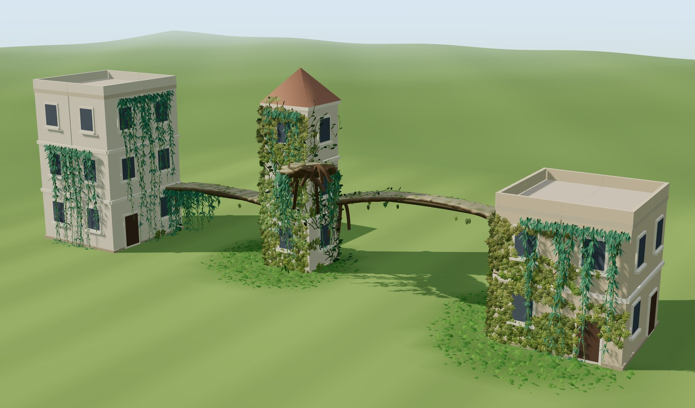
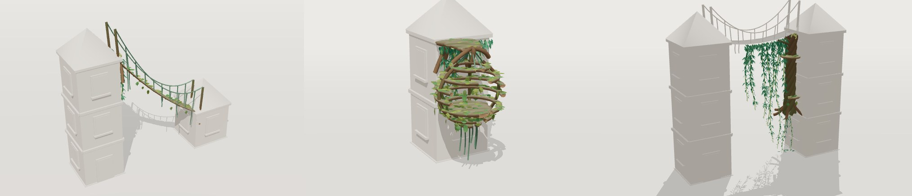
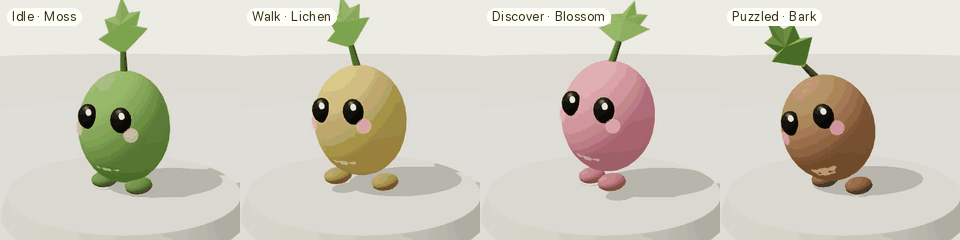
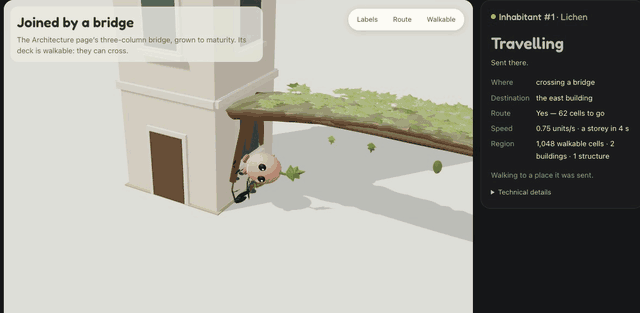
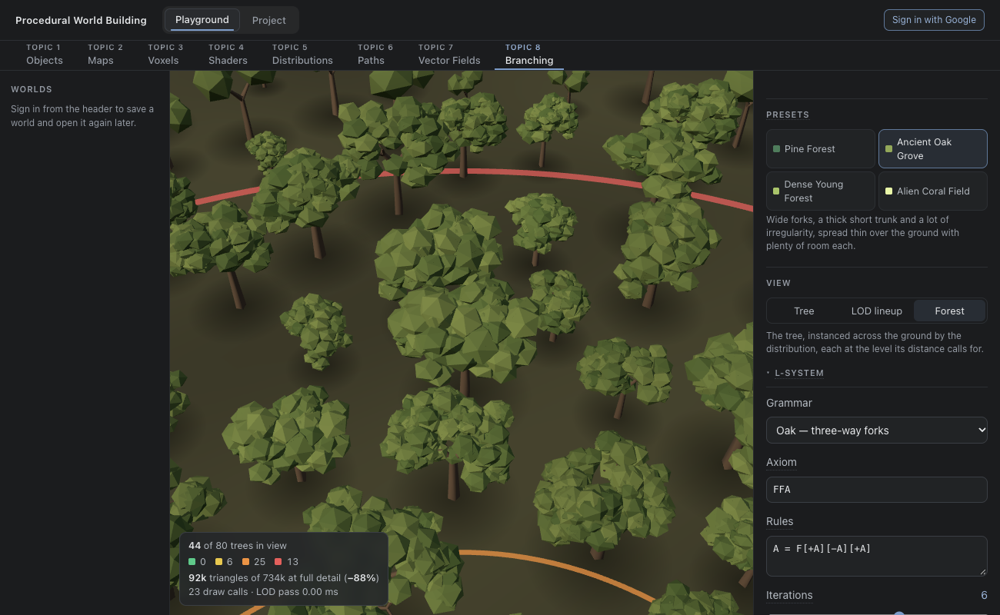

# Wildform

*Grow architecture by shaping how plants behave.*

Jessica Hsiao · Procedural World Building — coursework for a weekly design
course, built with React, TypeScript and Three.js.


**Wildform** is a procedural building game. The player builds a little — rigid
blocks from a budget of thirty — and plants a lot: **Climber**, which climbs
and follows edges; **Spreader**, which spreads toward the light; and
**Draper**, which hangs from edges and falls with gravity. Where the plants
meet and pile up, they grow **living architecture** the player never draws:
bridges, balconies, scaffolds, terraces, canopies, and — where a Draper's
curtain hangs over the others — suspended walkways, hanging pods and root
columns. Each becomes new ground for the next round of growth. The goal: get
two buildings that stand too far apart for plants alone *holding hands*.

**The player controls the conditions, but not the exact final form.**

    build → plant → grow → interact → mutate → adapt

## Contents

- [How it plays](#how-it-plays)
- [The pages](#the-pages)
- [Where it came from: the Playground](#where-it-came-from-the-playground)
- [Study notebook](#study-notebook)
- [Keyboard](#keyboard)
- [Getting started](#getting-started)
- [Project structure](#project-structure)
- [Conventions](#conventions)
- [Built with](#built-with)

## How it plays

**Build, plant, grow.** Two buildings stand on a lawn eight columns apart; a
living bridge reaches five. So the player has to choose what to build — a
stepping-stone tower, a wing pushed out — and where to plant, then let the
plants do the rest. Blocks place themselves Townscaper-style: walls, roofs,
arches and ledges work themselves out. Building and growing are one loop:
editing the town mid-growth carries every plant onto the new building.



**Living architecture.** A structure's kind comes from what met — Climber and
Spreader, a plant over layered growth, a Draper's curtain over the others —
and its shape from the walls, the plants' headings and the space around it.
It grows in stages, matures, then shades the plants under it, gives climbers
support, and becomes a surface they grow on in turn.



**Seasons.** The year turns on its own: four seasons set the real rain, sun
and warmth the plants grow by, eased across each change, and shown — leaf
colour, sky, rain, snow, brown leaves falling where plants wither. Tuned over
ten seeds so the goal comes as often as before, with winter costing about a
third of the plants and spring growing them back.


**Inhabitants.** Small creatures live on the green: they walk only where
plants grow or on mature living architecture, so two buildings are separate
worlds to them until the plants join them, and a maturing bridge is a route
they go and discover. They make the consequences of growth visible.





Worlds can be saved and reopened, signed in, as state rather than a picture —
a loaded world carries on growing exactly as it would have.

## The pages

The project is the app's **Project** section, eight pages:

- **Overview** — what Wildform is: the loop, the behaviors, living
  architecture, the challenge, and future environments (not built).
- **Play** — the game, full-screen at `/play`, and the page to try first: a
  goal always on screen, a guided opening, a playful voice, the seasons, the
  inhabitants, blocks and seeds counted, and a proper win.
  [`play.md`](docs/project/play.md)
- **Lab** — the same game with every control and number showing, the weather
  sliders included: for taking it apart. [`build.md`](docs/project/build.md)
- **Architecture** — an atlas of the eight structures, each a real game grown
  until it formed, in two or three variations: watch it form, see its
  structure, trace the plants that made it. [`architecture.md`](docs/project/architecture.md)
- **Inhabitants** — a studio for the creatures: a portrait, four test scenes
  run by the same agents as Play, a live inspector and overlays.
  [`inhabitants.md`](docs/project/inhabitants.md)
- **Site** — Wildform's environment logic at campus scale: Cornell Tech on
  Roosevelt Island from NYC Open Data, lit by the real sun through a simulated
  year. [`roosevelt-island.md`](docs/project/roosevelt-island.md)
- **Progress** — how the project evolved, in four phases, with what each tried
  and taught.
- **Decisions** — the design decisions behind the pivots, for critique.

The midterm prototype, **Explore**, is archived — out of the tabs, reachable
from Progress — and its simulation is the one the game runs.
[`wildform.md`](docs/project/wildform.md)

## Where it came from: the Playground

The app's other half, the **Playground**, is the course itself: one topic for
each body of work, each taking a single technique apart with every parameter
on screen. Every earlier topic is still there and still runs. Each has a
chapter in [`docs/topics/`](docs/topics/).

<table>
<tr>
<td width="50%" valign="top"><a href="docs/topics/topic-1-objects.md"></a><br><b><a href="docs/topics/topic-1-objects.md">1 · Objects</a></b> — a WebGL object viewer: five primitives, a quaternion gizmo that never gimbal-locks, materials lit by a generated environment.</td>
<td width="50%" valign="top"><a href="docs/topics/topic-2-maps.md"></a><br><b><a href="docs/topics/topic-2-maps.md">2 · Maps</a></b> — noise into ground: layered noise shaped and warped, then an automaton and droplet erosion. The default stack measures a Hurst exponent of 0.75.</td>
</tr>
<tr>
<td valign="top"><a href="docs/topics/topic-3-voxels.md"></a><br><b><a href="docs/topics/topic-3-voxels.md">3 · Voxels</a></b> — solids as distance fields joined by CSG, meshed four ways; dual contouring cuts corner error from 23.8% of a cell to 1.2%.</td>
<td valign="top"><a href="docs/topics/topic-4-shaders.md"></a><br><b><a href="docs/topics/topic-4-shaders.md">4 · Shaders</a></b> — eight surface shaders on one terrain, and four GPU simulations: ripples, reaction–diffusion, pipe erosion, fish schooling.</td>
</tr>
<tr>
<td valign="top"><a href="docs/topics/topic-5-distributions.md"></a><br><b><a href="docs/topics/topic-5-distributions.md">5 · Distributions</a></b> — trees, bushes and rocks placed by rules a hover probe explains; over four terrains, slope always orders trees &lt; bushes &lt; rocks.</td>
<td valign="top"><a href="docs/topics/topic-6-paths.md"></a><br><b><a href="docs/topics/topic-6-paths.md">6 · Paths</a></b> — roads graded into the terrain, rivers carved by it; the default road's steepest stretch falls from 73% to 26%.</td>
</tr>
<tr>
<td valign="top"><a href="docs/topics/topic-7-vector-fields.md"></a><br><b><a href="docs/topics/topic-7-vector-fields.md">7 · Vector Fields</a></b> — eighteen thousand particles following a divergence-free field of current, vortices and curl noise.</td>
<td valign="top"><a href="docs/topics/topic-8-branching.md"></a><br><b><a href="docs/topics/topic-8-branching.md">8 · Branching</a></b> — from an L-system to an instanced forest with levels of detail: 76–85% fewer triangles in each preset's opening view.</td>
</tr>
</table>

## Study notebook

The write-ups are the coursework, not a side effect of it. The full index —
with a description of what each document covers — is in
**[`docs/README.md`](docs/README.md)**. In short:

| Area | Contains |
| --- | --- |
| [`docs/topics/`](docs/topics/) | One chapter per topic: what it does, how it works, and the decisions behind it |
| [`docs/analysis/`](docs/analysis/) | Measurement and comparison reports that outgrew their chapter |
| [`docs/project/`](docs/project/) | The project — Wildform: Play, the Lab, Architecture, Inhabitants, the Roosevelt Island site, the archived midterm, the growth model underneath and the ideas notebook — plus infrastructure: the showcase worlds, the visual system, how the app is divided into Playground and Project, Firebase setup and auth, and the survey that preceded it |
| [`docs/images/`](docs/images/) | Screenshots, all captured from the running app |

## Keyboard

| Key | Effect |
| --- | --- |
| `H` | Hide every panel and give the whole window to the object. Press again to bring them back |
| `Esc` | Always restores the panels, never hides them |

Focus mode works on every topic and on the archived Explore — it hides both
navigation rows, both side panels and the dividers between them, leaving the
viewport the whole window. `Esc` only
ever restores, which is what makes hiding the UI safe to try, and a small
clickable reminder stays in the corner.
The shortcut is ignored while a select or text field has focus, since a letter
key means something there, but it still works from a slider or checkbox, which
is where focus usually sits after changing a value.

## Getting started

```bash
npm install
npm run dev
```

Then open the URL Vite prints (default `http://localhost:5173`).

| Script | Purpose |
| --- | --- |
| `npm run dev` | Start the dev server with hot module replacement |
| `npm run build` | Typecheck and produce a production build in `dist/` |
| `npm run lint` | Run ESLint |
| `npm test` | Run `tests/*.test.ts` on Node's own test runner (bundled with rolldown first; no test framework) |
| `npm run preview` | Serve the production build locally |

Firebase is optional. With no `.env` the header says so and every topic runs
exactly as before. With one, you can sign in and save a world from any topic
to your account — parameters only, never geometry, because the generator is
deterministic. See [`docs/project/firebase-setup.md`](docs/project/firebase-setup.md).

## Project structure

<details>
<summary>The source tree</summary>

```
src/
├── main.tsx                  Entry point
├── App.tsx                   Two-row nav shell, page switching, focus mode
├── routes.ts                 The route model: both destination tables, path ↔ state, useRoute
├── Slider.tsx                Labelled range input, shared by both pages
├── InfoTip.tsx               Hover explanation, portalled out of the scrolling panel
├── ribbon.ts                 Strips along a centreline that cannot fold — rivers and roads
├── LayerPanel.tsx            Layer stack editor (Topic 2)
├── pages/
│   ├── ObjectViewerPage.tsx  Topic 1 — viewer and its control panel
│   ├── MapsPage.tsx          Topic 2 — the Noise | Simulate switch, and the shared Noise-tab state
│   ├── NoiseLabPage.tsx      Topic 2 Noise tab — map, terrain, profile, pipeline, presets
│   ├── NoisePage.tsx         Topic 2 Simulate — automata, erosion, and the original generator
│   ├── VoxelPage.tsx         Topic 3 — viewport, sidebar, and CSG state
│   ├── ShaderPage.tsx        Topic 4 — strategy selector and parameters
│   ├── DistributionPage.tsx  Topic 5 — layer rules, debug view, probe
│   ├── PathPage.tsx          Topic 6 — path editor and elevation profile
│   ├── FlowPage.tsx          Topic 7 — field and particle controls
│   └── BranchingPage.tsx     Topic 8 — grammar, geometry, distribution, LOD, display
├── SceneCanvas.tsx           Topic 1 Three.js scene, render loop, disposal
├── RotationGizmo.tsx         Draggable XYZ orientation widget
├── shapes.ts                 Shape definitions and geometry factory
├── theme.ts                  Shared accent colour and hex parsing
├── palette.ts                Colour ramps, OKLab interpolation, ramp fitting
├── NoiseMapPreview.tsx       Sidebar source map, click to inspect a cell
├── NoiseViewport.tsx         3D scene — height field, point cloud, or planet
├── noise.ts                  PRNG, sampling, shaping ops, blend modes, compositing
├── automata.ts               Cellular automaton over the composited field
├── erosion.ts                Droplet hydraulic erosion over the height field
├── density.ts                Distance-field primitives, CSG operations, scenes (Topic 3)
├── mesher.ts                 Blocks, greedy, marching cubes, surface nets, dual contouring
├── VoxelViewport.tsx         3D scene for the meshed solid
├── CsgPanel.tsx              Shape stack editor (Topic 3)
├── ShaderViewport.tsx        Topic 4 WebGL context, render loop, pointer input
├── gpu/                      GPU simulations (Topic 4)
│   ├── core.ts               Ping-pong render targets, passes, ramp textures
│   ├── simulation.ts         The contract every strategy implements
│   ├── ripples.ts            Wave equation
│   ├── reactionDiffusion.ts  Gray–Scott
│   ├── erosion.ts            Virtual-pipe hydraulic erosion
│   ├── boids.ts              Fish schooling
│   └── index.ts              The strategy registry
├── study/                    Shared by the Topic 5–8 studies
│   ├── terrain.ts            Small eroded terrain: height, slope, distance to water
│   └── study.css             Viewport overlays, segmented picker, swatches
├── maplab/                   Topic 2's Noise tab
│   ├── noiseLab.ts           White, Perlin and cellular noise; layers and blends; the pipeline; its pseudocode; presets
│   ├── LabMap.tsx            The noise map, with the profile row
│   ├── LabProfile.tsx        The row cut through the terrain
│   └── maplab.css            The two-view bench, presets, the pseudocode block
├── distributions/            Topic 5
│   ├── rules.ts              The factors, the three layers, their defaults
│   ├── props.ts              Tree, bush and rock geometry, roughened by hash
│   ├── scatter.ts            Jittered candidates, acceptance, per-instance variation
│   └── DistributionViewport.tsx  Terrain, instanced assets, masks, hover probe
├── paths/                    Topic 6
│   ├── spline.ts             2D Catmull–Rom at even arc length, corridor stamp, smoothing
│   ├── road.ts               Projection, grade, cut and fill
│   ├── river.ts              Downhill trace, descending profile, carve
│   └── PathViewport.tsx      Terrain, ribbons, draggable handles, debug projection
├── flow/                     Topic 7
│   ├── field.ts              Current, vortices, curl noise, stirs; the divergence check
│   ├── particles.ts          Typed-array particles, midpoint step, segment writer
│   └── FlowViewport.tsx      Accumulation buffer, arrow and handle overlays, pointer
├── branching/                Topic 8
│   ├── lsystem.ts            Parallel rewriting, with a symbol cap
│   ├── skeleton.ts           The 3D turtle: segments, generations, taper, leaf sites
│   ├── treeGeometry.ts       Tapered tubes and leaf clumps as typed arrays
│   ├── lod.ts                Four levels per tree, canopy blobs, chooseLod with hysteresis
│   ├── distribution.ts       Five point processes, Clark–Evans ratio
│   ├── ForestRenderer.ts     Instanced buckets, per-tree culling and level, stats
│   ├── presets.ts            Settings shape, palettes, grammar library, presets
│   ├── BranchingViewport.tsx Scene, camera, LOD rings; one effect per stage
│   └── branching.css         Grammar editor, preset grid, derivation and LOD tables
├── AuthBar.tsx               Header sign-in / sign-out
├── Workspace.tsx             Three resizable columns: library, canvas, inspector
├── ViewControls.tsx          Floating View popover over the viewport, display-only controls
├── ControlSection.tsx        Collapsible sidebar group
├── ConfigPanel.tsx           The worlds library — the left column on every topic
├── hashNoise.ts              Table-free value noise, used by Topics 5–7
├── cameraControls.ts         One mouse convention for every 3D view: drag rotates, right-drag moves
├── green/                    The growth model underneath: cells, fields, and the Site's three species
│   ├── building.ts           The invented building as a spec; any spec into cells and neighbours
│   ├── fields.ts             Sunlight (shadow rays), moisture (walls and roofs), geometry; how they combine
│   ├── growth.ts             Seeded tips of three species that grow, branch, stall, die and compete
│   ├── species.ts            Ivy, moss, flowering vine: needs, growth traits, colours
│   ├── params.ts             Growth parameters and species defaults, shared by the Site
│   ├── buildingMesh.ts       Shell with a texel per cell, merged detail boxes
│   ├── vegetation.ts         Stems, leaf shapes, the age shader and instance batches
│   ├── fromFootprints.ts     Cells for real buildings, from outlines and heights
│   ├── sunPath.ts            The real sun's path over a day, and each cell's sun hours
│   └── green.css             Shared sidebar, legend and ramp styles for Build, Explore and Site
├── build/                    Project Build: the gameplay prototype
│   ├── town.ts               The grid, existing blocks, the budget, masses, the lawn scenario
│   ├── townMesh.ts           The rigid rules: walls, windows, roofs, arches, stilts, ledges
│   ├── townBuilding.ts       The town as growth cells for the plants
│   ├── lawn.ts               The lawn
│   ├── living.ts             Mutation nodes and what grows from each combination
│   ├── draperLiving.ts       The Draper's meetings, read from its curtain: root column, hanging pod, suspended walkway
│   ├── livingMesh.ts         Living architecture drawn, grown in stages
│   ├── surfaces.ts           Pitched roofs and living architecture as surfaces plants grow on
│   ├── draper.ts             The Draper: edges, gravity-led strands, rooting, the veil, spreading
│   ├── draperMesh.ts         Drapers drawn: stems, hanging leaves, the lip
│   ├── groundCover.ts        Ground spread from wall feet, roots and Draper roots
│   ├── sky.ts                The clear-day sky
│   ├── seasonFx.ts           The seasons made visible: leaf tint, lawn, sky, light, weather particles
│   ├── game.ts               One game, carried through every edit; the goal; seeds planted
│   ├── worldState.ts         A world as data: what is saved, read back and checked
│   ├── WorldMenu.tsx         Save, Save as, New world, My worlds, unsaved changes
│   ├── BuildViewport.tsx     The scene, tools and picking
│   └── BuildPage.tsx         The Lab's sidebar: goal, mode, plant behavior, interaction, environment, growth, living architecture, events
├── game/                     Project Play: Wildform as a game, full-screen
│   ├── PlayPage.tsx          The front door in the Project tabs
│   ├── GamePage.tsx          The game: HUD, the opening, the voice, seasons, seeds, the win
│   ├── narrator.ts           Logged events said playfully; planting verdicts
│   ├── seasons.ts            The four seasons, eased; the badge's words; moods
│   ├── seasonLook.ts         What each season looks like
│   ├── UnsavedDialog.tsx     The warning before unsaved work is lost
│   └── game.css              The game's look
├── inhabitants/              Project Inhabitants: creatures that live on the green, and their studio
│   ├── nav.ts                Where they can walk: the walkable rule, regions, routes
│   ├── agent.ts              One inhabitant and its state machine, shared by every page
│   ├── inhabitantMesh.ts     The model and its animations
│   ├── population.ts         Play's and the Lab's inhabitants
│   ├── visibility.ts         Show Inhabitants, a stored display preference
│   ├── scenarios.ts          The studio's test scenes, each a real game
│   ├── StudioViewport.tsx    The studio's stage: scenes, overlays, click to send
│   └── InhabitantsPage.tsx   The studio: portrait, scenes, inspector, notes
├── architecture/             Project Architecture: the atlas of living structures
│   ├── specimens.ts          Recipes, each grown as a real game until its structure forms
│   ├── SpecimenViewport.tsx  The studio: views, timeline, labels, camera
│   ├── ArchitecturePage.tsx  The page: plates, stage, variations, texts
│   └── views.ts              View modes and their colours
├── wildform/                 The Wildform simulation Build runs, and the archived midterm Explore page
│   ├── names.ts              Every name the page shows: title, species, mutation
│   ├── species.ts            Climber and Spreader: needs, directions, looks
│   ├── world.ts              The building, its fields, and the architecture plants add
│   ├── growth.ts             The two species in stacks of layers: substrate, shade, withering
│   ├── grammar.ts            Interaction rules: sites and conditions → mutation
│   ├── sim.ts                One run: steps, mutations, events, the Midterm Demo
│   ├── platformMesh.ts       The Living Platform as geometry, grown in
│   ├── wildVegetation.ts     The two species drawn by shape
│   ├── WildViewport.tsx      Scene, views, annotations, timeline re-runs
│   └── WildformPage.tsx      The presentation sidebar
├── site/                     Project Site: Roosevelt Island from NYC Open Data
│   ├── siteData.ts           The snapshot's types, loader and area helpers
│   ├── campus.ts             The Cornell Tech buildings as growth-model cells
│   ├── campus.worker.ts      Builds the campus and traces the sun off the main thread
│   ├── campusSim.ts          The growth model on the campus: a year of light, warmth, die-back
│   ├── SiteHistory.tsx       Coverage over the run, by species, winters shaded
│   ├── facadeSurfaces.ts     Surface types and what each means to a plant
│   ├── facade.ts             Procedural façades: rules per archetype → cell types and geometry
│   ├── sunClock.ts           The real sun for any date and New York clock time, for the scene's light
│   ├── SunDial.tsx           The sun-path dial over the scene
│   ├── siteVegetation.ts     Plant masses drawn from the cells, the far level of detail
│   ├── siteStructure.ts      Stems, growth front and leaf clusters, the middle level
│   ├── siteLeaves.ts         Real leaves on the campus, near the camera only
│   ├── roadside.ts           The roadside study's ground: 1 m cells, surfaces, shadows, runoff
│   ├── roadsideLayer.ts      The roadside on screen and its simulation
│   ├── siteAtmosphere.ts     Golden hour: sky, haze, the sun coloured by its height, glass, trees
│   ├── siteContext.ts        The real buildings across the river, as one hazy mesh
│   ├── siteLandscape.ts      The south's lawns and parks: land cover, relief, trees, shrubs
│   ├── siteLook.ts           Ground colours and the sun ramps
│   ├── SiteViewport.tsx      Island, ground layers, extruded buildings, picking
│   ├── SitePage.tsx          Site summary, Cornell Tech list, selection, layers
│   └── site.css              The Site page's sidebar, tooltip and compass
├── showcase/                 Five demonstration worlds, four documents each
│   ├── worlds.ts             The presets, built from each topic's own defaults
│   ├── validate.ts           Whether a preset is storable and renderable
│   └── seed.ts               Wrote them into the account; now unmounted
├── config/
│   ├── spec.ts               The per-topic contract and shared validators
│   ├── objectConfig.ts       Topic 1's saved shape
│   ├── noiseConfig.ts        Topic 2's saved shape
│   ├── voxelConfig.ts        Topic 3's saved shape
│   ├── shaderConfig.ts       Topic 4's saved shape
│   ├── distributionConfig.ts Topic 5's saved shape
│   ├── pathConfig.ts         Topic 6's saved shape
│   ├── flowConfig.ts         Topic 7's saved shape
│   └── branchingConfig.ts    Topic 8's saved shape, and its slider definitions
├── project/                  The Project section — separate from the topics, not a topic itself
│   ├── ProjectLayout.tsx     Reading shell: measured column (or wide page), own scroller
│   ├── ProjectOverview.tsx   The idea, the question, the system as a flow, scope
│   ├── ProjectProgress.tsx   Pipeline, five one-rule experiments, presets, decisions
│   ├── ProjectDecisions.tsx  The design decisions, one card each, with open questions
│   └── project.css           The Project section's own styling
├── firebase/                 App init, auth context and provider, Firestore, Storage
├── App.css                   Shell, panel, and canvas styling
└── index.css                 Global reset

docs/
├── README.md                 Study notebook index — start here
├── topics/                   One chapter per topic
│   ├── topic-1-objects.md
│   ├── topic-2-maps.md
│   ├── topic-3-voxels.md
│   ├── topic-4-shaders.md
│   ├── topic-5-distributions.md
│   ├── topic-6-paths.md
│   ├── topic-7-vector-fields.md
│   └── topic-8-branching.md
├── analysis/                 Measurement and comparison reports
│   ├── energy-and-idle-cost.md
│   └── topic-3-meshing-and-chunking.md
├── project/                  The project, and infrastructure and setup
│   ├── wildform.md
│   ├── play.md
│   ├── build.md
│   ├── architecture.md
│   ├── inhabitants.md
│   ├── green-architecture.md
│   ├── roosevelt-island.md
│   ├── final-project-ideas.md
│   ├── showcase-worlds.md
│   ├── visual-system.md
│   ├── app-structure.md
│   ├── firebase-setup.md
│   └── firebase-integration-report.md
└── images/                   Screenshots, captured from the running app

public/
├── green/                    Figures for Progress and Decisions, captured from the first Explore
├── project/                  Figures for Overview, Progress and Decisions: Build and Site captures, served copies of docs figures
└── site/                     The Roosevelt Island snapshot, the far shores' buildings, the south's landscape

tests/
└── seeds.test.ts             Seed counting: planting, refusals, growth, undo, save and load (npm test)

scripts/
├── run-tests.mjs             Bundles tests/*.test.ts with rolldown and runs them on node:test
├── fetch-roosevelt-island.mjs  Fetches NYC Open Data and writes the snapshot
├── fetch-roosevelt-context.mjs The Manhattan and Queens buildings across the river, as scenery
└── fetch-roosevelt-landscape.mjs The south's trees, lawns, paths and ground heights, as scenery

firestore.rules               Owner-scoped Firestore access rules
storage.rules                 Owner-scoped Storage access rules
CLAUDE.md                     Working agreements, for AI assistants and humans
```

</details>

Adding a topic is one page component in `src/pages/`, one entry in the
`PLAYGROUND` array in `routes.ts` — the Playground opens on the last entry —
one line in `PLAYGROUND_PAGES` in `App.tsx`, and one chapter in `docs/topics/`.
Topics are added to the Playground; the Project is not where new coursework
goes.

## Conventions

Decisions specific to a topic live in that topic's chapter. These hold
everywhere.

<details>
<summary>Read the conventions</summary>

**Chrome is neutral so the worlds do not have to be.** Every colour the
interface uses is a semantic token in `src/index.css` — neutral charcoal
surfaces, one slate blue for interaction, and nothing else. What a topic
*generates* is governed separately by `theme.ts`, `palette.ts` and
`gpu/style.ts`, and is as saturated as its subject needs. The two used to share
constants, which meant restraining a button would have washed out a lit surface.
See [the visual system](docs/project/visual-system.md).

**One mouse convention in every 3D view.** Left-drag rotates, right-drag (or
⌘/Ctrl/Shift-drag) moves, scroll zooms — the web's 3D default, set in one
place (`src/cameraControls.ts`) that every viewport calls. The Explore page and Site
once dragged "like a map", left-drag moving and right-drag rotating, so the
same gesture meant opposite things on neighbouring pages; they and Build now
follow the rest. In scenes that are places — the island, a building, a town —
moving slides along the ground, so a drag can't lift the view up a tower or
sink it under the ground.

**One font family, and the hierarchy comes from size and weight.** The Project
pages are more spacious than the Playground; that difference is carried by size,
line height and whitespace, never by a second typeface. The stack is declared
once on `body`, which is what keeps a control from inheriting the user agent's
serif when it moves.

**The app has two sections, and they are not peers of each other's pages.**
Playground is where a technique is taken apart, Project is where the techniques
are put back together — so they sit on their own row above the topic tabs, and
the two sets are never shown at once. The project is not a topic: topics are
numbered bodies of coursework, and the project cuts across all of them.
Navigation is the History API in forty lines rather than a router, because seven
static destinations use almost none of what a router is for — measured at
`react-router-dom` 7.18.4 costing 15,235 bytes gzipped for the exports this
would have needed.

**Every topic has the same three columns.** Library on the left, viewport in
the middle, inspector on the right, under the topic nav — so the hierarchy
reads app → topic → world → parameter. Both boundaries drag and are remembered
per topic, because Topic 2 has far more controls than Topic 1 and one shared
width would be wrong for both.

**Controls are placed by what they change, not by topic.** The right sidebar
answers "how is this made"; the floating **View** popover over the viewport
answers "how am I looking at it". A control belongs in View only if changing it
leaves the generated world identical — which is why Topic 4 keeps relief,
lighting, Fresnel and haze in the sidebar: on a page about shading, the
appearance is the subject.

**A simulation step advances state; a draw presents it.** The render loop calls
`step` only while a simulation is advancing and `draw` every frame, so anything
a control changes about appearance has to be written in `draw` or it will not
update while paused. Topic 4's shading study got this wrong once and the bug
was invisible except as "the sliders do nothing".

**Scenes are built once and mutated in place.** Geometry swaps replace
`mesh.geometry` rather than the mesh itself, so the render loop never loses the
object it closed over. Changing resolution rebuilds the point cloud's geometry
without tearing down the renderer.

**Values are routed by how they behave.** Continuous ones (rotation, spin,
scale) reach the render loop through refs, keeping pointer-rate updates out of
React. Discrete ones (material properties) are applied in effects, since
writing them every frame would be wasted work.

**Panels are hidden with `display: none`, not made transparent.** Their
controls leave the tab order with them, so tabbing while the UI is hidden
cannot land inside a panel you cannot see. Both canvases watch their container
with a `ResizeObserver`, so the view reflows to the full width rather than
stretching.

**Viewports stop drawing when nothing is moving.** Every topic runs on
`startRenderLoop` in `renderLoop.ts`, which caps the frame rate at 60 and stops
scheduling frames entirely once the frame function reports the view is static.
Measured before it existed: an idle Topic 1 issued 295 draw calls a second and
a paused simulation 59, all of them redrawing an image identical to the one
already on screen. Idle is now 0 on every topic. Waking is deliberately
over-eager — any pointer movement anywhere wakes every loop — because a frame
that finds nothing to do is far cheaper than a viewport that never wakes.

**A resize draws immediately; it does not wake.** Resizing a canvas wipes it,
and a `ResizeObserver` is called after every animation-frame callback and
before the paint — so a resize handler that only woke the loop left that frame
to paint an empty canvas. Dragging a panel divider resizes on every pointer
move, and every topic flickered: measured, all 40 steps of a 40-step drag
painted blank, on all eight. Resize handlers call `loop.drawNow()`, which runs
the frame inside the observer's callback with the real elapsed time; after it,
0 of 40 on all eight.

**Every viewport sits on one shared ground.** `VIEWPORT_BACKGROUND` in
`theme.ts` is the single source; Topics 1–3 previously hardcoded `#111218`
in three separate files and matched only by accident. It is deliberately not
near-black: against near-black a muted surface glows by contrast, which is most
of what reads as "sci-fi" in a stylised render. Topic 4's map views keep a
lighter slate board of their own, so chalk contour lines have something to read
against.

**Claims in the docs are measured, not estimated.** Every number in this
repository — Hurst exponents, millisecond costs, triangle counts, percentage
savings — came from running the code and reading the result. Where a
measurement contradicted the expectation, the note says so rather than quietly
dropping it.

**Screenshots are captured from the running app**, by driving it in a headless
browser rather than by posing a mock-up. A figure and the numbers beside it
therefore describe the same run.

**Work for a topic happens on its own branch** — `topic-3-voxels` and so on —
and lands on `main` collapsed into one to three commits, when the topic is done
and not before. A merge would replay every branch commit onto main and only
`git log --first-parent` would hide them; compressing first means the log stays
short however it is read, while the reasoning survives in the commit messages
rather than being discarded.

These conventions are restated in [`CLAUDE.md`](CLAUDE.md), which is where an
AI assistant working in this repo will actually look for them.

</details>

## Built with

React 19 · TypeScript · Vite · Three.js
