# Procedural World Building

Coursework for a weekly design course, built with React, TypeScript, and
Three.js. The app has two halves. **Playground** holds the topics — one per
body of work, each taking a single technique apart with every parameter it has
on screen. **Project** puts them back together into one system with a question
behind it: vegetation growing over a building, steered by its environment.

Each topic is a page in the Playground and a chapter in the study notebook
under [`docs/`](docs/). The app accumulates as the course goes rather than
replacing what came before, so every earlier topic is still reachable and still
runs.

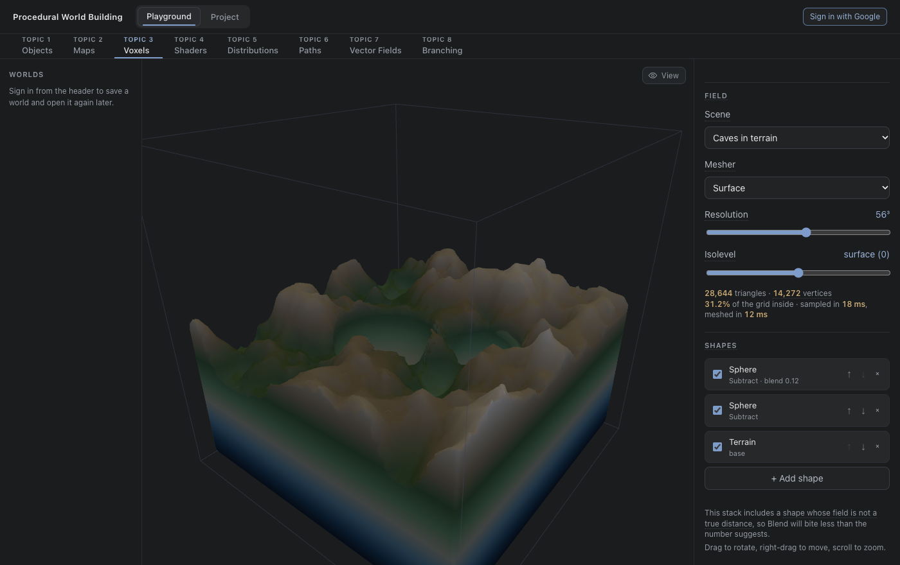

## Contents

- [The project](#the-project) — Green Architecture
- [Topics](#topics) — the Playground
  - [Topic 1 — Objects](#topic-1--objects)
  - [Topic 2 — Maps](#topic-2--maps)
  - [Topic 3 — Voxels](#topic-3--voxels)
  - [Topic 4 — Shaders](#topic-4--shaders)
  - [Topic 5 — Distributions](#topic-5--distributions)
  - [Topic 6 — Paths](#topic-6--paths)
  - [Topic 7 — Vector Fields](#topic-7--vector-fields)
- [Study notebook](#study-notebook) — the full documentation index
- [Keyboard](#keyboard)
- [Getting started](#getting-started)
- [Project structure](#project-structure)
- [Conventions](#conventions)
- [Built with](#built-with)

## The project

**Green Architecture** — vegetation that grows over a building by itself,
steered by sunlight, moisture and the building's own geometry. Nothing is
placed by hand: seeds at the foot of the wall, and a growth rule that decides,
a step at a time, where each plant goes next — up the walls, over the cornices
and onto the roofs. Three species — ivy, moss and a flowering vine — each with
their own needs, compete for every surface. The
question is *how do geometry, sunlight and moisture influence where plants
grow?*

Four pages, none of them a topic — the project cuts across all of them and is
numbered by nothing:

- **Overview** — the idea and the question, in the first person, with the
  system drawn as a flow and one run shown two ways: the building, and which
  species holds each cell.
- **Explore** — the simulation. An L-shaped block with a lower wing and its roof
  terrace, every wall and roof cut into cells that know their neighbours; play,
  step and reset at 1×/4×/16× (Play stops itself once growth has); rain and sun;
  three species to switch on and tune; switches for each rule; four presets; and
  views that paint species territories, moisture, sunlight, geometry and
  suitability onto the building.
- **Site** — Roosevelt Island from NYC Open Data, the real place the model is
  moving onto: 68 buildings extruded from their footprints, parks, roads and
  sidewalks. The six Cornell Tech buildings are cut into cells like the invented
  building, lit by the real sun for a clear day in June, at an equinox or in
  December, and grown on by the same three species, planted automatically along
  every wall or by clicking, through a simulated year in which plants die back
  where they can't live. The species sort themselves the way a gardener would
  plant them — vine on full-sun walls, ivy on part sun and shade — and each
  winter cuts the vine back out of the walls it can't keep. Close up, real
  leaves; in the sidebar, coverage by building and wall direction. A second
  study, **Roadside**, grows the same plants on the island's ground and tests
  whether verges are greener because roads bring seeds or because pavement
  sheds water (seeds, at normal rain; water, in a dry year).
  See [`docs/project/roosevelt-island.md`](docs/project/roosevelt-island.md).
- **Progress** — the pipeline, five experiments that each add one rule, the
  three species and the walls they took, the presets side by side, and the
  decisions with the measurements behind them.

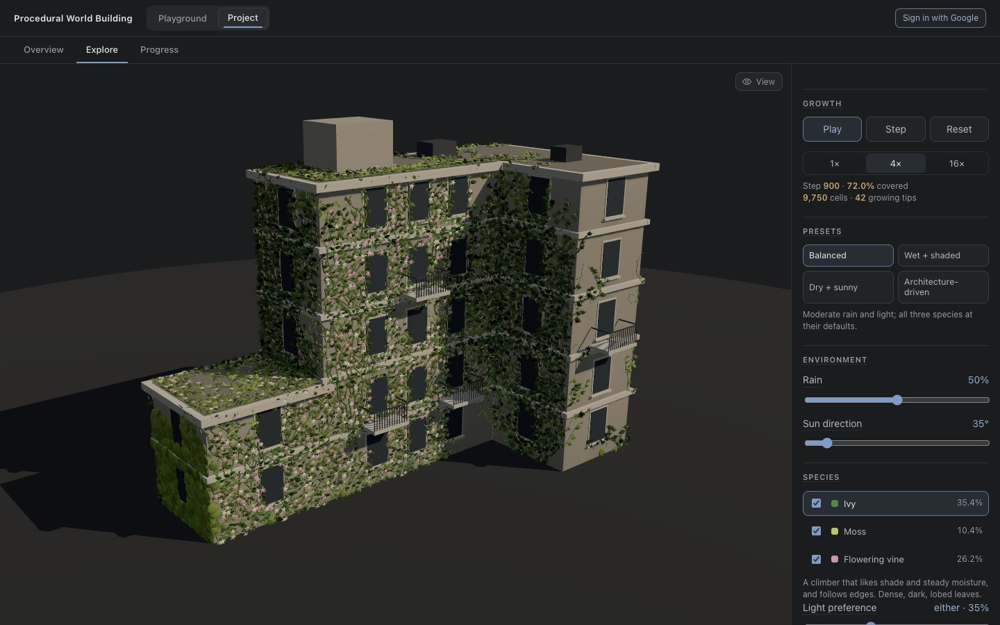

Nobody placed those territories. The Species view of the same run: the vine
(pink) took the walls facing the sun and the roofs, ivy (green) the shade, moss
(yellow) the wing's shaded west wall.

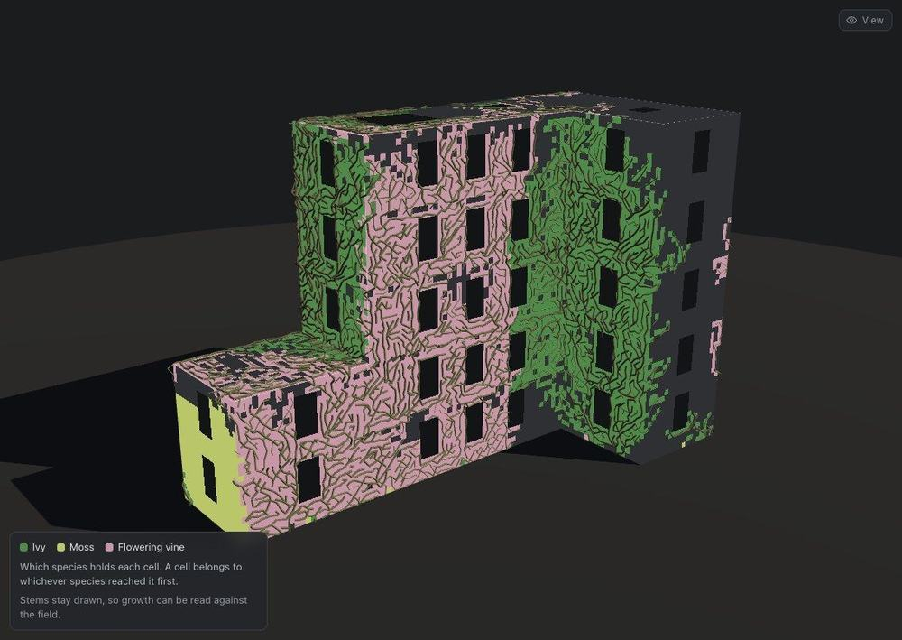

See [`docs/project/green-architecture.md`](docs/project/green-architecture.md)
for the model, the measurements and the limits, and
[`docs/project/app-structure.md`](docs/project/app-structure.md) for how the
two sections are divided. The project's earlier direction — three walkable
worlds — is in the git history.

## Topics

The Playground. Each topic is one technique, taken apart.

### [Topic 1 — Objects](docs/topics/topic-1-objects.md)

A real-time WebGL object viewer. Five primitives swapped in place, a draggable
XYZ gizmo storing orientation as a quaternion so the object never gimbal-locks,
and material controls lit by a generated `RoomEnvironment` cubemap.

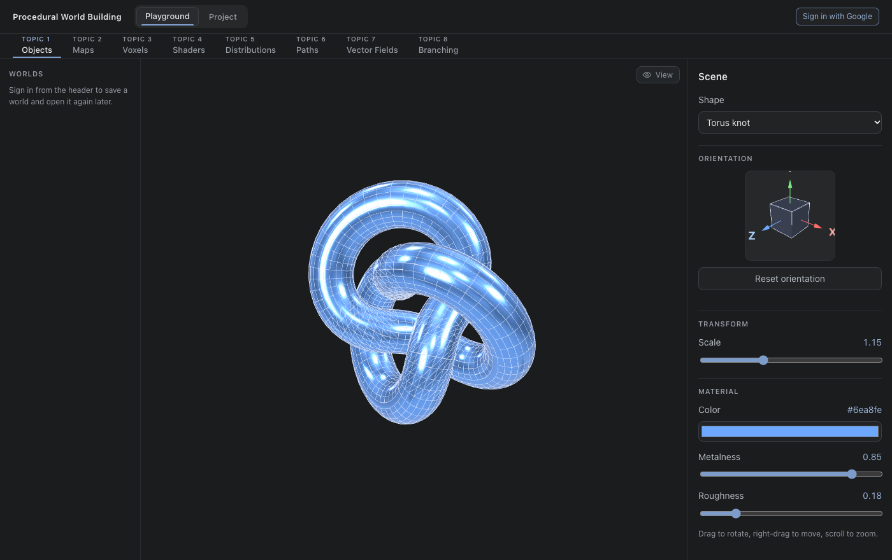

### [Topic 2 — Maps](docs/topics/topic-2-maps.md)

Noise turned into ground, in two stages: *noise → shape → simulate*.

The **Noise** tab opens first and shows one idea: *noise → modify noise → use it as a
map*. Stack up to four noise layers — white, Perlin or cellular, each with its
own octaves and its own ridged or billow fold — and blend them by add,
subtract, multiply or max. Then terrace or power-curve the result, warp the
lookup, mask an island, flood it — and see the noise map and the terrain it
makes side by side, a profile cut through both, and the pseudocode the controls
amount to with the live numbers in it. Eight presets, from Baseline to
Mountains to Cells, are each the same pipeline with different switches.

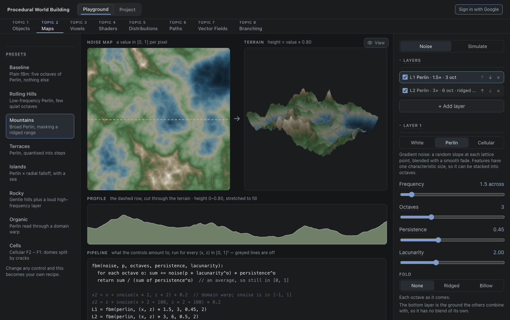

**Simulate** runs processes on the Noise tab's field — the automaton and erosion,
the operations that need neighbours and time. Behind it, as the **Original
generator**, is the layered value-noise stack Topic 2 began with, kept with its
volume and planet modes because the chapter's measurements and the showcase
worlds were built on it:

- **Layers** — a stack of value-noise fields, composited bottom-up with nine
  blend modes. Defaults to a six-octave fBm stack, which measures at a Hurst
  exponent of 0.75 with R² 0.990 — inside the band real topography occupies.
- **Warp** — looks the field up at coordinates displaced by another noise
  field, so strata fold and ridges curve.
- **Automata** — a 3×3(×3) neighbour rule run to its fixed point, turning
  speckled noise into connected landmasses and caves.
- **Erosion** — droplet hydraulic erosion plus thermal slippage, which is what
  cuts dendritic valley networks that noise alone never produces.
- **Output** — eight per-cell shaping ops, six colour ramps interpolated in
  OKLab, and three geometry modes: height field, point cloud, or planet.

### [Topic 3 — Voxels](docs/topics/topic-3-voxels.md)

Solids defined as one scalar function of position, rather than as a grid of
samples, and combined with constructive solid geometry:

- **Density fields** — eight primitives (sphere, box, torus, cylinder, cone,
  half-space, gyroid, and terrain as a solid rather than a height map, so it
  can have caves cut into it). Six of the eight return true Euclidean
  distance, measured; the panel says which.
- **CSG** — union, intersection and difference are `min`, `max` and
  `max(a, −b)`. No polygon clipping and no intersection curves to solve. A
  per-operation blend width turns any boolean into a weld or a fillet.
- **Four meshers** over the same field — blocks (with optional greedy merging
  of coplanar faces, 40–73% fewer quads and provably lossless), marching cubes
  with a case table derived rather than transcribed, surface nets, and dual
  contouring, which is the only one that can reconstruct a sharp corner:
  measured error at a box's corners falls from 23.8% of a cell to 1.2%.

The same field, meshed four ways — a box with four spheres drilled out of it,
sampled at 40³. Only dual contouring reconstructs the box's edges:

| Blocks | Marching cubes | Surface nets | Dual contouring |
| --- | --- | --- | --- |
| 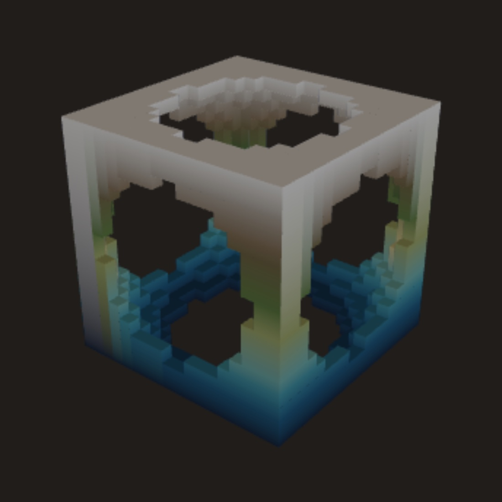 | 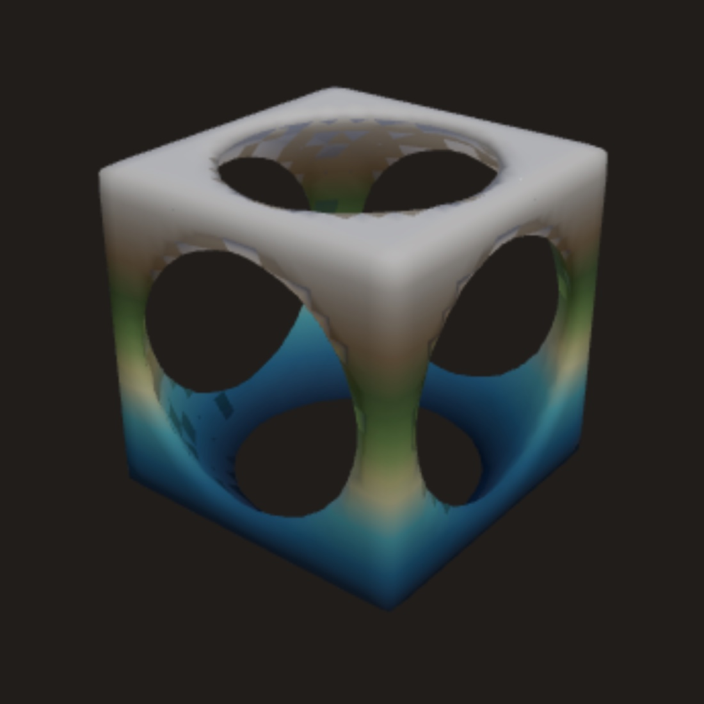 | 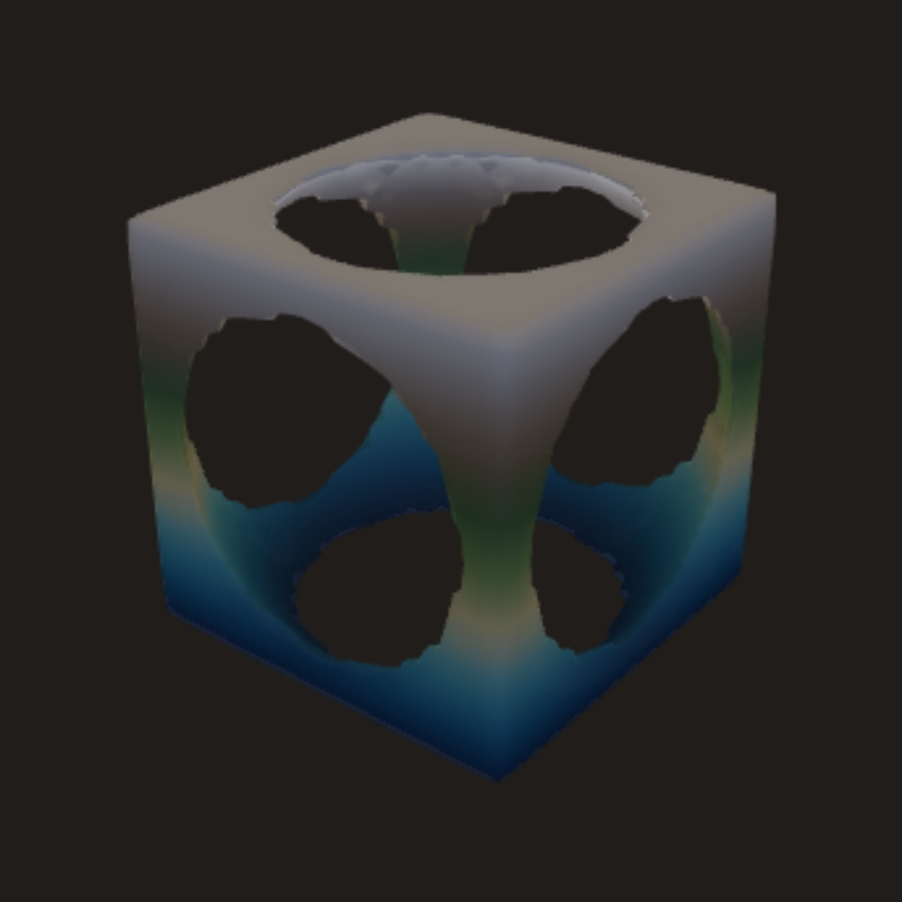 | 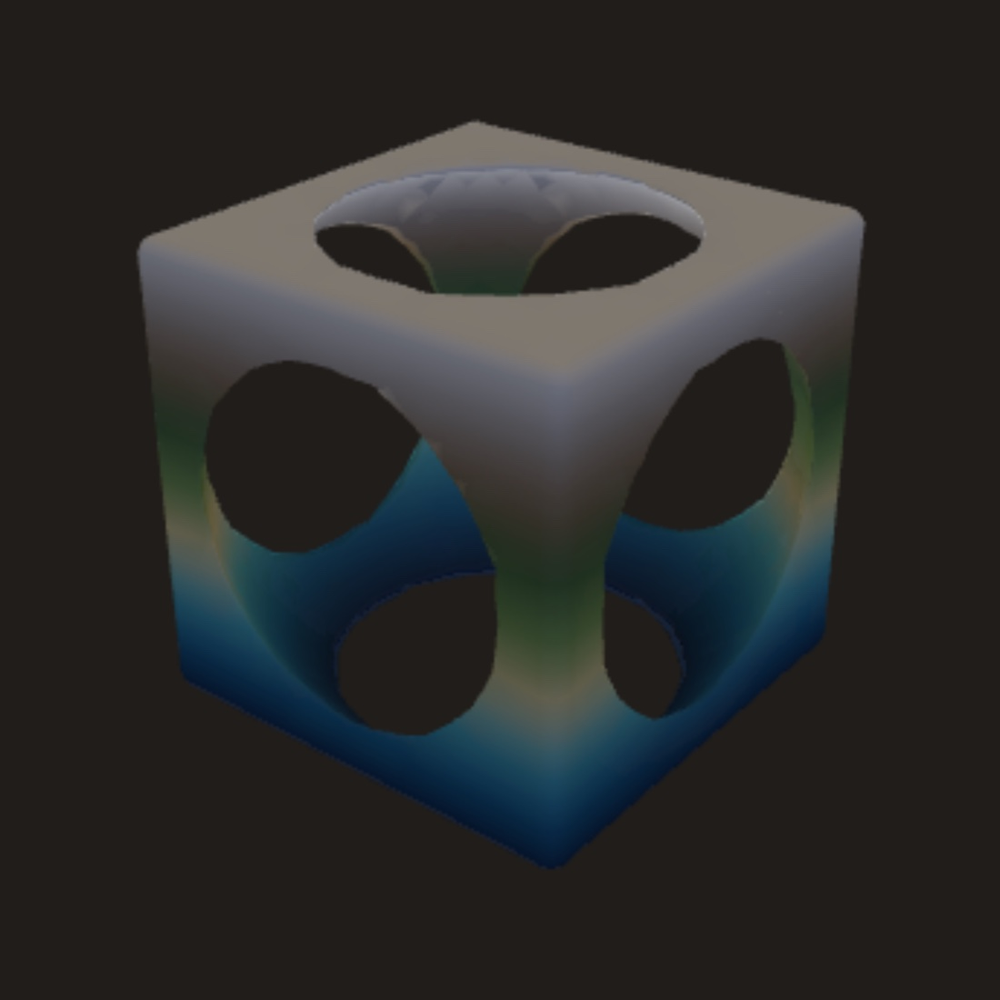 |
| 1,536 tris · 3,072 verts | 4,288 tris · 12,864 verts | 4,272 tris · 2,128 verts | 4,272 tris · 2,128 verts |

### [Topic 4 — Shaders](docs/topics/topic-4-shaders.md)

A shading study and four GPU simulations. Topics 1–3 computed on the CPU and
handed finished geometry to the graphics card; this topic moves the work itself
into a shader — first to decide what colour a surface is, then to decide what
the surface *does*.

- **Surface shading** — one eroded terrain, eight fragment shaders. The geometry,
  the light and the camera never change, so the only thing that differs between
  them is the answer to "what colour is this pixel?": matte diffuse, a
  height palette, a slope-driven material, procedural noise, Fresnel and
  atmosphere, all five layered, animated water that reads its own depth from
  the heightfield, and a stylized contour map. The terrain is carved by Topic 2's own
  droplet erosion, so the two topics share a landscape.
- **Water ripples** — the wave equation on a 512² grid. Its stability limit is
  measured rather than quoted: C = 0.500 stays bounded, C = 0.510 reaches a peak
  amplitude of 4.4 × 10³⁰ within about 300 steps, bracketing the theoretical
  CFL bound of exactly 1/2.
- **Reaction–diffusion** — Gray–Scott. Two chemicals and four constants,
  producing the coral and fish-skin patterns Turing described in 1952.
- **Hydraulic erosion** — the virtual-pipe model, five passes per step. Not a
  port of Topic 2's erosion but a different algorithm, because droplets are
  serial by nature and a GPU cannot run them. Ground and sediment are a closed
  system, held to 0.001% drift over 5,900 steps.
- **Fish schooling** — Reynolds' three rules, one fish per texel. Every fish
  reads every other, so 1,024 fish is 1,048,576 neighbour tests per step and
  the O(N²) wall is a dial you can turn.

The page uses two visual registers, both matte and both on a dark ground:
**dusk after dark** for anything lit in 3D, and **slate and chalk** for the flat
field views, which are maps rather than photographs.

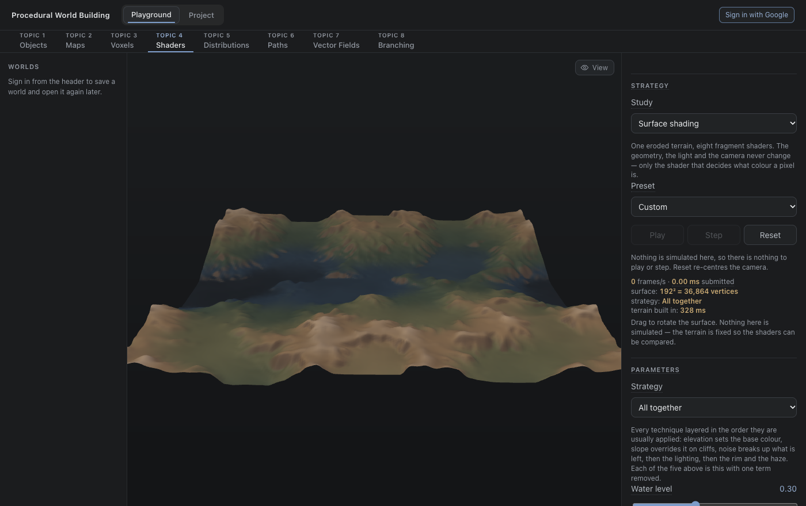

### [Topic 5 — Distributions](docs/topics/topic-5-distributions.md)

Where things appear. Trees, bushes and rocks are scattered over a small eroded
terrain, each layer by its own rule: a product of soft factors for elevation,
slope, distance to water and cluster noise, so any one of them can veto a
point. Trees take the flatter valley floors, bushes crowd the shoreline, rocks
take the steep rim and whatever vegetation leaves. Measured over four terrains,
the mean slope under each layer always orders trees < bushes < rocks, and the
bushes are always the layer closest to water.

- **Rules you can edit** — slope window, elevation band, water influence and
  clustering per layer, plus a density each.
- **A probe** — hover the ground and every factor of every rule is printed for
  that point, so a refusal always says which question refused it.
- **Debug masks** — paint the terrain with any layer's probability, all three,
  or the input fields the rules read.
- **Variation from the ground** — broadleaf trees in the wet lowlands, trees
  shrinking toward the treeline, rocks larger on steep ground and tilted to it.
- Seeded and reproducible; five instanced meshes, re-scattered live in a few
  milliseconds.

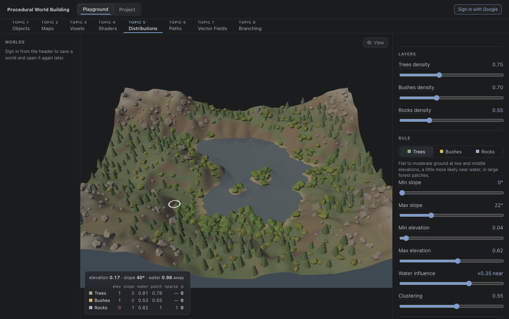

### [Topic 6 — Paths](docs/topics/topic-6-paths.md)

How lines and terrain shape each other. Roads and rivers — up to four of each —
on the same ground, all drawn as a 2D spline first and given height second, and
opposite in who gives way. The **road** takes its heights from the terrain, smooths them into a
grade, then cuts and fills the corridor to meet it: on the default route the
steepest stretch falls from 73% on the ground to 26% on the road. The **river**
lets the terrain choose its route, tracing downhill from a source with a water
surface that only descends and a channel that only cuts. Held to its guides it
climbs 0.41 units of ridge and has to trench 0.55 deep; let the terrain lead and
it finds the valley and climbs nothing.

- **Draggable control points** — the path and the ground it changes rebuild as
  you drag; add or remove points, roads and rivers.
- **Paths that meet** — rivers carve in order, so a later one can join an
  earlier one's channel as a tributary; roads grade last, filling channels as
  causeways and meeting each other at junctions.
- **Debug view** — the 2D spline on a map plane above the terrain, drop lines to
  its projected points, the centreline it was built to, and each path's
  footprint tinted on the ground.
- **Elevation profile** — the ground under the spline against the road grade or
  the water surface and bed.

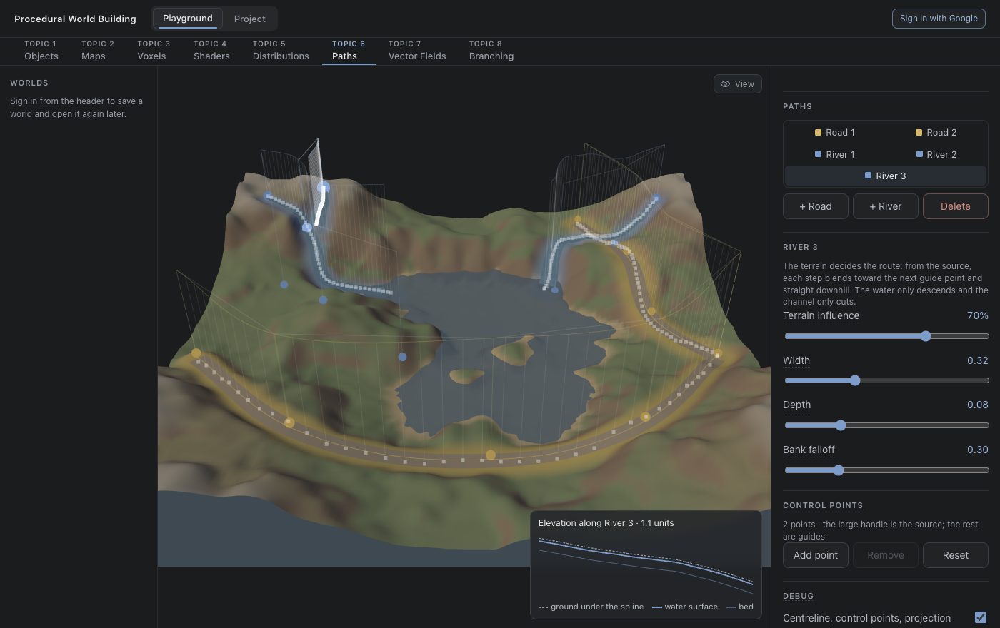

### [Topic 7 — Vector Fields](docs/topics/topic-7-vector-fields.md)

Motion without geometry. Eighteen thousand particles, none with any motion of
its own, each asking one 2D velocity field which way to go: a current left to
right, vortices that bend it into swirls, slowly drifting curl noise, and
whatever the mouse stirs in. Every term is divergence-free — checked
numerically on screen — so particles flow around each other instead of piling
into sinks, and the trails they leave in a fading half-float buffer are the
field made visible.

- **Show vector field** — an arrow grid over the dimmed trails, so the
  particles can be seen doing what the arrows say.
- **Draggable vortices** — move any vortex by its centre; drag anywhere else to
  stir, which injects a decaying vortex dipole.
- **Midpoint integration** — measured against Euler, which spirals a vortex
  orbit outward by 78% in ten seconds and would empty every core.
- Controls for particle count, flow speed, current, vortex count, strength and
  radius, noise, and trail persistence; seeded and resize-safe.

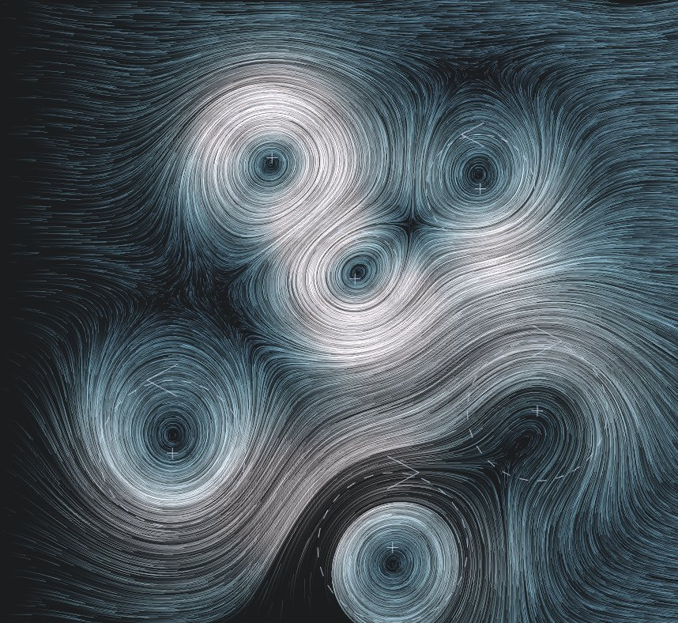

## Study notebook

The write-ups are the coursework, not a side effect of it. The full index —
with a description of what each document covers — is in
**[`docs/README.md`](docs/README.md)**. In short:

| Area | Contains |
| --- | --- |
| [`docs/topics/`](docs/topics/) | One chapter per topic: what it does, how it works, and the decisions behind it |
| [`docs/analysis/`](docs/analysis/) | Measurement and comparison reports that outgrew their chapter |
| [`docs/project/`](docs/project/) | The project — Green Architecture, the Roosevelt Island site and the ideas notebook — plus infrastructure: the showcase worlds, the visual system, how the app is divided into Playground and Project, Firebase setup and auth, and the survey that preceded it |
| [`docs/images/`](docs/images/) | Screenshots, all captured from the running app |

## Keyboard

| Key | Effect |
| --- | --- |
| `H` | Hide every panel and give the whole window to the object. Press again to bring them back |
| `Esc` | Always restores the panels, never hides them |

Focus mode works on every topic and on Explore — it hides both
navigation rows, both side panels and the dividers between them, leaving the
viewport the whole window. `Esc` only
ever restores, which is what makes hiding the UI safe to try, and a small
clickable reminder stays in the corner.
The shortcut is ignored while a select or text field has focus, since a letter
key means something there, but it still works from a slider or checkbox, which
is where focus usually sits after changing a value.

## Getting started

```bash
npm install
npm run dev
```

Then open the URL Vite prints (default `http://localhost:5173`).

| Script | Purpose |
| --- | --- |
| `npm run dev` | Start the dev server with hot module replacement |
| `npm run build` | Typecheck and produce a production build in `dist/` |
| `npm run lint` | Run ESLint |
| `npm run preview` | Serve the production build locally |

Firebase is optional. With no `.env` the header says so and every topic runs
exactly as before. With one, you can sign in and save a world from any topic
to your account — parameters only, never geometry, because the generator is
deterministic. See [`docs/project/firebase-setup.md`](docs/project/firebase-setup.md).

## Project structure

```
src/
├── main.tsx                  Entry point
├── App.tsx                   Two-row nav shell, page switching, focus mode
├── routes.ts                 The route model: both destination tables, path ↔ state, useRoute
├── Slider.tsx                Labelled range input, shared by both pages
├── InfoTip.tsx               Hover explanation, portalled out of the scrolling panel
├── ribbon.ts                 Strips along a centreline that cannot fold — rivers and roads
├── LayerPanel.tsx            Layer stack editor (Topic 2)
├── pages/
│   ├── ObjectViewerPage.tsx  Topic 1 — viewer and its control panel
│   ├── MapsPage.tsx          Topic 2 — the Noise | Simulate switch, and the shared Noise-tab state
│   ├── NoiseLabPage.tsx      Topic 2 Noise tab — map, terrain, profile, pipeline, presets
│   ├── NoisePage.tsx         Topic 2 Simulate — automata, erosion, and the original generator
│   ├── VoxelPage.tsx         Topic 3 — viewport, sidebar, and CSG state
│   ├── ShaderPage.tsx        Topic 4 — strategy selector and parameters
│   ├── DistributionPage.tsx  Topic 5 — layer rules, debug view, probe
│   ├── PathPage.tsx          Topic 6 — path editor and elevation profile
│   └── FlowPage.tsx          Topic 7 — field and particle controls
├── SceneCanvas.tsx           Topic 1 Three.js scene, render loop, disposal
├── RotationGizmo.tsx         Draggable XYZ orientation widget
├── shapes.ts                 Shape definitions and geometry factory
├── theme.ts                  Shared accent colour and hex parsing
├── palette.ts                Colour ramps, OKLab interpolation, ramp fitting
├── NoiseMapPreview.tsx       Sidebar source map, click to inspect a cell
├── NoiseViewport.tsx         3D scene — height field, point cloud, or planet
├── noise.ts                  PRNG, sampling, shaping ops, blend modes, compositing
├── automata.ts               Cellular automaton over the composited field
├── erosion.ts                Droplet hydraulic erosion over the height field
├── density.ts                Distance-field primitives, CSG operations, scenes (Topic 3)
├── mesher.ts                 Blocks, greedy, marching cubes, surface nets, dual contouring
├── VoxelViewport.tsx         3D scene for the meshed solid
├── CsgPanel.tsx              Shape stack editor (Topic 3)
├── ShaderViewport.tsx        Topic 4 WebGL context, render loop, pointer input
├── gpu/                      GPU simulations (Topic 4)
│   ├── core.ts               Ping-pong render targets, passes, ramp textures
│   ├── simulation.ts         The contract every strategy implements
│   ├── ripples.ts            Wave equation
│   ├── reactionDiffusion.ts  Gray–Scott
│   ├── erosion.ts            Virtual-pipe hydraulic erosion
│   ├── boids.ts              Fish schooling
│   └── index.ts              The strategy registry
├── study/                    Shared by the Topic 5–7 studies
│   ├── terrain.ts            Small eroded terrain: height, slope, distance to water
│   └── study.css             Viewport overlays, segmented picker, swatches
├── maplab/                   Topic 2's Noise tab
│   ├── noiseLab.ts           White, Perlin and cellular noise; layers and blends; the pipeline; its pseudocode; presets
│   ├── LabMap.tsx            The noise map, with the profile row
│   ├── LabProfile.tsx        The row cut through the terrain
│   └── maplab.css            The two-view bench, presets, the pseudocode block
├── distributions/            Topic 5
│   ├── rules.ts              The factors, the three layers, their defaults
│   ├── props.ts              Tree, bush and rock geometry, roughened by hash
│   ├── scatter.ts            Jittered candidates, acceptance, per-instance variation
│   └── DistributionViewport.tsx  Terrain, instanced assets, masks, hover probe
├── paths/                    Topic 6
│   ├── spline.ts             2D Catmull–Rom at even arc length, corridor stamp, smoothing
│   ├── road.ts               Projection, grade, cut and fill
│   ├── river.ts              Downhill trace, descending profile, carve
│   └── PathViewport.tsx      Terrain, ribbons, draggable handles, debug projection
├── flow/                     Topic 7
│   ├── field.ts              Current, vortices, curl noise, stirs; the divergence check
│   ├── particles.ts          Typed-array particles, midpoint step, segment writer
│   └── FlowViewport.tsx      Accumulation buffer, arrow and handle overlays, pointer
├── AuthBar.tsx               Header sign-in / sign-out
├── Workspace.tsx             Three resizable columns: library, canvas, inspector
├── ViewControls.tsx          Floating View popover over the viewport, display-only controls
├── ControlSection.tsx        Collapsible sidebar group
├── ConfigPanel.tsx           The worlds library — the left column on every topic
├── hashNoise.ts              Table-free value noise, used by Topics 5–7
├── mapDrag.ts                Map-style dragging for the Project's Explore and Site views
├── green/                    The Project: Green Architecture
│   ├── building.ts           The invented building as a spec; any spec into cells and neighbours
│   ├── fields.ts             Sunlight (shadow rays), moisture (walls and roofs), geometry; how they combine
│   ├── growth.ts             Seeded tips of three species that grow, branch, stall, die and compete
│   ├── species.ts            Ivy, moss, flowering vine: needs, growth traits, colours
│   ├── params.ts             Environment and species controls, rule switches, four presets
│   ├── buildingMesh.ts       Shell with a texel per cell, merged detail boxes
│   ├── vegetation.ts         Stems, a leaf shape per species, flowers; aged and shaded per leaf
│   ├── GreenViewport.tsx     Scene, sun and shadows, field textures, the step clock
│   ├── fromFootprints.ts     Cells for real buildings, from outlines and heights
│   ├── sunPath.ts            The real sun's path over a day, and each cell's sun hours
│   ├── GreenExplorePage.tsx  Controls, species, presets, display and camera
│   └── green.css             Explore's sidebar, presets and field legend
├── site/                     Project Site: Roosevelt Island from NYC Open Data
│   ├── siteData.ts           The snapshot's types, loader and area helpers
│   ├── campus.ts             The Cornell Tech buildings as growth-model cells
│   ├── campus.worker.ts      Builds the campus and traces the sun off the main thread
│   ├── campusSim.ts          The growth model on the campus: a year of light, warmth, die-back
│   ├── SiteHistory.tsx       Coverage over the run, by species, winters shaded
│   ├── siteLeaves.ts         Real leaves on the campus, near the camera only
│   ├── roadside.ts           The roadside study's ground: 1 m cells, surfaces, shadows, runoff
│   ├── roadsideLayer.ts      The roadside on screen and its simulation
│   ├── siteLook.ts           Ground colours and the sun ramps
│   ├── SiteViewport.tsx      Island, ground layers, extruded buildings, picking
│   ├── SitePage.tsx          Site summary, Cornell Tech list, selection, layers
│   └── site.css              The Site page's sidebar, tooltip and compass
├── showcase/                 Five demonstration worlds, four documents each
│   ├── worlds.ts             The presets, built from each topic's own defaults
│   ├── validate.ts           Whether a preset is storable and renderable
│   └── seed.ts               Wrote them into the account; now unmounted
├── config/
│   ├── spec.ts               The per-topic contract and shared validators
│   ├── objectConfig.ts       Topic 1's saved shape
│   ├── noiseConfig.ts        Topic 2's saved shape
│   ├── voxelConfig.ts        Topic 3's saved shape
│   ├── shaderConfig.ts       Topic 4's saved shape
│   ├── distributionConfig.ts Topic 5's saved shape
│   ├── pathConfig.ts         Topic 6's saved shape
│   └── flowConfig.ts         Topic 7's saved shape
├── project/                  The Project section — separate from the topics, not a topic itself
│   ├── ProjectLayout.tsx     Reading shell: measured column (or wide page), own scroller
│   ├── ProjectOverview.tsx   The idea, the question, the system as a flow, scope
│   ├── ProjectProgress.tsx   Pipeline, five one-rule experiments, presets, decisions
│   └── project.css           The Project section's own styling
├── firebase/                 App init, auth context and provider, Firestore, Storage
├── App.css                   Shell, panel, and canvas styling
└── index.css                 Global reset

docs/
├── README.md                 Study notebook index — start here
├── topics/                   One chapter per topic
│   ├── topic-1-objects.md
│   ├── topic-2-maps.md
│   ├── topic-3-voxels.md
│   ├── topic-4-shaders.md
│   ├── topic-5-distributions.md
│   ├── topic-6-paths.md
│   └── topic-7-vector-fields.md
├── analysis/                 Measurement and comparison reports
│   ├── energy-and-idle-cost.md
│   └── topic-3-meshing-and-chunking.md
├── project/                  Infrastructure and setup
│   ├── green-architecture.md
│   ├── roosevelt-island.md
│   ├── final-project-ideas.md
│   ├── showcase-worlds.md
│   ├── visual-system.md
│   ├── app-structure.md
│   ├── firebase-setup.md
│   └── firebase-integration-report.md
└── images/                   Screenshots, captured from the running app

public/
├── green/                    Figures for the Project pages, captured from Explore
└── site/                     The Roosevelt Island snapshot the Site page reads

scripts/
└── fetch-roosevelt-island.mjs  Fetches NYC Open Data and writes the snapshot

firestore.rules               Owner-scoped Firestore access rules
storage.rules                 Owner-scoped Storage access rules
CLAUDE.md                     Working agreements, for AI assistants and humans
```

Adding a topic is one page component in `src/pages/`, one entry in the
`PLAYGROUND` array in `routes.ts` — the Playground opens on the last entry —
one line in `PLAYGROUND_PAGES` in `App.tsx`, and one chapter in `docs/topics/`.
Topics are added to the Playground; the Project is not where new coursework
goes.

## Conventions

Decisions specific to a topic live in that topic's chapter. These hold
everywhere.

**Chrome is neutral so the worlds do not have to be.** Every colour the
interface uses is a semantic token in `src/index.css` — neutral charcoal
surfaces, one slate blue for interaction, and nothing else. What a topic
*generates* is governed separately by `theme.ts`, `palette.ts` and
`gpu/style.ts`, and is as saturated as its subject needs. The two used to share
constants, which meant restraining a button would have washed out a lit surface.
See [the visual system](docs/project/visual-system.md).

**One font family, and the hierarchy comes from size and weight.** The Project
pages are more spacious than the Playground; that difference is carried by size,
line height and whitespace, never by a second typeface. The stack is declared
once on `body`, which is what keeps a control from inheriting the user agent's
serif when it moves.

**The app has two sections, and they are not peers of each other's pages.**
Playground is where a technique is taken apart, Project is where the techniques
are put back together — so they sit on their own row above the topic tabs, and
the two sets are never shown at once. The project is not a topic: topics are
numbered bodies of coursework, and the project cuts across all of them.
Navigation is the History API in forty lines rather than a router, because seven
static destinations use almost none of what a router is for — measured at
`react-router-dom` 7.18.4 costing 15,235 bytes gzipped for the exports this
would have needed.

**Every topic has the same three columns.** Library on the left, viewport in
the middle, inspector on the right, under the topic nav — so the hierarchy
reads app → topic → world → parameter. Both boundaries drag and are remembered
per topic, because Topic 2 has far more controls than Topic 1 and one shared
width would be wrong for both.

**Controls are placed by what they change, not by topic.** The right sidebar
answers "how is this made"; the floating **View** popover over the viewport
answers "how am I looking at it". A control belongs in View only if changing it
leaves the generated world identical — which is why Topic 4 keeps relief,
lighting, Fresnel and haze in the sidebar: on a page about shading, the
appearance is the subject.

**A simulation step advances state; a draw presents it.** The render loop calls
`step` only while a simulation is advancing and `draw` every frame, so anything
a control changes about appearance has to be written in `draw` or it will not
update while paused. Topic 4's shading study got this wrong once and the bug
was invisible except as "the sliders do nothing".

**Scenes are built once and mutated in place.** Geometry swaps replace
`mesh.geometry` rather than the mesh itself, so the render loop never loses the
object it closed over. Changing resolution rebuilds the point cloud's geometry
without tearing down the renderer.

**Values are routed by how they behave.** Continuous ones (rotation, spin,
scale) reach the render loop through refs, keeping pointer-rate updates out of
React. Discrete ones (material properties) are applied in effects, since
writing them every frame would be wasted work.

**Panels are hidden with `display: none`, not made transparent.** Their
controls leave the tab order with them, so tabbing while the UI is hidden
cannot land inside a panel you cannot see. Both canvases watch their container
with a `ResizeObserver`, so the view reflows to the full width rather than
stretching.

**Viewports stop drawing when nothing is moving.** Every topic runs on
`startRenderLoop` in `renderLoop.ts`, which caps the frame rate at 60 and stops
scheduling frames entirely once the frame function reports the view is static.
Measured before it existed: an idle Topic 1 issued 295 draw calls a second and
a paused simulation 59, all of them redrawing an image identical to the one
already on screen. Idle is now 0 on every topic. Waking is deliberately
over-eager — any pointer movement anywhere wakes every loop — because a frame
that finds nothing to do is far cheaper than a viewport that never wakes.

**Every viewport sits on one shared ground.** `VIEWPORT_BACKGROUND` in
`theme.ts` is the single source; Topics 1–3 previously hardcoded `#111218`
in three separate files and matched only by accident. It is deliberately not
near-black: against near-black a muted surface glows by contrast, which is most
of what reads as "sci-fi" in a stylised render. Topic 4's map views keep a
lighter slate board of their own, so chalk contour lines have something to read
against.

**Claims in the docs are measured, not estimated.** Every number in this
repository — Hurst exponents, millisecond costs, triangle counts, percentage
savings — came from running the code and reading the result. Where a
measurement contradicted the expectation, the note says so rather than quietly
dropping it.

**Screenshots are captured from the running app**, by driving it in a headless
browser rather than by posing a mock-up. A figure and the numbers beside it
therefore describe the same run.

**Work for a topic happens on its own branch** — `topic-3-voxels` and so on —
and lands on `main` collapsed into one to three commits, when the topic is done
and not before. A merge would replay every branch commit onto main and only
`git log --first-parent` would hide them; compressing first means the log stays
short however it is read, while the reasoning survives in the commit messages
rather than being discarded.

These conventions are restated in [`CLAUDE.md`](CLAUDE.md), which is where an
AI assistant working in this repo will actually look for them.

## Built with

React 19 · TypeScript · Vite · Three.js
