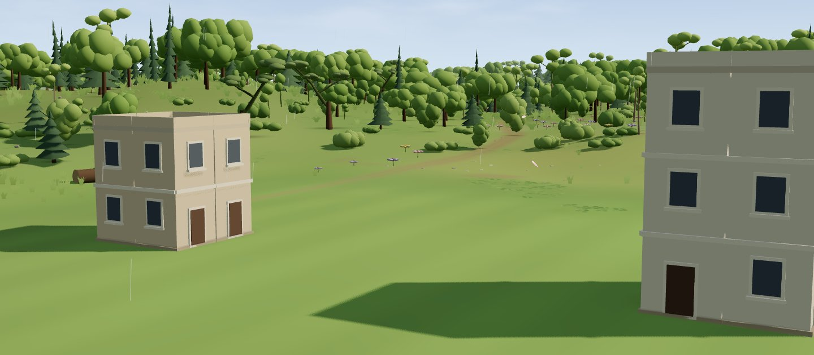
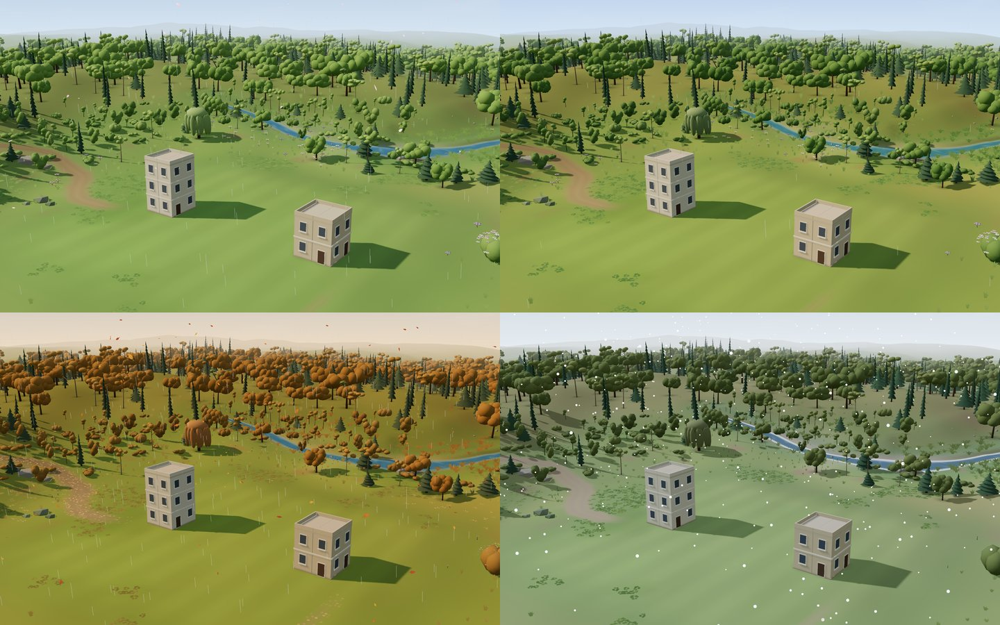

# Build

Jessica Hsiao · Procedural World Building

*Wildform's main playable prototype: the player builds part of the
architecture, and plants grow the rest.*

    build → plant → grow → plants meet → living architecture → build again

The design idea: **the player controls the starting conditions, but not the
exact final form.** Where rigid blocks go, from a budget, and where seeds go,
are the player's; what the plants make of them is the simulation's.

![The lawn scenario played out under a clear sky: the three-storey west building and two-storey east building, a one-column stepping-stone tower between them, and a living bridge arching from each building to the tower, with a balcony-pod on the tower. Teal Draper curtains hang from the roof edges and a ledge of the west and east buildings and from the tower's roof, and under the west bridge where a curtain spread onto it; patchy beds of ground cover spread from the foot of the tower and the east building](../images/build-living.jpg)

## Contents

- [The scenario](#the-scenario)
- [Two kinds of architecture](#two-kinds-of-architecture)
- [Rigid architecture: building](#rigid-architecture-building)
- [The plants](#the-plants)
- [The Draper: a plant that hangs](#the-draper-a-plant-that-hangs)
- [Living architecture: mutation nodes](#living-architecture-mutation-nodes)
- [What grows from what](#what-grows-from-what)
- [Growing in stages](#growing-in-stages)
- [Build and grow are one loop](#build-and-grow-are-one-loop)
- [Surfaces: roofs and living architecture](#surfaces-roofs-and-living-architecture)
- [The landscape](#the-landscape)
- [Ground spread](#ground-spread)
- [Sky and light](#sky-and-light)
- [The page](#the-page)
- [Saving worlds](#saving-worlds)
- [Inhabitants](#inhabitants)
- [Seeds planted](#seeds-planted)
- [Code](#code)
- [Measured](#measured)
- [Limitations](#limitations)
- [Notes](#notes)

## The scenario

A lawn, and two existing buildings on it: a three-storey block to the west
and a two-storey block to the east, **eight columns apart**. They are free,
and can't be removed.

**Goal: join the two buildings with living architecture, using no more than
30 blocks — and keep them two buildings.**

A living bridge reaches about five columns, so the plants can't do it alone.
The player has to bring the buildings within reach, and that is the decision:

- push a wing out from one building, then let one bridge grow across;
- or put up a cheaper stepping-stone tower between them, and get two living
  links, west to tower and tower to east;
- or bridge the gap with blocks directly — which joins the two masses into
  one building, and the goal asks that they stay separate. Spending blocks on
  the connection itself undoes the point of it.

The first version stood the buildings four columns apart: both bridges grew
without a block spent, and there was no decision to make.

## Two kinds of architecture

| | Rigid | Living |
| --- | --- | --- |
| Made by | the player, block by block | the plants, where they meet |
| Comes | at once | over hundreds of steps, in stages |
| Costs | one block from the budget each | time, and the right conditions |
| Form | modular, predictable | decided by the plants and the context |
| Looks | clean boxes, warm stone, muted terracotta roofs | irregular decks, fibrous below and stone with moss above, on roots |

## Rigid architecture: building

Townscaper's interaction: the player only places and removes blocks on a
14 × 14 × 8 grid, and the rules (`townMesh.ts`) decide what each becomes:

- **walls** only where a side faces the open, each with a window; a **door**
  on one open side of each ground-floor house;
- a **roof** by the neighbours at the same height — a hip roof on a house
  alone, one gable ridge along a row, a roof terrace with parapets where
  there are neighbours both ways;
- an **arch** under a block that spans between two others at its height, with
  nothing beneath — a gateway, or a bridge's arcade — and **stilts** under any
  other floating block;
- a **string course** where a storey meets the one above: a ledge, drawn
  where the growth model has one;
- a stone **footing** into the lawn.

Each block the player places costs one of 30. A new block takes the colour of
the block it was placed against, so a house stays one colour; on open ground
a stone from the Site's palette. The sky and light are a clear day of the
page's own (see *Sky and light*).

## The plants

Wildform's two species and their simulation, unchanged: the **Climber** (goes
up, follows edges, tolerates shade) and the **Spreader** (goes sideways, seeks
light), growing in **stacks of layers** — each onto what is already there,
the top layer shading the ones beneath. Sun and rain are the growth model's.

**Layered** is not a third species to plant: it is what a cell becomes when
one plant has grown over the other. It is shown beside the species, and it is
what the mutation rules read.

The fourth is the **Draper**, which hangs — next.

## The Draper: a plant that hangs

Climber grows up, Spreader sideways. The **Draper** grows **down**: it hangs
from an elevated edge and lets strands fall under gravity until they gather
into a curtain (`draper.ts`, drawn by `draperMesh.ts`).

It is its own model, not a third Wildform species. Wildform's plants live on
wall cells, each growing into a neighbouring cell. A hanging strand spends
most of its length in open air below an edge, where there are no cells, and
adding a species to Wildform would have changed Explore's simulation and
every species array the Build loop reads. The Draper still reads the same
world:
- the light and moisture where it hangs;
- the Climber growth beneath it;
- the town it hangs past or lands on;
- the living architecture it hangs from.

**The rules:**

1. **Anchoring.** A Draper needs an edge at the top. Valid edges:
   - the top edge of an open wall face: a **roof** eave, or a **ledge** (a
     string course where the storey continues above);
   - the bottom edge of a block with nothing under it, an **overhang**;
   - the edge of a **mature living structure's deck**.

   An edge runs on along neighbouring blocks with the same edge, up to three
   either side, so a curtain can widen along an eave. Not the lawn.
2. **Direction.** Each strand grows down, about 0.03 units a step at full
   vigour. A slow sway along the edge and a little outward drift keep it from
   hanging like a cable; gravity dominates.
3. **Surface.** Where there is a wall behind, a strand clings lightly: it is
   drawn toward a small, wavering gap off the façade. Where there is none,
   under an overhang or a bridge, it hangs free.
4. **Contact.** A strand that reaches the lawn **roots**, and a small patch of
   Draper grows round the root (in the ground cover), tying hanging growth
   back to the ground. A strand that meets a block — a lower roof, a wing —
   rests on it and stops.
5. **Density.** A Draper sprouts a strand every 24 steps (slower when it
   grows poorly), up to 9. They come in clusters of two or three, spreading
   out along the edge from where it was planted. Strands near the middle are
   longest (up to 10 units, about three storeys), so the curtain's hem curves.

**Ecology.** It likes moderate moisture and part sun: the lee of a building,
or the filtered light under a deck. It slows in full sun, in deep shade and
on a dry wall. Its vigour is the product of a light match (best at 0.45) and
a moisture match (best at 0.5). Both are read over the band of wall it hangs
across — about 4 units down and 1.5 either side — not at the anchor (see
*Notes*).

**Interactions.**
- **Veil.** Over a wall where Climber has grown (3 or more Climber cells
  under the anchor), a Draper grows half as many strands again, and faster:
  a denser curtain where the two meet.
- **Spreading onto living architecture.** An established Draper (160 steps,
  4 strands) can attach to a mature living deck. It does so when its edge
  comes within 2.6 units of the deck's edge, or a grown strand within 1.2,
  and a new curtain starts there. Only a planted Draper spreads, at most
  twice.

An established Draper takes part in the mutation rules through its curtain
(see [The Draper's forms](#the-drapers-forms)).

**Drawn as hanging vegetation, not lines:**
- the stems are thin three-sided tubes, tapering, green-brown to fresher green;
- slim pointed leaves hang off them, dense near the top and sparser below,
  with pale young leaves opening at the tip;
- clusters of larger leaves bunch round a stem every so often;
- a lip of foliage runs along the edge between the outermost strands;
- a few leaves sit round each rooted base.

The leaves are teal-green, to read apart from Climber's dark green and
Spreader's olive. They sit at fixed distances along each strand, so a growing
strand adds leaves at its tip and none move.

**Planting.** With Draper chosen, the player clicks a wall, a roof or a
mature living structure, and the Draper anchors on the nearest valid edge:
- on a wall, the edge at the top of that block;
- on a block with nothing below, its soffit edge if that is nearer;
- on a roof, the nearest open edge;
- on a living structure, the nearest deck edge.

On hover, a mint bar along the edge, with short strands hanging from it,
shows where it would hang. The lawn, and a living structure that has not
matured, show nothing and refuse the click.

## Living architecture: mutation nodes

The old rule spawned a rectangular prefab platform where the plants met.
Here a meeting forms a **mutation node**, and architecture grows from it.

Every 10 steps, `findNode` looks for a wall cell where enough of one
combination has gathered (`living.ts`):

- at least **6** cells of Climber + Spreader, or **2** of a layered
  combination, within 1.2 units;
- their growth at least **25 steps** old on average — established, not a
  passing tip;
- at least **1.8 units** up the wall (at the foot, the "bridge" was a ramp
  from the lawn);
- **5 units** from any other node, and **8** structures at most, of which at
  most **3** balconies (see *Measured*).

The rarer layered combinations are looked for first.

## What grows from what

The combination is read from the cell's stack; it sets the architectural
identity. The context — the wall's facing, the plants' growth directions
nearby, other buildings in reach, the free space in front, the roof above —
sets the form.

| Stack | Combination | Grows |
| --- | --- | --- |
| two layers, both species | **Climber + Spreader** | a **bridge** to another building in reach, or a **balcony** if none |
| a Climber on two layers | **Climber + Layered** | a **scaffold**, up past the roof |
| a Spreader on two layers | **Spreader + Layered** | a **terrace** at a roof, or a **canopy** below one |

The Climber gives a vertical path, the Spreader horizontal reach, layered
growth mass:

- **Bridge.** From the node, a cast along the wall's facing, turned toward the
  Spreader's growth and fanned ±20° and ±40°, at the node's height and a
  storey up or down, finds the nearest face of *another* building within five
  columns. The deck arches between them — a quadratic Bézier whose control point is
  raised 0.12 of the span, so its crown rises about 6% of it — and is
  bowed sideways the way the Spreader was growing. It grows as two halves
  from either end that meet in the middle, each flaring into a root plate on
  its wall. Under it, two edge rails and a sagging keel.
- **Balcony.** No building in reach: a pod out along the wall's facing and the
  Spreader's direction, as far as the free space allows (2–4.2 units),
  widening then narrowing, curling up at its lip, on two root braces from the
  wall below, tendrils hanging from the rim.
- **Scaffold.** Three helical rails twisting round an axis 1.25 units off the
  wall, leaning with the Climber's growth, from below the node to a storey
  above the roof, with small stair pads stepping round them and a crown on
  top; tie-backs into the wall each storey. If another building is within
  four columns of the crown, an arm grows across to it.
- **Terrace / canopy.** A thick fan-shaped deck from the wall, at the roof if
  it is within a storey (terrace), else just above the node (canopy), domed,
  widening outward along the wall's facing and the Spreader's direction. If
  another building is within reach it spans to it; if not, and it is high, two
  trunk-like root columns carry its far edge to the ground.

Each structure is a set of curves and swept surfaces, so no two come out
alike.

## The Draper's forms

A Draper never enters a wall cell's stack — its strands hang in open air off
the face — so its meetings can't be read from `comboOf`. They are read from
the curtain instead (`draperLiving.ts`): what grows on the wall behind its
grown strands (within 0.7 units of one), what has spread along the edge it
hangs from, and what its strands have reached below. A Draper must be
established first: hung 200 steps, with five strands.

| The curtain | Combination | Grows |
| --- | --- | --- |
| hangs from living architecture, or over three cells of layered growth, with three strands down to the lawn or a roof at least 2.5 units below | **Draper + Layered** | a **root column** |
| hangs over four Climber cells, from an edge at least 5.5 units up, with another building within five columns (level or up to two storeys up or down) | **Climber + Draper** | a **suspended walkway** |
| hangs from an edge at least 4.5 units up where three Spreader cells have spread (on the edge, the roof beside it or just under it), with room below for the pod | **Spreader + Draper** | a **hanging pod** |

Checked in that order, before the wall's nodes, and each Draper makes one
structure at most. Where the conditions aren't met, nothing forms: a curtain
over Climber with no building in reach stays a veil; a pod that would hit a
block or come within half a unit of the lawn isn't grown.

What the Draper brings is a direction the others don't have — down — so its
forms hang, descend and are held in tension:

- **Root column.** The landed strands nearest the curtain's middle twist into
  a trunk: six strands spiralling round an axis from the edge to where they
  landed, narrow in the middle, flaring at the foot into six buttress roots,
  gripping the edge with a capital of five strands. Bracket shelves, one a
  storey, grow out on alternating sides. Under a living deck it stands free;
  on a wall, half a unit off the face. A foot on another building's roof makes
  it a connection.
- **Suspended walkway.** A thin deck (0.14 units, against a bridge's 0.3–0.4)
  sagging below the line between its ends, hung by hangers from two cables
  strung between masts at either end; strands trail from its edges. It lands
  on the neighbour's roof when that is within two storeys up or down, so it
  can slope where a bridge stays level.
- **Hanging pod.** Under a lip grown from the Spreader's spread, seven open
  hoops, widest a third of the way down and gathered to a point 3.1–3.5 units
  below, ribs between, a floor across the belly, a mouth facing out; hangers
  gather to the lip's end; strands trail below.

Two new kinds of member carry this: **trunks** (drawn thick, and climbable
surfaces like any frame member) and **cables** (thin, in the Draper's teal,
not surfaces). Both are optional fields on a structure, so worlds saved before
them load unchanged; a saved world round-trips both, and the Draper's record
of what it formed, and carries on identically (checked for 400 steps after a
reload).

**Spacing.** Draper forms keep the wall's five-unit spacing, with two
exceptions: a column may stand under the structure it hangs from, and two
forms facing opposite ways may be two units apart. Without the second, a
tower slinging walkways from both eaves — 3.6 units apart — only ever got
one.

## Growing in stages

A structure grows over simulation steps, so pausing pauses it:

| Steps after the node | Stage |
| --- | --- |
| 0–30 | **node** — a knot swells where the plants met |
| 20–150 | **frame** — rails, keels, helices and roots draw out along their length |
| 140–300 | **surface** — the decks fill in from their roots outward |
| 280–380 | **mature** — the raw, fibrous tint gives way to stone |
| 360–520 | **vegetation** — leaves open over it, from the node out |

At step **300** it becomes architecture: its decks are added to the world as
solids, so they cast shade on the plants (and the plants under a new bridge
respond, as under Wildform's platform), and the walls its frame and roots
touch become support, so Climbers climb it. A connection counts from then.
And its surfaces join the building, so plants grow on it (next section).

## Build and grow are one loop

There are no separate modes. Tools — **Build**, **Remove**, **Plant** — work
whether growth is running or paused, and editing the town never resets it:

- the town becomes a new building, and every plant layer whose cell still
  exists (same position, same facing) is carried onto it in birth order, with
  its age and the conditions it grew in (`WildGrowth.restoreFrom`); a layer
  under a new block is dropped, and what grew from it is left standing;
- mature living structures persist and are laid back into the new world, still
  shading and supporting;
- the new architecture can shade plants that were in the sun — which then
  wither — and new walls are open to growth.

## Surfaces: roofs and living architecture

*Geometry creates different conditions; no surface is arbitrarily plantable
or unplantable.* Pitched roofs used to have no cells at all — plants stopped
at the eave — and a living structure was a shadow and a support with nothing
growing on it, so only the Draper used it. Now both are surfaces
(`surfaces.ts`).

**Patches.** The growth model's cells are vertical walls and flat roofs, and
`assembleBuilding` is shared with Explore and the Site, so it is left alone.
Instead each pitched roof face and each part of a mature structure becomes a
grid of cells laid on the surface as drawn, appended to the town's building
and stitched to the cells beside it (any edge cell within 0.45 units of
another surface's cell). An eave joins the top of the wall under it, a root
joins the wall it grips, and a deck's rim joins its underside. A wall cell
with all eight neighbours gives up a diagonal for the stitch, so growth can
step onto a patch as well as off it. Every roof patch cell in a test town
(862 of 862) is reachable from the walls.

**Every cell carries its surface:** a kind (wall, flat roof, roof slope,
ridge, eave, gable end, deck top, deck rim, underside, support, junction),
its slope, attachment (an edge or rib to hold) and water retention. From
these:

    slope → runoff → moisture
    kind + slope + attachment → affinity per behavior → suitability

**Roofs.** Three pitches, so the roofs a player gets are three surfaces: a
terrace is flat, a gable over a row is 31°, a house's hip roof 49° (they were
41–43° and alike before). Water kept falls with slope — 1.0 flat, 0.80 at
31°, 0.49 at 49° — and what a slope sheds lands on its eave, which comes out
wetter than the slope above it. Ridges shed both ways, and are the driest
line. Ridges and eaves are edges, which the geometry field reads, so the
Climber follows them.

| From three seeds on the sunny side, 800 steps, mean of 6 | Climber | Spreader |
| --- | --- | --- |
| Terrace, 0° | 1.8% | **100%** |
| Gable, 31° | 0.5% | 7.6% |
| Hip, 49° | 1.3% | 1.5% |

| Seeded at the walls' feet and on the roof, 1,500 steps | rain 55% | rain 85% |
| --- | --- | --- |
| Terrace: Spreader | 95% | 98% |
| Gable slope: Spreader | 0.2% | 37% |
| Hip slope: Spreader | 0.7% | 8.6% |
| Hip eaves: Climber · Spreader | 48% · 25% | 86% · 50% |

Flat roofs fill. Steep roofs keep little and grow at their eaves. Moderate
roofs are in between, and patchy in dry weather — see *Notes* for why.

**Living architecture.** Once a structure matures, its surfaces join the
building:
- each deck's **top**, with its **rim** (the outer fifth either side);
- its **underside**;
- every rail, keel, rib and root, as a **support** strip;
- **junctions** where a deck meets its node or the wall it roots in.

| Behavior | Affinity on a structure |
| --- | --- |
| Climber | full on rims, supports and junctions; about half on a deck top; 0.5 underneath |
| Spreader | full on a deck top; fair on a rim; 0.3 on a rib; 0.25 underneath |
| Draper | unchanged: it anchors on deck edges, rims and the eaves under them |

Draper-favored is not Draper-exclusive: an underside is poor for the others,
and possible. A structure's surfaces keep its id. A node can form on them
like on a wall: a deck top plans from its rim's direction, a roof slope from
its eave. Those nodes use the same mutation rules (`living.ts`) — there is no
second system for structures grown on structures.

On the stepping-stone run, at step 3,200:

| Living surface | Climber | Spreader | Layered |
| --- | --- | --- | --- |
| Deck top | 3.8% | 12.3% | 1.7% |
| Deck rim | 18.9% | 4.4% | 2.2% |
| Support | 5.7% | 0.8% | 0.4% |
| Underside | 1.8% | 0.2% | 0.1% |
| Junction | 17.6% | 22.5% | 9.2% |

**Recursion happens.** In that run a balcony grew at step 1,630 from the rim
of bridge #1 — architecture grown on architecture — matured, and its own
surfaces joined the building. A structure born on another doesn't count as
a connection (its start is not a block).

**Planting.** A click on a wall, a roof of any pitch or a mature structure
plants there. Only glass refuses. On anything but a wall, a note names the
surface and how it suits the plant — *Roof slope · poor for a Spreader* —
good (suitability ≥ 0.45), fair (≥ 0.2), poor, or *poor — it may not spread*
(under 0.1, the least a tip needs to move). A structure that hasn't matured
says so.

**Surface view** (sidebar, last): every cell as a dot, coloured red–yellow–
green by one behavior's suitability (Climber, Spreader), or by how good a
hanging anchor it is (Draper). The plants are hidden while it shows.

## The landscape

The ground round the town used to be one flat green field. It is now a
procedural landscape (`landscape.ts`, drawn by `lawn.ts` and
`landscapeDecor.ts`) — pure scenery: the simulation never reads it.

**The town's ground is untouched.** Height is `lawnHeight` — the ground the
game has always stood on — plus hills multiplied by a mask that is exactly 0
within 3 units of the buildable grid and eases (smoothstep) to 1 by 14 units.
So every block, every Draper root and every ground-cover leaf stands where it
did, and there is no plateau edge to see. Measured: the same 1,200-step game
(blocks, plantings, a Draper) gives the same goal step, structures, layer count
and hash with the landscape as without; within 3 units of the grid, height
equals `lawnHeight` exactly (tested on three seeds).

**Terrain** — seeded 2D gradient (Perlin) noise, **domain-warped**: the
coordinates are first pushed up to 9 units by a slow noise, so the rolls bend
and run into each other instead of sitting on a lattice. Two octaves — broad
rolls (one every ~35 units, ±1.5) and smaller undulations (~12 units, ±0.4) —
grow from 0.7× at the meadow to 1.6× beyond 50 units from the grid (it was 0.6×
to 1.6× over 70: the hills now come up soon enough to be a middle layer between
the clearing and the ridge). (A third, fine ripple only made the ground look
bumpy and is gone.) Over that, the hollow and the landforms below. Tops above 4
units are eased toward 5.8 (`4 + 1.8·tanh((h − 4)/1.8)`): where the rim ran into
the ridge the two stacked to 6.3. Tested on five seeds, over a grid: highest
point under 6 (4.4–5.6 on four seeds), no slope steeper than 1 in 2 (0.43–0.50).
The slope test used to sample one seed, which passed while three others ran
to 0.59 once the rim existed — it checks five now.

**The hollow.** The meadow was a flat lawn ringed by trees — a park, or an
arena. Now the town sits in a shallow **hollow**: the ground lifts gently from
11 units inside the clearing's edge, crests about 14 past it, and eases back a
little beyond, so the land behind reads as a further layer rather than a wall
(`shelter`). The trees at the edge stand on the rise, above the buildings' feet,
and close the view round them. Not a ring: its height round the circle is
noise sampled round a circle, from a low saddle to shoulders of 4 units or so,
and it falls away along the open valley, which stays the clearing's way out.
It gives way where the spur or the ridge's foot already climbs: stacked, the
two rose together over the mask's few units to a slope of 0.59. Measured on
four seeds: at the clearing's edge the ground is 0.46–0.68 units above the
town's on average (it was 0.07–0.22), at the crest 2.0–2.4 (was 0.7–1.0), and
the trees within 10 units of the edge stand on ground 1.1–1.5 up (was
0.16–0.59). The grid itself is untouched — the hollow is inside the same mask
as every hill. Seen from the opening view, wooded slopes rise behind and on
both sides of the buildings, with the hazed far hills above them: foreground
meadow, the town, the rising edge, the ridge.
The lawn mesh is 320 units wide on a stretched grid (`x = 70u + 90u³`): vertices
about 0.47 apart at the centre, where mown stripes need them, coarser toward
the fogged edge — 90,601 vertices.

**Three fields**, all 0–1 and reusable (by weather, seasons or anything
placed later):
- *elevation* — the land's height relative to the town's ground;
- *relief* — the same, leaving out the hollow's rim: the hills and the ridge.
  The rim is shaped land, not a crest, so moisture, ground colour and where
  conifers lead a stand all read the relief. Read from the elevation, the rim
  turned dry and olive and halved the grass (1,977 → 1,021 at the opening
  view), left 111 of 685 ferns and 53 of 281 flowers, and made every stand at
  the edge conifer-led;
- *moisture* — slow noise, wetter in hollows and drier on crests (tested: mean
  moisture in hollows above that on crests);
- *fertility* — best at moderate moisture (waterlogged is poorer), on flat
  ground, plus its own patchy noise.

**Colour** blends from the lawn's green, by the fields, never by threshold:
toward olive where it's dry, a cooler green where it's wet, a richer green
where it's fertile, earth where it's poor and steep, moss in damp hollows.
The palette is read as sRGB — read as linear it came out washed-out and pale.

**Decorations** — grass, shrubs, ferns, saplings, rocks, small flowers,
stones, reeds and fallen leaves — are placed by `scatter`: a jittered grid of
candidates (for reeds, points along the stream), visited in a seeded order,
each kept with probability *suitability × density*, with a minimum spacing for
the larger kinds, up to a cap. Nothing is placed on a footpath, and nothing but
reeds in the water.

| Kind | Prefers | Clustered by | Nearest the grid | Medium cap | Medium, four seeds |
| --- | --- | --- | --- | --- | --- |
| Grass | fertile, not steep, out of the woods | its own noise field, or the meadow's patches (taller there, from 5 units off the grid) | 2.5 units, ramping up over 5 | 6,500 | 1,596–1,721 |
| Shrubs | fertile; the meadow's edge | a band across the edge, loose clumps in the meadow; 1.1 apart | 7 units | 300 | 173–216 |
| Ferns | moist, shaded: from 4 units inside the edge to ~20 past it, and the stream's banks | irregular drifts | 9 units | 900 | 460–739 |
| Saplings | a wide band across the edge, from the meadow's margin into the young trees; never in the open valley | their own field; 1.0 apart | 10 units | 220 | 61–98 |
| Rocks | poor, dry, steep | their own cluster field; 0.7 apart | 4 units | 200 | 200 |
| Flowers | wildflower drifts in the meadow's patches, one colour each, and sparse accents on fertile, moderately moist ground | the drifts' own field; candidates every 0.5 | on the lawn only in the strongest drifts; never the protected ground | 700 | 241–355 |
| Clover | irregular ground-cover patches, out of the woods | a warped field; only inside its patches | on the lawn only in the patches' hearts; never the protected ground | 1,600 | 1,534–1,600 |
| Stones | beside the footpaths and at the water's edge, a few in the meadow | their own cluster field; 0.35 apart | 4 units | 140 | 140 |
| Reeds | the stream's edge, from just in it to a unit up the bank; lush reaches, the insides of bends | clumps, not a hedge | — | 380 | 71–150 |
| Fallen leaves | the paths' edges, the stream's banks, the forest's edge — shown in autumn only | their own field | 4 units | 650 | 630–650 |

Low and High scale the caps and probabilities by 0.45 and 1.7. So the
buildings keep a quiet margin, the middle ground is sparse grass and flowers,
and the edge is layered — saplings ahead of the trees, shrubs and ferns under
them — foreground, middle and background come from distance in the world, not
from the camera.

**Undergrowth, varied.** Shrubs were 420 near-identical leafy mounds, and many
alike made a pattern; they are capped at 300 now, in three shapes, each
stretched differently: a rounded mound and a low spreading cushion in the
meadow, and — only at and past the forest's edge — a **tall** upright shrub
about 1.4 high, clumps scattered through a vase that spreads toward the top (a
first version, nine clumps one above another, read as a column of balls). A
**fern** is eight fronds arching out and down from a crown, normals pointing
up so it lights like the ground; a **sapling** is a thin stem and two small
leaf clumps about 0.9 high. With the young trees below, they make the **middle
layer** between the meadow and the mature forest: saplings from the meadow's
margin into the young trees (the band was ±4 units and placed 45–79; it is
±6.5 now), tall shrubs and ferns under them. When the clearing shrank and its
rim rose, grass and flowers fell (to 1,456–1,590 and 88–136, from 2,358–2,501
and 320–411) because the meadow was smaller and part of it sloped; the
meadow's patches and wildflower drifts below brought them back up.

**Drawn** as instanced meshes — one per kind (two for flowers, stem and head;
three for shrubs), trunks and six crowns for the trees, near and far, soft contact
shadows, and plain meshes for the water and the footpaths — none of which can be clicked: each mesh's `raycast` does nothing, and
the viewport's picking only ever tests the town, the lawn and the plants —
clicking straight on a shrub with Build or a plant picked builds and plants
nothing (checked). Low-poly to sit with the town's blocks; tufts and ferns have
their normals pointing up so they're lit like the ground (with true normals,
half the blades went dark).

**A forest clearing.** The meadow is a clearing in a forest. Its edge is an
irregular closed curve: the clearing's radius in each direction is two octaves
of noise sampled round a circle (so it closes on itself), 13–21 units on four
seeds, mean about 17.7 — groves reaching toward the town in some directions,
longer sightlines in others; never nearer than 12 (the grid's corners are 10
from the centre, and trees keep 6 from the grid anyway). It was 15–31, mean 22:
the meadow read as a park and the forest as a far-off wall. A *forest* field
(0–1) rises from 3 units inside that edge to 8 past it, is broken into groves
and gaps by a slow noise, and fills in beyond 14–34 units, so the far forest is
a mass, not a row. Trees are scattered as **groves** round a jittered grid of
centres every 8 units, each kept with probability set by the field, trunks 1.3
apart. 2,600 trees at Medium, reaching 140 units out — the same count as
before.

**Habit.** A grove is *tight* (60%: five to fourteen trees within 1.5–2.8
units) or *loose* (three to seven, 3–4.5 units apart). Together with the forest
field's gaps that makes dense clumps, open groups and clearings. A first pass
with loose groves spread 3.5–6.5 units, and 70 young groups spread ±5 units
either side of the edge, speckled the meadow evenly — a scatter, not clusters.

**Scale.** Trees are smaller: from 0.6× of the old size at the edge to 1.0×
deep in the forest (it was 0.55–1.15, with accents to 1.45), and they mature
over 20 units past the edge (was 15), so the forest rises gradually. Measured
on four seeds: 0.64–0.67× within 5 units past the edge, 0.75–0.77× at 5–10,
1.00× at 20–40; 0.92× on average within 50 units of the centre (was 1.10). A
mature broadleaf now stands about as tall as the three-storey building; only
the spires top it (~4.5–5 units; the old evergreens reached 5.5). Not smaller
still: from 0.5×, edge trees read as dots beside the buildings. The ridge
moved in with it (below), from 48 units to 42.

**The edge.** Placed before the groves, so the budget can't be spent first:
34 loose **groups of three to five young trees** (0.5–0.75×) from 1 unit inside
the edge to 5 past it — slender trees, firs, the odd spire or broadleaf — and up
to seven **accents** standing out in the meadow's margin with room round them:
crooked trees, a weeping tree, a big broadleaf (1.0–1.25×). Weeping trees are
the least likely: alone and large in the open their curtain read as a barrel
(see below). The order from the town is meadow → flowers thinning → saplings
and the first young groups → shrubs, tall shrubs and ferns → young mixed trees
→ mature mixed forest; grass and flowers thin as the woods thicken, and the
ground under them darkens to a forest floor. Tested: no tree within 6 units of
the grid, the radius varies by over 6 units round the town and never comes
nearer than 12, edge trees are smaller than deep ones.

*Nearest first.* The grove centres used to be visited in a shuffled order, and
the cap is reached long before every centre is visited — so the far forest,
which has far more area, took most of the 2,600 and only 6 trees stood within
10 units of the edge. They are visited nearest-first now (with a little
jitter, so the cut-off isn't a circle): at the time, 81–109 trees within 10
units of the edge on four seeds, the same 2,600 in all, reaching 110 units. More trees where
they are seen, not more trees. (Earlier still, the forest ramped up over 14
units, which left a ring of shrubs and 2 trees in 1,500 near the edge; it ramps
over 11.)

**Landforms.** Over the rolling noise, placed for composition (the opening
view looks north-west). The first version made them anisotropic Gaussians,
and they read as smooth isolated domes; they are built from **ridged noise**
now — `(1 − |n|)²`, sharp where the noise crosses zero, broad between:
- a **ridgeline** behind the scene, ~42 units out (was 48), its crest a
  wandering line and its height along the crest ridged noise — peaks up to
  ~4.8 (was 5.5) with saddles
  between, never a straight bar — with a long gentle fall toward the clearing
  (20 units) and a shorter, steeper back (10);
- a lower **spur** off its western end toward the south-west, so the skyline
  steps and the ridge reads as part of a range;
- shallow **troughs** out in the far land, inverted ridged noise carving long
  valleys (to −1.2) between the rolls;
- the open **valley** to the north-north-east, where the ground dips and the
  forest stays sparse — a long sightline out of the clearing (tested: three
  times fewer trees along it than to the east and west together).

All smooth and beyond the mask, so the town's ground never sees them. Tested:
the highest point in the north-west sector is over 3 units on seed 4 (the crest
wanders, so the test takes the sector's maximum, not one sample).

**Six tree families**, each its own silhouette:

| Family | Silhouette | Medium, four seeds |
| --- | --- | --- |
| Broad canopy | a rounded deciduous crown of 16 leafy clumps, lopsided, its underside a little flattened | 1,132–1,311 |
| Slender | a light, open young deciduous tree: a trunk leader and four branches, each ending in a flattened leaf clump, on a pale trunk | 287–306 |
| Fir | a shorter, broader conifer: six ragged tiers, cool dark green | 513–654 |
| Spire | a tall, narrow conifer: nine tight tiers tapering to a long point, darker and bluer than the fir | 422–482 |
| Crooked | an accent: a trunk that bends away as it rises, a side limb, flat layered pads of foliage — a windswept pine; leans hard | 34–40 |
| Weeping | an accent: a dome with a curtain of foliage hanging nearly to the ground, in damp hollows | 7–12 |

Fir, spire and crooked keep their green through the year (the seasons give
them only a touch of their colour, 10%); the broadleaves turn fully, and the
undergrowth with them — see [Play](play.md#seasons).

**Mixed stands.** A grove has a *leading* family and companions. The leader is
drawn, not decided: a conifer-led stand is likelier on high or steep ground
(spires highest), but possible anywhere, and a slow `standMix` noise field,
independent of the terrain, moves the odds about. "High" is the relief, not the
elevation — the hollow's rim is high all round. 50–85% of a grove follow its
leader; the rest are companions — firs and broadleaves among spires, conifers
and young slender trees among broadleaves, now and then a crooked or (if damp)
a weeping tree. The previous pass gave each grove its family from the terrain,
with 88% following it: conifers stood in stands, but the ridge side of the
clearing was 76–86% conifers and the east 0–1% — one side firs, the other
round trees. Now, within 60 units, conifers are **27–65% of the trees in every
eighth of the compass** on four seeds (tested: between 15% and 75%).

Silhouettes that didn't work: a broad crown flattened hard on a long trunk read
as an umbrella on a stick; a slender tree of spheres stacked up a pole read as
a column of balls. And one bug sat under three of them: every flattened clump
was built `blob(…).scale(…)` — placed, then scaled about the origin — which
scaled its height off the ground too. The slender tree's leaf clumps sank down
its branches, leaving bare twig tips poking out of the crown; the weeping
tree's dome sank inside its curtain, so the curtain's tops stood above it — the
barrel; and the crooked tree's first pads lay as dark slabs far below its
branches. Clumps are now shaped about their own centre, then placed
(`shaped`).

**Light and haze** — soft, warm morning light: a warm sun (`#ffedd2`, 2.75 —
it was 3.0) and a stronger, cooler sky fill
(`#c9d6e8`, 1.4, was 1.15) with a green bounce from the ground (`#93a072`), so
shaded sides read as cool green, not grey. Shadows are soft-edged (PCF with a
blur radius of 4 — a penumbra of a few pixels, checked close up). The sun's
shadow map covers the meadow and its edge (±19 units, 3,072²), so the nearest
trees cast real shadows; every tree and shrub also stands on a soft contact
shadow, and so does every ground-floor block of the town, so the buildings sit
on the grass rather than hover over it. Haze starts at 55 units (it was 45, and
34 before that) and thickens to 190: the meadow, the buildings and the
clearing's edge stay crisp, and only the far forest and the ridge recede. Each
season's palette moves from these (spring 2.75, summer 2.95, autumn 2.45,
winter 2.0).

**Foliage shading.** Crowns are smooth-shaded, slightly lumpy clumps, each
shaded from its own shape, lighter on top and at the rim, so it reads as
foliage, not a faceted solid. The first shrubs were two big flat-shaded lumps
and read as dark rocks. In Play the broadleaf canopy and the undergrowth
take the season's tint, each by its own amount; evergreens keep nearly theirs.

**The camera.** The opening view is 16° down and 31 units out from the
south-east (36° round from south), aimed at (−1.2, 3.2, −2.6) — a little behind
the buildings and above the ground: the buildings sit in the lower middle,
larger than before, with the gap between them side to side, less empty lawn in
the foreground, and the ridge's conifers rising behind them against the sky.
A grown world — a tower between the two, bridges, Drapers — fits the same frame
without running into the toolbar. (26° down at 25 units filled the frame with
the buildings and showed no forest; 31° at 32 showed the forest but the ridge
stood above the frame; 15° at 36, the last version, left the buildings small over a wide
foreground of lawn.)

 Orbit, pan and zoom are
as before, with three additions:
- panning keeps the target over the town and a margin round it (26 × 22
  units), moving the camera with it, so a long drag can't lose the town in the
  forest;
- the camera never goes below the ground, which on the hills it could;
- trees within 5 units of the camera dissolve (a dithered fade in their
  shader — no transparency sorting), so a low orbit or a zoom near the edge
  never puts a trunk across the view.

**The stream.** A small stream springs on the ridge's wooded slope to the
north-west, runs down to the clearing's north margin, follows the ridge's foot
10–12.5 units off the grid — behind both buildings in the opening view, the
middle ground between the meadow and the hills, never between them — and
leaves by the open valley, where the hollow drains, into the haze 155 units
out (156–162 units long on four seeds, its nearest 9.6–11.5 units off the grid). `planStream` lays it out by bearing in
three runs — down from the spring, along the margin, out along the valley —
then gives it a meander from noise across the line and, on the hillside and in
the valley, draws it toward the lowest ground within three units. Those
offsets are smoothed along the line before they're applied: chosen point by
point, neighbours jumped by units and the line zigzagged into loops near the
spring. The line is then evened out over about ±4 units and its corners
rounded (Chaikin) — rounding alone works only within a point or two, and where
the margin turns into the valley the stream made a V seen from above —
and resampled every 0.6.

*Its shape along the line* (`streamShape`). The first stream hardly varied: a
half-width of 0.5–0.94 from one slow noise. Now the width comes from two noises
over a narrower base (0.55–0.8), widens by up to half again round a bend, and
swells into **pools** — about 1.8× as wide and deeper — at the three sharpest
bends 10–110 units down, at least 16 apart. The inside of a bend is wider than
its outside (up to ±0.3 of the half-width), so the two shores differ: a shallow
**gravel bar** on the inside, a **cut bank** on the outside. Two slow fields along
the stream give each reach a character — stony, lush, or neither, and open. And
each point has a **pace** (0.75 ÷ half-width, held to 0.6–1.6: quicker where it
narrows) and a **phase**, ∫ ds ÷ pace, which the shader and the floating leaves
move along.

*Downhill only, and below both banks.* Each point's water level is the lowest
of: the last one's, less 1.2 mm, so the surface never rises downstream; its own
ground less 24 cm (it was 12); and the ground a unit or two out on either side,
by at most 0.35 more. Where the ground humps above that, the channel is cut
through. That last bound is the important one. Running along the hollow's
slope, the water's level came from its centre line only, and on its lower side
the meadow 3 units out stood up to 0.8 *below* the water, its bank built up to
meet it: water on a levee, which is what read as a ribbon laid on the grass.
Measured now, over 96 sampled sides per seed, the ground beside the water dips
more than 0.1 below it on 0 sides of seeds 1 and 42, 3 of seed 9 and 7 of seed
4; uncapped, the bound made a 2.4-deep cut on a side slope at the ridge's foot,
where there's no room for a bank that wide. Eight spring bearings are tried
and the one kept needs the least cutting, never comes back within reach of its
own banks (two water levels would meet in one bank), and doesn't run across a
hillside too near the town for the bank it would need. It was first routed
along the east margin — outside the opening view, but for a sliver at its edge.

*Cut into the land, with a bank you can see.* `height` is the land plus the
stream's channel (`channelAt`): a bowl under the water a fifth of its
half-width deep, deeper in pools (a fixed depth under the spring's narrow
trickle made its sides 1 in 1); at the water's edge, exactly the water level;
then a small **lip**, up to 0.2 high over 0.65 units — taller on a bend's outside
than its inside — and the rest of the rise blended into the land over a bank
whose width grows with the cut and the ground either side (2.8 units plus 4 per
unit of cut). The first banks were a smoothstep from the water, which starts
flat: no edge to see. Now the ground stands 0.17–0.18 above the water 0.6 units
past its edge, on average; a lip taking a share of the whole cut, the version
before, stood at 1 in 1 where the cut was deep. The carve fades out 3–6 units
off the grid, so the town's ground is exactly unchanged (tested at 0.25-unit
spacing on five seeds).

The lawn's triangles near the stream are 0.5–0.9 apart — too coarse to draw a
lip under a unit wide. So the bed and banks are a **finer mesh of their own**
(`bankStrip`): rows every 0.3 units, from the middle of the bed out 2–6 units
past the edge, at the land's exact height and in its exact colours, fading out
over its last stretch onto the lawn. The lawn is lowered 10 cm beneath it
(`lawnSink`), so its coarser triangles can't poke through, and the mesh takes
the lawn's seasonal colour, so the two never part. Terrain, bank mesh, water and
everything standing on the banks read the same `height`. The bed is sand in the
shallows and a darker olive-brown where it's deep; the lip is exposed earth,
strongest on a bend's outside — the dark line that reads as a bank from the
opening view; a bend's inside and the stony reaches show pale gravel; then damp,
darker grass up the bank. The water is a flat ribbon at its level, each side as
wide as the water is there, reaching just 0.12 past the edge, under the lip.
(It reached 1.3× the half-width at first, under banks too gentle to show.)

Hills are held under 1 in 2. The banks have their own bound: carving a level
channel into a hillside already near 1 in 2 makes the uphill bank steeper than
the hill, and holding the water below its lower side too makes it more so.
Measured: 0.48–0.52 on four of five seeds; on seed 4, where it crosses a side
slope at the ridge's foot near the town, 0.87 at most, with 10 of its 1,140 bank
samples over 0.6 (tested: none over 0.9, under 2% over 0.6).

*The water* is a shallow woodland stream, stylised: soft, muted blue that keeps
its colour against autumn's orange. A deeper `#4d84a6` down the middle eases to
a paler, greener `#86b4bf` in the shallows, by the ribbon's own depth; and it is
translucent there — opacity 0.5 at the edge to 0.93 mid-stream — so the sandy
bed shows at the rim and the water reads as having depth. The first water was
one opaque sheet. Its patterns are laid out on the stream's phase, not across
the world, so moving them at one rate moves them with the water, along its
curves, quicker through narrows and slower in pools: long, faint flecks of
light (two slow waves multiplied, so they come and go) and ripples in the
normal only, so the sun leaves soft moving highlights — roughness 0.3, no
environment map, no mirror. Up to six stones set in the stream get a thin,
faint, broken line of water at their edge. Each is sized from the water where
it stands — its foot 3 cm into the bed, its top 6–12 cm above the surface
(tested). Placed at a fixed size, all of them ended 5–25 cm under once the
stream was deepened, and only their rings showed: a bright band 0.3 wide that
read as a white circle in the river, with nothing in it. The time is real time, not the game's, so at 4× the water is
as calm; it stops while play is paused, like the weather.

*The banks* follow the water and each reach's character, so they aren't
decorated evenly. Reeds (nine curving blades and two cattails, 0.4–0.8 high)
stand in clumps in the lush reaches and on a bend's inside, few on its outside
— 71–150 on four seeds, in uneven runs (on seed 1, by 10-unit reach: 25, 5, 0,
1, 4, 18, 5, 0, 1, 7). River stones gather in groups of two to five in the stony
reaches and on gravel bars (`bankStones`, 35–61 per world): the shared scatter,
capped with the meadow's stones, had put 0–11 at the water. Ferns and damp
grass thicken on the lush banks; trees keep 1.3 units off; the stretches with
neither stay open.

**The footpaths.** One main path comes in from the forest on the west, across
the meadow, and on to the west building's outer wall; a fainter trail branches
off it to the south-west; and a fainter one still comes out of the
south-eastern woods to the east building's far corner — three on each of four
seeds. Routed, not drawn: A* over a 1-unit grid where a cell costs
1 + 40 × slope² (+3 in the open valley, kept as a sightline), so a path takes
the gentle way over the clearing's rim. Out in the meadow a path keeps 3.5 units
off the buildable grid; it comes onto the town's lawn only to reach *one*
building's outer side, never into the gap between the buildings or 4.5 units
either side of it (`inGap`), never onto a wall, never within 1.6 of the stream.
The east trail is routed on its own and never meets the main path. So no path
runs from one building to the other — tested on four seeds: no path point in
the gap, and no path within 4 units of both buildings — and nothing on the
ground suggests that anything but the plants will join them. (At first the
main path stopped in the meadow 3.5 units short of the grid, and the meadow
round the buildings read as unfinished.) The inhabitants never walk the open
lawn (`nav.ts`), so a path is scenery, not a route. The walk is rounded
(Chaikin) and given a slow meander from noise across it, so the grid's
straight runs and 45° turns don't show. It is drawn as a ribbon seven vertices
across: a worn middle in muted earth that drifts in tone along it, two faint
ruts, edges fading to nothing over the grass (vertex alpha) and pushed in and
out by noise, so the outline is ragged; it is narrower under the trees, fades
over 14 units into the forest and over 2.5 into trodden grass at its building,
narrows on the town's lawn, has a few stretches worn thin where the grass has
come back across it, and the grass either side of it is a little worn. It lies on the lawn's *drawn*
surface (`surfaceHeight` interpolates the mesh's own triangles): the true
terrain between vertices can sit centimetres above or below them, enough to
bury a ribbon or float it. The first render showed no path at all — its
triangles were wound facing down and culled. Trees keep a unit off a path's
edge, so it runs through the woods in a gap; small stones gather beside it.

**The meadow.** The open ground varies in drifts rather than evenly, in
layers that each have a reason.
- A *patch field* (two octaves, about 9 and 4 units across) makes grass denser
  and, from 5 units off the grid, up to 1.7× taller — still under half a
  storey, so nothing near the buildings hides a planting or an inhabitant — and
  moves the ground's green lighter and yellower, or deeper.
- A *broad tone*, about 30 units across, shifts the whole meadow's green from
  one side to the other, and faintly the lawn's: the open ground between the
  buildings isn't one flat green.
- *Ground cover* — clover and creeping weeds, rosettes 0.3 across and a few
  centimetres high, lit like the ground — grows only inside irregular patches:
  a field read through coordinates warped by a slower noise, so a patch runs
  out in lobes and fingers rather than a disc. The ground under a patch is a
  little deeper green, so it reads from afar. (Spread thinner, with soft patch
  edges, the first version read as dots everywhere.) 1,534–1,600 per world.
- *Wildflowers* gather in drifts, each drift mostly one of five soft colours —
  creamy white, lavender, pale pink, muted yellow, now and then blue — one
  flower in five another, the ground under a drift washed in its colour. One
  flower is a few pixels at play distance; a drift reads. 241–355 per world,
  richer toward the woods.
- A few small *bare-soil* patches out in the meadow, and gentle *swells* up to
  12 cm about 7 units across between the town's ground and the clearing's edge
  (16 cm took one seed's steepest slope to 1 in 2).

**The protected ground.** The town's lawn stays open: only colour and things that
lie flat reach it, and nothing at all reaches the *protected ground* — the gap
between the buildings, 4.5 units either side of it, and 2.5 units round each
building, where its plants climb, drape and spread (`inProtected`). On the rest
of the lawn, clover comes only in the hearts of its patches (2–64 per world)
and flowers only in the hearts of the strongest drifts, as clumps (0–25):
singly, they read as dots sprinkled between the buildings. Within KEEP of the
grid the height is exactly the town's ground, as before.

**Landmarks.** Two groups of boulders, 0.7–1.3 across, three or four
together: beside the main path where it comes out of the trees, and on the
clearing's bank where the stream turns away into the valley. A boulder that
would land on the path, in the water or within 6 units of the grid is left
out: 4–6 stand on four seeds.

**Accents** (`clearingAccents`): one of each, so each part of the clearing has
something to know it by — a fallen log with moss along its top and a broken
stub of a branch; three mossy stones; a ring of seven mushrooms; and a
flowering shrub, its blossom pale pink and white. Each takes its own quarter
of the compass, in a seeded order, so different worlds put them differently,
at a spot where its kind belongs: the log and the mushrooms in the shade at the
forest's edge, the mossy stones on damper ground, the blossom out in the open
meadow. Never on the town's lawn, a path or a bank, at least 6 apart; trees
keep 2.2 off them. Their first colours were given as raw vertex values — which
are linear, so the bark came out a pale plank — and the blossom's flowers sat
inside the shrub's mound.

**Through the year**, from the same blended look as everything else — no
calendar of its own: spring is the petals' weight, autumn the falling leaves',
winter the snow's, summer what's left.
- *Water:* clear blue in spring, a touch greener in summer, still blue in
  autumn — the contrast to the orange — and cooler and greyer in winter, its
  edges frosting over and its ripples damped. A little fuller in spring (the
  surface 3.5 cm up its banks) and lower in winter (3 cm down).
- *On the water:* in autumn, twenty-two leaves float down it, each following
  the stream's own line at the water's pace there (`FloatingLeaves`), turning
  slowly; one that passes the reach you can see comes back in upstream.
- *Reeds* go a muted gold in autumn — their own material, at half the
  undergrowth's tint (at the shrubs' strength they went orange) — and die back
  to two thirds of their height in winter.
- *Wildflowers:* their heads scale in the vertex shader — 1.1 in spring, 1 in
  summer, a third in autumn, gone in winter (they used to bloom in the snow).
- *Fallen leaves* (650 drifts on the paths' edges, the banks and the forest's
  edge) are placed always and scaled in only in autumn; the paths' earth is
  speckled with leaves too, and in winter shows paler and more exposed.
- The meadow follows the lawn's golden autumn and frosty winter; reeds and
  grass turn with the undergrowth, and the grass stands 10% taller in summer,
  shorter in autumn and low in winter (its height in the vertex shader).
- *Accents:* the flowering shrub's blossom opens and closes with the
  wildflowers; the mushrooms are small in spring and summer, fuller in autumn,
  gone in winter.
Each is one uniform set when the look changes; nothing rebuilds.

**Cost.** Measured in the browser at the opening view, Medium: 65 draw calls
since the clearing's refinement (the ground cover and the four accents' meshes);
it added about 150 ms to a new world's land, measured against the commit before
it in the same session — the lawn's extra colour fields 115, the ground cover
30. (The swells first slowed every height in the land by half: they are worked
out inside the clearing only.) Before it: 56 draw calls
and 3.5 million triangles a frame (shadow pass included); the river's
refinement added three (the bank mesh, the stones in the stream and on its
banks, the floating leaves) and about 90 ms to the decorations' build (233 →
325 ms, the same session), mostly the bank mesh's heights and colours. On a new world or a
density change, never per frame, the land takes about 875 ms: planning the
stream and paths 30–60 ms, the lawn's heights and colours 470 ms, the
decorations and forest 360 ms. Earlier versions of this section gave "about
230 ms" — that was the decorations alone; the lawn's colours, never counted,
took 600 ms. Adding the stream and paths took them to 870 ms (each lawn vertex
built the terrain about 14 times over, through fields built from other
fields); `colour` now builds each field once and hands it on — 400 ms, with
identical results. The water (about 2,200 triangles) and paths (under 2,000)
cost almost nothing; most of the rise is reeds and flowers. Most of the triangles are the broad crowns (1,280 each); mixing put
fewer broad trees in the forest, so the frame is lighter than before it (37
calls, 4.0 million), with eight more draw calls for the two new families and
the tall shrub. The triangles were once 5.9
million: an instanced mesh is culled as a whole, so every one of the 2,600
trees was drawn into a shadow map that only covers ±19 units. Trees are now in
two sets of meshes, and only those within 60 units cast shadows — beyond it,
with the sun 38° up, no tree can reach the map (the derivation is beside `SHADOW_REACH` in `landscapeDecor.ts`).
That split left the frame pixel-identical apart from the falling rain. The tree
count is the same 2,600 throughout: better composition, not more objects.

**Controls.** In Play, the Worlds menu's *Landscape* group; in the Lab, under
Environment:
- *Show decorations* — a display preference, kept in the browser, like Show
  Inhabitants; never a change to the world.
- *Density* (Low / Medium / High) and *New landscape* (a new seed) — saved
  with the world, so they are changes (a world becomes unsaved). Growth, the
  town and the inhabitants carry on untouched.

**Saved** as the seed and density only (`landscape` in the save), never the
objects: the same seed and density give the same land, so a reopened world's
land is the same tuft for tuft (checked in the browser: 4,860 / 340 / 200 /
700 after a reload). A new world's land takes the world's seed; a world saved
before landscapes existed gets its own seed and Medium, so it is the same land
every time it loads.

## Ground spread

The plants on the walls creep out onto the lawn round their feet
(`groundCover.ts`). It is drawn, not simulated — the growth model has no
ground — but it is read from the simulation, so it is where the plants are,
as old as they are, and the kind they are:

- **Sources.** Every plant layer in a wall cell within 1 unit of the ground,
  its reach growing with its age. A cell two or three layers deep is also a
  source of layered growth. A living structure adds its roots and supports
  that come within 1.2 units of the ground, and the wall foot under its
  node — the denser patches by mutation zones.
- **Stronger where it is moist and shaded**, so beds are thicker in a
  building's lee and at corners, where two walls' sources overlap.
- **Each kind spreads its own way:**

| | Reach | Patches | Drawn as |
| --- | --- | --- | --- |
| Climber | up to 1.4 units — it goes up, not out | a fine fringe at the wall foot | small dark leaves |
| Spreader | up to 5 units — the ground coverer | broad, irregular mats | ivy-like leaves |
| Layered | up to 2.6 units | dense clumps | upright tufts |

Coverage is the sum of the sources' falloffs, saturated. Noise then breaks
it into patches, more strictly the thinner it gets: next to a wall nearly
every place is covered, while farther out only the noise's peaks are, so a
bed frays into islands instead of ending in a circle. A leaf appears where a
fixed per-tile random number falls under the local density. As a bed grows,
leaves are added and none move. Under the beds the lawn's colour shifts
toward moss.

The beds are three instanced meshes of 4–9 triangles a leaf, over a
0.5-unit grid. They are redrawn on every edit and every 16 steps while
growing.

## Sky and light

A clear day, for a playable sandbox (`sky.ts`):
- a pale blue horizon deepening to a medium blue overhead;
- soft white clouds from noise on a plane overhead, thinning toward the
  horizon;
- a faint warm glow round the sun.

Sunlight is barely warm, the sky fill cool, and the haze pale blue-grey. The
lawn is a fresh, slightly muted green (`#87a35c`), mown in stripes over the
grid. The stripes are half the contrast they were (+0.009 / −0.006 lightness,
from +0.018 / −0.012): the grid is 14 × 14, most of the meadow in the opening
view, and at full strength its broad bands made the clearing a sports lawn.
Faint, they still show where the grid is.

The page first borrowed the Site's golden hour. Its orange wash turned the
lawn dusty and the plants olive, and a playable sandbox wants the clear
colours. The Site keeps its golden hour.

## The page

**Project → Lab** (this page; it was the Build tab, and its route is still
`/project/build`) — the game with every control and number showing. The
full-screen game is [Play](play.md). A first visit gets one card, top left of the scene: *Goal: connect the
structures using living architecture. Build what you need, then let plants
complete what you don't.* "Got it" puts it away, remembered per browser, and
it goes once the goal is met.

The sidebar is the game's interface rather than a dashboard, in the order a
player asks:

1. **Goal.** The objective, and a four-step progress strip: plant → node →
   mature → join. Under it, living connections and whether West ↔ East are
   joined, and one hint while the goal is open. On completion it becomes a
   completion block: *✓ Goal complete — West ↔ East connected, with n of
   30 blocks*. There is no target count of connections, because it depends
   on the layout: a wing needs one link, a stepping-stone tower two.
2. **Mode.** Build / Remove / Plant. The active mode gets a tint and a short
   accent bar. Below that, the block budget, then the quieter secondary
   actions Undo / Clear / Restart.
3. **Plant behavior.** Climber ↑ (*climbs, follows edges*), Spreader ↔
   (*spreads, seeks light*), Draper ↓ (*hangs from edges, follows gravity*).
   The selected one has a left accent bar in its own colour, stronger in
   Plant mode, where it is what a click will place. Choosing one switches to
   Plant mode. All three show **coverage**: the share of the building's
   growable surface each holds. For the Draper that is the surface its
   curtains hang over (cells within 0.6 units of a grown strand); a curtain
   in open air, under a deck, counts none.
4. **Interaction.** **Layered**, which is not a plant to place but what forms
   where plants grow over each other, with its coverage, and the most recent
   mutation (*Climber + Spreader → Bridge · step 390*).
5. **Environment.** Rain and Sun direction, each with a reading of what the
   value means for the plants. Rain: dry / light / moderate / wet. In the
   lawn scenario, median wall moisture (low walls / high walls) is 0.16/0.08
   at 10% rain, 0.36/0.22 at 30%, 0.54/0.36 at 55% and 0.69/0.50 at 85%.
   Sun: which walls it lights, from the growth model's sun — east and west
   as the game names its buildings, front and back as seen from where the
   camera starts. Changing either shows, for 2.5 s, how well every surface
   now suits the selected plant — the Lab's weather tint — so the effect is
   visible at once rather than hundreds of steps later. (The game itself has
   no weather controls: its seasons set the weather; see
   [Play](play.md#weather).)
6. **Growth.** Transport controls: ▶ Play / Pause, Step, the step count;
   speed 1× / 4× / 16×.
7. **Living architecture.** The outcome first, the recipe second: *Bridge /
   Balcony 4 — Climber + Spreader · 3 bridges, 1 balcony*. Below it, the
   mutation rules in a fold-out.
8. **Events.** The last three by default, and *Show history* for up to 40.

The camera follows the app's convention: drag rotates, right-drag moves, scroll zooms — a short click is a click, so a left-drag never places a block. Right-click removes a block with any tool; a white ghost shows where a block
will go, red what will be removed. A label appears in the scene beside a new
node, and again when a structure matures.

## Saving worlds

The top of the sidebar is the world: its name, an amber dot when there are
unsaved changes, **Save**, and **Worlds ▾** — New world, Save as…, My worlds….

- **Save** asks for a name (1–120 characters) the first time, then saves over
  that world. **Save as…** makes a new one ("… copy").
- **My worlds** lists each world with its scenario, blocks, step, living
  structures and when it was saved. Each has Open, Rename, Duplicate (a new
  world with the same state, "… copy") and Delete (asks first).
- **New world**: a fresh lawn, default weather, a new seed.
- **Unsaved changes** means your own changes since the last save — a block,
  a planting, a slider — or more than 200 steps of growth. Growth alone counts
  only past that: the world keeps growing while it plays, and when every step
  counted, a world saved mid-growth was unsaved again within a frame (83 steps
  by the time the dialog closed). Opening another world, New world, Restart and
  leaving all ask first, saying which it is, with **Save first** for a world
  already saved.
- A world opens **paused**, at the step it was saved, with its weather on the
  sliders.
- A failed save or open says why and leaves the current world as it was. A
  world this build can't read — saved by a newer version, or damaged — is
  listed with the reason and can't be opened.

What is saved is the world's state, not its scene:
- the town;
- the living architecture as planned;
- every plant layer and growing tip;
- the Drapers;
- the weather, seed and step;
- the seeds the player has planted (see [Seeds planted](#seeds-planted)).

Loading rebuilds the rest through the same path as an edit (`BuildGame.load`).
So a loaded world is not a picture of the saved one but the same simulation:
in Node, its next 400 steps were identical to the original's. Stored in
Firestore under `users/{uid}/worlds`, with the heavy part in chunks so no
document nears 1 MiB — see [Firebase setup](firebase-setup.md#wildform-worlds).

## Inhabitants

The Lab has the game's inhabitants too — creatures that walk only where plants
grow or on mature living architecture — with **Show Inhabitants** under the
Growth controls and a count of how many live there. It is the same
preference as Play's, stored in the browser, never a change to the world.
See [Inhabitants](inhabitants.md).

## Seeds planted

Blocks are the player's direct construction; seeds their indirect influence.
Both are counted, so how a player balances them can be seen: under the block
budget the sidebar reads *Seeds planted 9*, then *Climber 4 · Spreader 4 ·
Draper 1*. Play shows the same count (see [play.md](play.md#seeds-planted)).
Nothing is limited by it — no seed budget, no score.

The count lives on the game (`BuildGame.seeds`), the one state the Lab and
Play share, and rises in exactly two places: `plant` and `plantDraper`,
when they succeed. So it counts what the player did and nothing the
simulation does:
- a refused planting — the same plant twice on one cell, glass, a second
  Draper where one hangs — counts nothing;
- growth, branching, regrowth after winter, a Draper spreading onto living
  architecture, and mutations count nothing (checked: 1,500 steps of a game
  where Drapers spread and structures formed, and a winter and its regrowth,
  left the count where it was).

Plantings can't be undone — Undo takes back blocks — so the count only rises,
until Restart or New world sets it to zero. It is saved with the game's other
counters. A world saved before seeds were counted has no record of them, and
the count isn't rebuilt from what is there: seedlings that withered and
Drapers that fell leave no trace, so a rebuilt count would undercount without
saying so. Such a world opens counting from zero, marked partial — shown as
*3+* — and stays marked through later saves. Counts in a save that aren't
three whole, non-negative numbers are ignored the same way. `npm test` runs
these cases (`tests/seeds.test.ts`).

## Code

`src/build/`:

| File | What it holds |
| --- | --- |
| `town.ts` | The grid, the existing (locked) blocks, the budget, masses, undo, the lawn scenario |
| `townMesh.ts` | The rigid rules: walls, windows, doors, roofs, arches, stilts, string courses, footings |
| `townBuilding.ts` | The town as growth cells for the plants |
| `lawn.ts` | The lawn: gentle relief, mown stripes over the grid |
| `worldState.ts` | A world as data: what is saved, how it is read back and checked, versions and migration |
| `WorldMenu.tsx` | The world bar and its dialogs: Save, Save as, New world, My worlds, unsaved changes |
| `surfaces.ts` | Pitched roofs and living architecture as cell patches stitched to the building; each cell's kind, slope, retention, attachment and per-behavior affinity |
| `draper.ts` | The Draper: edges and anchoring, gravity-led strands, contact and rooting, vigour, the veil, spreading onto living architecture |
| `draperLiving.ts` | The Draper's meetings, read from its curtain, and the three forms they grow: root column, suspended walkway, hanging pod |
| `draperMesh.ts` | Drapers drawn: tapering stems, hanging leaves and clusters, the lip, rooted bases |
| `landscape.ts` | The land round the town: masked Perlin hills, elevation / moisture / fertility, colour, and where decorations stand |
| `landscapeDecor.ts` | The decorations, drawn: instanced grass, shrubs, rocks and flowers, never raycast |
| `landscapePrefs.ts` | Show decorations (a stored preference); density and new-landscape helpers |
| `groundCover.ts` | Ground spread round wall feet and living roots, by species, patchy |
| `sky.ts` | The clear-day sky dome and the scene's light colours |
| `living.ts` | Mutation nodes, what grows from each combination, connections, shade and support |
| `livingMesh.ts` | Living architecture drawn, and grown in stages |
| `game.ts` | One game: building, plants and living architecture carried through every edit; the goal |
| `BuildViewport.tsx`, `BuildPage.tsx`, `build.css` | The scene and the sidebar |

In Wildform: `WildGrowth.restoreFrom`, and `World.addLiving` for living
architecture's solids and support. Wildform's own page and its Midterm Demo
are unchanged (its platform still forms at step 870, with the same counts).

## Measured

In Node, with the lawn scenario:

- **The intended strategy works and is cheap.** A three-block stepping-stone
  tower in the middle, a Climber and a Spreader planted together at the foot
  of each of the four walls that face across the gaps: living bridges grow
  east to tower and tower to west, and the goal is complete at step 700–800,
  with 3 of 30 blocks.
- **Without blocks it can't be done.** Nothing living reaches eight columns.
- **Edits keep the growth.** Placing a block mid-growth carried all 3,930
  plant layers across (it was losing a fifth — see *Notes*); a rebuild takes
  about 80 ms.
- **Which combinations turn up.** Planting both species at every ninth cell
  round the foot of the buildings, over 4,000 steps, in three layouts:
  Climber + Spreader first, from step 100–300; Climber + Layered from step
  500–1,100; Spreader + Layered in one layout of three, at step 2,800. The
  layered combinations need stacks two deep, which take time.
- **Balconies, uncapped, took every slot.** Climber + Spreader with no building
  in reach becomes a balcony, and before the cap of three they filled all
  eight structures before a layered node formed. Capped, a run grows a mix —
  balconies, scaffolds and terraces, or balconies, scaffolds and bridges.

Ground spread, in the browser, for the stepping-stone run above:

| Step | Climber leaves | Spreader leaves | Layered tufts | Update |
| --- | --- | --- | --- | --- |
| 200 | 21 | 199 | 3 | 0.7 ms |
| 400 | 45 | 632 | 5 | 1.0 ms |
| 700 | 101 | 1,275 | 32 | 1.5 ms |
| 1,100 | 124 | 1,459 | 62 | 1.7 ms |
| 1,600 | 168 | 1,444 | 84 | 1.5 ms |

The Spreader covers the ground, the Climber stays a fringe, and layered
tufts come late, as layered stacks do. The Spreader levels off near 1,450
leaves: its reach is reached by step 480, and after that only new sources
add to it.

Drapers, in the browser, on the stepping-stone run, planted at step 0 on the
tower's roof edge, the west building's east roof edge and a ledge on its
south face, and the east building's roof edge:

- Strands first reached the lawn and rooted at step 290; by step 1,100,
  25 of 66 strands had rooted.
- Vigour measured 0.58–0.85 on the planted edges. The tower's Draper became a
  veil over the Climber by step 700.
- Spreading: one curtain started under the west bridge at step 700, the step
  it matured, from the west building's curtain hanging past it. By step
  1,100, eight Drapers were hanging, four of them on living architecture.
- Cost at step 1,100, with 8 Drapers, 66 strands and 5,690 leaves: laying
  every strand out again after an edit takes 1.3 ms; redrawing them takes
  2.7 ms, every 4 steps while they grow; 100 steps of the whole game, plants
  and Drapers, took 26 ms.
- With real clicks, a click on the west building's wall planted a Draper on
  the ledge above it, and a click on the lawn was refused.

In the browser, with real clicks: placing and stacking blocks spends the
budget, planting and five seconds of play at 16× grew 583 layers, two
structures had formed by step 962, and Undo returned a block with every
plant layer kept.

## Limitations

- **Draper strands pass through living decks.** A strand from a roof edge
  above a bridge hangs straight through the deck; it starts a curtain on the
  deck's edge, but doesn't stop at it.
- **Walkways make the goal much easier.** On the stepping-stone run (a
  three-storey tower between west and east), Climbers with a Draper on each
  of the tower's eaves reached the goal on 10 of 10 seeds (median step about
  900); Climber and Spreader, the bridge route, on 4 of 10. A walkway needs
  only Climber under the curtain and a building in reach, where a bridge
  needs the right meeting high enough on the right face. Whether walkways
  should count toward the goal, or reach less far, is open.
- **Draper forms aren't affected by the seasons' warmth.** The Draper's own
  growth doesn't read it, so its forms come as readily in winter.
- **Ground spread is drawn, not grown.** It follows the plants but does not
  feed back into the simulation: a bed doesn't seed new wall growth, and a
  block placed on a bed only clears the leaves under it.
- **The player can't build on living architecture**, only plant on it.
- **Saving has not run against a live Firestore project.** The save logic has
  been tested end to end on a stand-in store that enforces the rules and the
  1 MiB limit, but not on Firestore itself; see
  [Firebase setup](firebase-setup.md#not-yet-verified). Undo history isn't saved.
- **A loaded world draws its random numbers afresh** from the seed and step,
  as every edit does. It continues exactly as the saved world would have after
  an edit at that step, not as it would have without one.
- **Moderate roofs are patchy in dry weather.** See *Notes*.
- **Ridges are for wet weather.** The driest line on a roof; the Climber
  follows them at 85% rain, rarely at 55%.
- **Stitches are by distance.** A wall cell gives up a diagonal neighbour
  for a stitch, so growth near a stitch is a little less connected there.
- **Spreader + Layered is rare.** It needs a Spreader to grow onto a two-layer
  stack, which takes a long time; a player waiting for a terrace waits.
- **The strategy is cheap.** Three blocks of thirty win; the budget will want
  tuning once there is more to spend it on.
- **One scenario**, a lawn; no hills, water or seasons.

## Notes

- **Withered stacks were miscounted as meetings.** A plant never grows onto
  its own kind, but when a middle layer withers the stack closes over the
  gap, so a cell can hold one species twice. The combination was read from
  depth alone, so a two-layer cell counted as Climber + Spreader whatever it
  held. It wasn't rare: at peak, 183 of 317 such cells in a default run, and
  292 of 423 when the sun moved mid-run, held one species twice. A
  combination now needs both species in the stack. It changed no outcome
  measured: three seeds of the stepping-stone run grew the same structures at
  the same steps (goal at step 700 on seed 1), because where nodes form there
  were already enough genuine meetings.
- **A fifth of the growth vanished on every edit.** When a middle layer
  withers, the stack closes over the gap and can hold one species twice in a
  row. Carrying growth across an edit by re-growing each layer refused the
  second, as the growth rule would. It now copies stacks as they stand.
- **A long advance looked for nodes once.** Advancing 1,600 steps in one call
  checked for a node at the end only, so a test run grew one structure where
  frame-by-frame play grew eight. It now advances in stretches of ten steps.
- **The lawn read as olive-brown.** The Site's lawn colour, under the golden
  hour this page first had, went murky. With a clear sky of its own, the lawn
  is a fresher green.
- **A Draper planted at the eaves barely grew.** Its vigour first read the
  moisture of the cell nearest its anchor. Moisture in the growth model
  gathers low on a wall and is near zero at the top, where a Draper is
  planted. Wall moisture runs 0.00 / 0.32 / 0.47 / 0.59 / 0.73 at the
  10th / 25th / 50th / 75th / 90th percentiles; sun runs 0.14 in shade and
  0.6–0.87 in sun. Vigour came out at 0.32–0.39, and after 1,100 steps no
  strand had reached the ground. It now reads the band of wall the curtain
  hangs across.
- **Chained spreading covered every deck.** When a curtain that had spread
  could spread again, six hung from the decks by step 1,100. Now only a
  planted Draper spreads, at most twice.
- **A world saved after pausing still read as unsaved.** The check compared
  the game's change count recorded at the save with the count in the scene's
  last report, which is sent every 0.3 s while growth runs and not at all when
  paused. After run, pause, save, the report stayed behind and the two never
  matched (reproduced on the earlier build: rounds two and three of run, pause,
  save were all "unsaved"). The check now reads the game's live count.
- **Saving crashed the page on its first run in a browser.** A React effect
  written as `() => onSession({...})` returned the setter's result, and React
  treats an effect's return value as its cleanup: "destroy is not a function"
  on the next render, and the sidebar unmounted. Typecheck and lint were clean;
  the headless test found it.
- **Moderate roofs: the sunny face dries, the shady face is too dark.** On
  the 31° gable the face toward the sun reads sun 1.00 and dries to moisture
  0.17; the other face keeps 0.26 but reads light 0.54, too little for the
  light-loving Spreader. The terrace has both, at sun 0.87 and moisture 0.25.
  So a moderate roof grows the Spreader in patches. That is the model's
  answer, not a tuning target, and in wet weather it greens (37%).
- **Slope was charged twice.** The first affinity took the Spreader from 1 on
  the flat to 0.3 at the steepest, on top of the water slope already costs
  it. A Spreader seeded on the gable died before it spread. It now eases off
  gently (0.7 + 0.3 × flatness), and runoff does the sorting.
- **The first runoff curve made moderate behave like steep.** Retention of
  0.60 at 31° left the gable's slopes almost bare; the curve now keeps 0.80
  there and 0.49 at 49°.
- **Terrace plants were inside the slab.** A terrace's cells sat at the top of
  the block, but townMesh draws a slab 0.08 of a block thick on it, so the
  cells and every plant on them were buried. The surface view showed a
  terrace with no dots; the cells now sit on the slab.
- **Seeds planted up high drew a stem from the lawn.** The vegetation drew
  every seed's stem from the ground, assuming seeds at the foot of a wall. A
  seed on a roof hung a straight dark line down to the grass. Seeds above
  0.5 units now start where they are planted.
- **The first ground beds were discs.** Summing the falloffs of every wall-foot
  cell saturated the coverage nearly to the full reach, so each building sat
  on an evenly filled round carpet. A lower gain lets only the band against
  the wall saturate, and noise thresholding that tightens with distance
  frays the rest.
