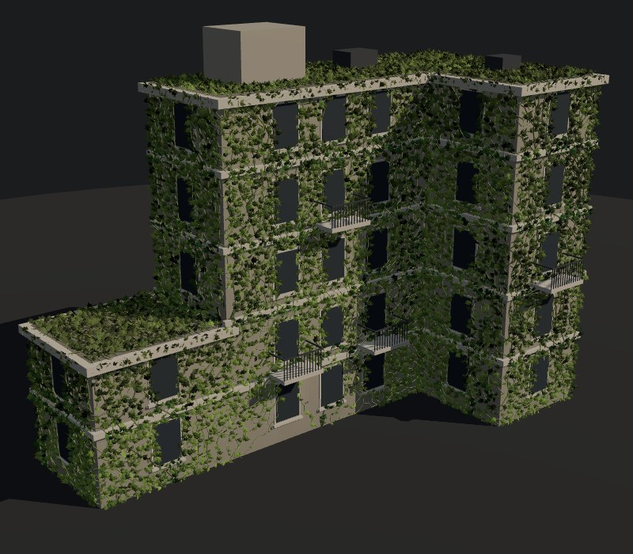
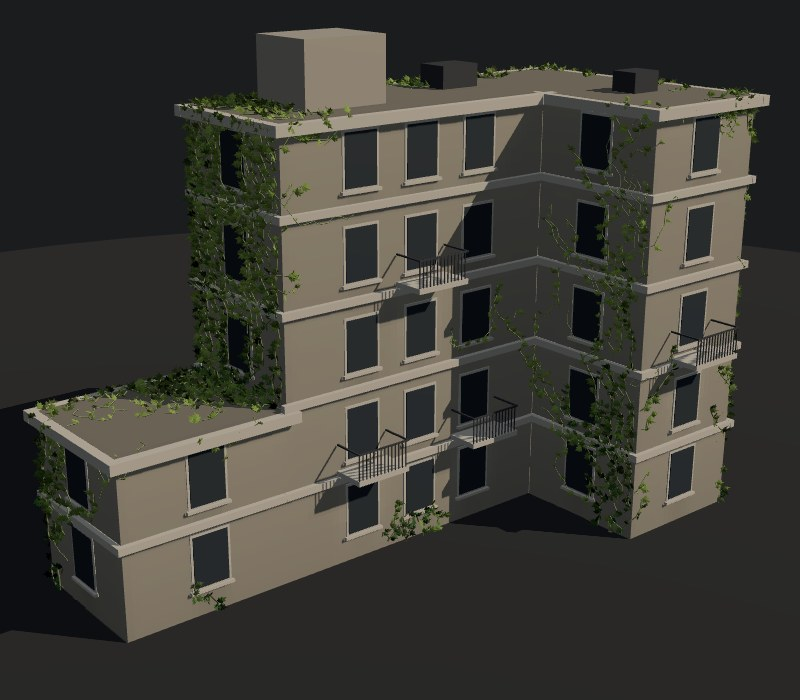
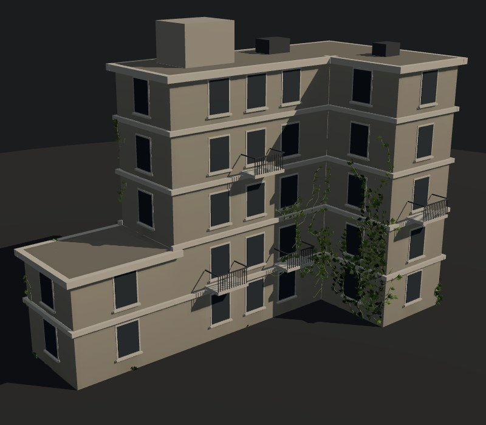
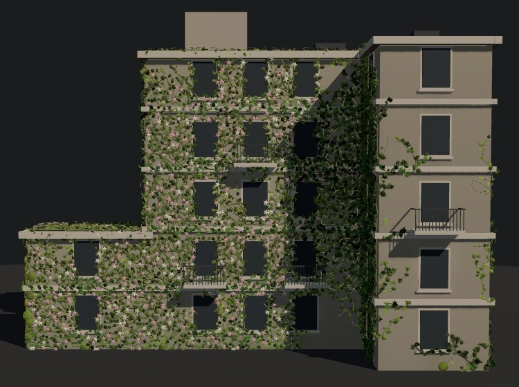
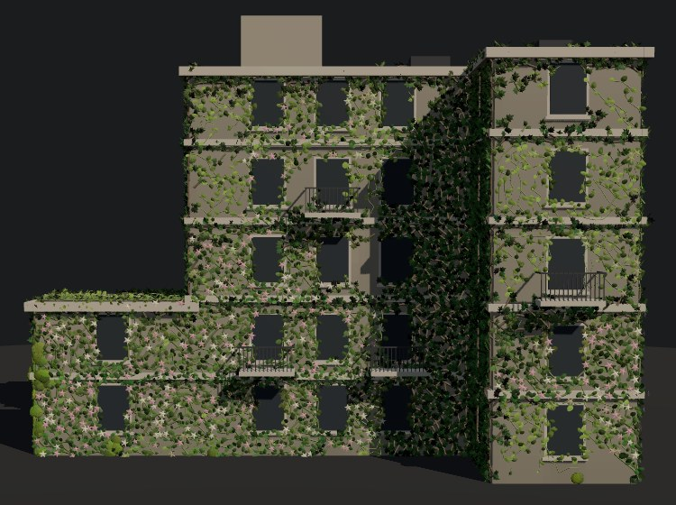
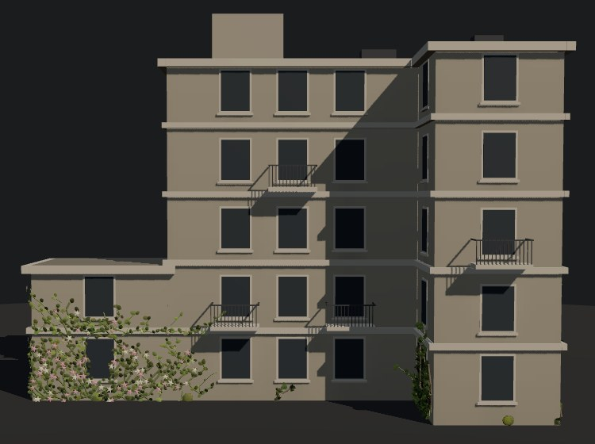
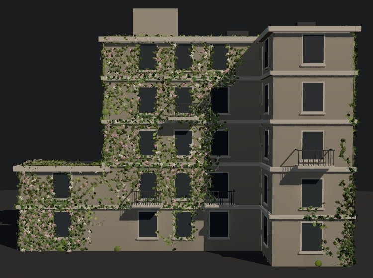

# Green Architecture

Jessica Hsiao · Procedural World Building

The final project: vegetation that grows over a building by itself, steered by
sunlight, moisture and the building's own geometry — three species, ivy, moss
and a flowering vine, competing for the same walls and roofs. This document covers what
the simulation is, how each part works, what the measurements say each rule
contributes, and what the model cannot yet say. The direction was chosen from
the candidates in the [ideas notebook](final-project-ideas.md).


## Contents

- [Concept](#concept)
- [Questions](#questions)
- [Current scope](#current-scope)
- [Surface representation](#surface-representation)
- [Environmental fields](#environmental-fields)
- [Growth algorithm](#growth-algorithm)
- [Species](#species)
- [Rendering](#rendering)
- [Controls](#controls)
- [What each rule contributes](#what-each-rule-contributes)
- [Performance](#performance)
- [Limitations](#limitations)
- [Next experiments](#next-experiments)
- [Notes](#notes)

## Concept

I'm interested in what happens when architecture is not static. Instead of
manually placing plants on a building, I want to explore how vegetation could
gradually grow across it based on the building's shape and its environment.

```
building geometry ─┐
sunlight ──────────┼─→ growth rules ─→ vegetation spreads ─→ the building changes
moisture ──────────┘                    over time
```

The central question: **how do geometry, sunlight and moisture influence where
plants grow?**

## Questions

- How does facade geometry guide vine growth?
- Do edges, corners, ledges and windows change the pattern?
- How do sunlight and moisture change where vegetation survives?
- Can simple local rules create believable organic growth?

## Current scope

One building, one growth system, three fields, three species. The building is
a stylised L-shaped block with a lower wing, simple on purpose: it exists to
give growth something to respond to — walls that face different ways, a
sheltered inside corner, windows, ledges, two flat roofs, and a terrace where a
wall rises from a roof. Not attempted: realistic botany, fluid simulation, more
than one building.

## Surface representation

The building is the original **L-shaped block**, five floors (15 units), with a
**two-floor wing** (6 units) along its west side. Every surface a plant can grow
on — eight runs of outer wall, the main block's wall above the wing, the main
roof and the wing's roof terrace — is cut into 0.25-unit cells: **15,792** in
all, 13,632 on walls and 2,160 on roofs (2,072 of them glass, 182 under rooftop
units).

Each cell knows its position, its outward normal, two directions across its
surface ("across" and "up" — along and up a wall, or +x and −z on a roof) and
**eight neighbours**, found by stepping one cell across the surface in each
direction and taking the nearest cell to where the step lands (within 0.2
units, less than a cell). On a flat wall that is the cell next door; past an
outside corner it is the first cell round it; up off the top of a wall it is
the roof's edge; down off the foot of the wall above the terrace it is the
terrace. No case is written for any of them.

| Choice | Why |
| --- | --- |
| Cells with a neighbour table | The first version unrolled the walls into one strip grid, where neighbours were index arithmetic and a corner was just the next column. A roof cannot be a column of a strip, and the line where a wall stands on a roof is neither a row nor a column. Finding neighbours geometrically handles both — and walls, roofs and every edge between them — with one rule. |
| Still laid out like a strip | Wall cells are created column by column around the outline, so the field texture, the moisture walk and the seeds along the foot of the wall all still read in that order. |
| An L, not a rectangle | A convex box never shades itself. The L's inside corner, at (3, 0), is where the building casts a shadow on its own walls, and that shadow is still the strongest single pattern in the results. |
| A lower wing | It adds a roof terrace at the second floor and a wall rising from it — the one place a wall stands on a roof. |

Checked headlessly: every growable cell is reachable from the ground across the
table; 872 links lead from a wall onto a roof; 25 of 125,547 links are one-way,
all at corners where two cells tie for nearest.

The cells are not built by code that knows this building. `buildBuilding()`
writes a *spec* — wall segments, roofs, rooftop units, the solids that cast
shadows, corners, windows and overhangs — and `assembleBuilding(spec)` turns
any spec into cells, neighbours and flags. The real buildings on the
[Site page](roosevelt-island.md) are another spec, derived from city
footprints by `buildFromFootprints`. Splitting it changed nothing here: the
invented building's cells, its three fields and a 600-step growth run hash
identically before and after. `Growth` was opened up the same way: it reads
the cell size from the building, takes a `scale` that multiplies every
species' seed count and tip cap (1 here; about 16 on the campus, whose walls
are sixteen times as long), can `plant` a single seed by hand, takes a
`vigour` that scales every chance to grow (1 here; less in a campus winter),
and has a `dieBack` this building doesn't call. The 600-step hash is unchanged
by all of it.

Each cell carries flags: `GLASS` (a pane — never grown on), `FRAME` (the ring of
wall around a pane), `LEDGE` (the band at each floor line and the cornice),
`SHELTER` (under a balcony, down to 1.5× its depth), `ROOF`, `BLOCKED` (under a
rooftop unit — never grown on) and `EDGE` (a roof's border, a cell against a
rooftop unit, or the foot of the wall above the terrace). Data lives in typed
arrays; none of `building.ts`, `fields.ts` or `growth.ts` imports three.js, so
the simulation runs and is measured in Node exactly as in the browser.

## Environmental fields

Three fields, one number per cell in [0, 1], each computed from the building
and the parameters — never from the growth. Each is a rule short enough to say
in a sentence, so a pattern in the growth can be traced to the sentence that
caused it.

**Sunlight** (`computeSun`). Lambert on each cell's facing (`n · L`, divided by
the cosine of the sun's 38° elevation, so the best-lit wall reads 1 and a flat
roof 0.78), then two kinds of exact shadow ray: against every solid — the main
block, the wing and each rooftop unit — and against the overhangs on the same
wall, which shade a band whose height depends on the sun's angle to that wall.
Sky light adds 0.14 on a wall (less near the inside corner and under balconies)
and 0.2 on a roof. Mean light: walls 0.38, the main roof 0.79, the terrace 0.68
— the main block shades part of it.

**Moisture** (`computeMoisture`). Walk each wall column from the top down,
carrying water: exposed wall catches rain; shelter catches none; **glass sheds
its whole load to the wall below**, which is why the strip under every window
is wetter; **a ledge soaks up much of what reaches it and throws the rest
clear**, so the wall just below a ledge starts drier. Rising damp adds a band
at the foot of walls that stand on the ground. **A roof catches more rain than
a wall** (0.6 against 0.35) and **water collects against whatever stops it**,
so a roof's edge cells and those against a unit get a third more; **the wall
above the terrace drains onto it**. The sun then removes up to 55%, a short
sideways blur stands in for wicking, and `1 − e^(−1.6·m)` saturates it
smoothly. Mean moisture at 50% rain: walls 0.50, the main roof 0.25, the
terrace 0.29 (0.38 at its edges) — sunny, flat roofs dry out.

**Geometry** (`computeGeometry`). Nearness to something a vine can follow:
vertical corners (Gaussian over 0.9 units, inside corners counted fully, outside
ones at 0.75), and window frames, ledges and edges by steps across the
neighbour table — 1 on the feature, 0.5 one step away, nothing at two. Fixed for
the building; computed once.

They combine into two per-cell values per species, and the split is the
model's main claim — **the environment decides whether a plant can live in a
cell; the geometry decides which way it goes**:

```
moistureFactor = smoothstep(0.06·need, need, moisture)
lightFactor    = clamp(1 − 1.1·|sun − lightPreference|, 0.08, 1)
env            = moistureFactor × lightFactor                 survival
suitability    = env × (1 − w + w·geometry),  w = edge pref.  direction
```

`need`, `lightPreference` and `w` belong to the species, so one wall gives
three answers: moss's env is high where ivy's is middling and the vine's is
near zero.

Multiplying rather than adding is deliberate: a bone-dry cell is not rescued by
being bright. A rule switched off contributes a constant 1 (or `w = 0`), so it
stops distinguishing cells without changing anything else.

## Growth algorithm

State: per cell, `birth` (−1 while empty, else the step it was grown into),
`parent` (the cell the vine came from) and `species`; the grown cells in birth
order; and the **tips** — up to 48 for ivy, 16 for moss, 32 for the vine — each
a cell, a species and a 3D growth direction. Directions are real steps between
cell positions, so the same rule works on a wall, a roof and over the edge
between them; `dy` is the height a step gains, in cells, clamped to ±1, so on a
flat roof upward tendency has nothing to act on. One step, for every tip, using
that species' fields and traits (the weights below are ivy's):

1. **Die?** With probability `0.005 + 0.12·(1 − env)²`.
2. **Score** the eight neighbours that are empty and growable:

   ```
   score = 1.4 · suitability
         + 0.6 · upward · dy                     climbing bias
         + 0.3 · (direction · last direction)    keeps a vine straight
         − 0.25 · occupied neighbours            keeps it a vine, not a blob
         − 0.05 if diagonal
         + 1.6 · randomness · (rand − ½)
   ```

3. **Grow** into the best with probability `0.05 + 0.95·suitability²`, and never
   into a cell below 0.1; otherwise stall, with a 10% chance of giving up.
   Having grown, **branch** into the second best with probability
   `0.03 + 0.04·env`.

Then a few grown cells are woken as side shoots (one per 300 grown, accepted
with probability `0.6·env`). New tips only ever start on grown cells, so growth
stays connected — nothing appears out of reach of an existing vine.

**Deterministic.** Seeded mulberry32 streams — one per species places its
seeds, one drives the steps — and tips are visited in array order. Seed
positions use only the seed and the species, so presets are compared from the
same starting points and switching one species off does not move another's.
Verified by running the same seed twice and comparing every cell's `birth`:
identical. In the browser, Reset followed by stepping to 900 grows the same
cell counts the Node harness does — 9,750 for Balanced with all three species,
seed 1.

## Species

Three plants under the same rule. What a species **needs** is adjustable in
Explore; how it **grows** is fixed, because that is what makes it that species.

| | Ivy | Moss | Flowering vine |
| --- | --- | --- | --- |
| Light preference | 35% (shade) | 15% (deep shade) | 80% (sun) |
| Moisture need | 0.5 | 0.85 | 0.3 |
| Edge preference | 45% | 20% | 50% |
| Upward tendency | 50% | 10% | 70% |
| Crowding weight | 0.25 — keeps strands apart | −0.12 — pulls growth into patches | 0.35 |
| Straightness | 0.3 | 0 | 0.4 |
| Branching | 0.03 + 0.04·env | 0.04 + 0.04·env | 0.04 + 0.05·env |
| Tips · seeds | 48 · 8 | 16 · 6 | 32 · 6 |
| Drawn as | lobed leaves on stems | flat clumps, no stems | oval leaves on stems, flowers |

**Ivy is the original single plant.** Its traits are the old constants. When
species were added, ivy alone grew the same cells as before, checked by hashing
every cell's birth step for fifteen runs — five rule combinations × three seeds
— before and after. The roof and wing then changed the building, so there is no
old run left to match; the experiments below are ivy alone on the current
building.

**Competition is for space only.** A cell belongs to whichever species reaches
it first; there is no displacement.


Under Balanced at step 900 (mean of ten seeds; 61.6% of the building covered,
32.2% of the roofs):

| Species | Share of building | Moisture × | Sun × | Mean height | On roofs |
| --- | --- | --- | --- | --- | --- |
| Ivy | 24.4% | 1.20 | 0.47 | 7.3 | 2.8% of its cells |
| Moss | 13.2% | 1.34 | 0.33 | 3.1 | 0.4% |
| Flowering vine | 23.9% | 0.92 | 1.55 | 7.1 | 14.6% |

And by surface — the share of each one that each species holds:

| Surface | Ivy | Moss | Vine |
| --- | --- | --- | --- |
| Main front (faces the sun) | 7% | 7% | 35% |
| Wing front (faces the sun) | 3% | 1% | 52% |
| East wing's front (faces the sun) | 2% | 0% | 54% |
| East (partly lit) | 14% | 1% | 52% |
| Inside corner's side face | 23% | 26% | 3% |
| Back (faces away) | 61% | 24% | 0% |
| Wing back (faces away) | 29% | 54% | 0% |
| Wing west (faces away) | 24% | 59% | 3% |
| Wall above the terrace | 49% | 8% | 3% |
| Terrace (wing roof) | 11% | 2% | 31% |
| Main roof | 4% | 0% | 24% |

Nothing places these territories. The vine holds about half of every wall
facing the sun and a quarter or more of each roof, and almost none of the walls
facing away; moss takes the wing's shaded walls; the wall above the terrace,
facing away from the sun, goes to ivy. Which species wins a given surface still
varies widely by seed (the vine's share ranges 40 points across ten seeds) —
first arrival decides a cell — so one run is one possible building.

## Rendering

Simulation decides *where*; rendering decides *how it looks*.

- **Building**: the shell is one quad per wall segment and one polygon per
  roof, with UVs laid so that each cell lands on its own texel of one shared
  256 × 100 field texture; walls and roofs differ only by vertex colour.
  Windows, frames, sills, ledges, cornices, balconies and rooftop units are
  merged boxes in vertex colour — one draw call. In Final the texture darkens
  damp surfaces by up to 22%.
- **Rooftop units**: the tall one is a stair housing, with a framed door
  toward the Front camera, a light over it, a cap and a louvred vent on the
  west side; the two low ones are air-handling units, galvanised boxes on a
  concrete pad with louvres down every side and fans in the top. They began as
  plain boxes, and a plain box on a roof read as nothing in particular — the
  first question about them was what they were. Hovering one in Explore names
  it and says why nothing grows on it.
- **Vegetation**: five instanced meshes at any size — stems for the two
  climbers (parent → cell), one leaf mesh per species, and the vine's flowers.
  Every instance carries its birth step; a uniform holds the current step with
  a fractional part, and the vertex shader turns the difference into size. A
  simulation step therefore only *appends* instances, and only the new range is
  uploaded. A cell's leaves are born at staggered times (ivy 2, 30 and 80 steps
  after it), which is the whole of "older growth is denser"; a quarter of vine
  cells flower, 70 steps after they grow.
- **Shades of green**, coarse to fine: the species' own young, lush and dry
  colours; age, from young to mature over 160 steps; the cell's moisture, which
  pulls the mature colour toward olive; and a per-leaf nudge of up to ±0.025 in
  hue, ±0.1 in saturation and ±0.07 in lightness, plus ±20% in width.
- **Debug views** swap the shell to an unlit material showing one field through
  a three-stop ramp, hide the panes and leaves, and keep the stems, so growth
  reads against the field under it.

## Controls

| Group | Control | What it does |
| --- | --- | --- |
| Growth | Play / Pause, Step, Reset; 1× / 4× / 16× | The page opens paused, on the seeds; a preset plays from them. 1× is 8 steps a second; 16× is 128. Reset replants the same seeds. Play pauses itself once nothing has grown for 600 steps |
| Presets | Balanced, Wet + shaded, Dry + sunny, Architecture-driven | Set parameters, switch all species on and replant — never a hand-authored layout |
| Environment | Rain, Sun direction | Change the moisture and sunlight fields |
| Species | On/off for ivy, moss, flowering vine; select one to edit its Light preference, Moisture need, Edge preference, Upward tendency | Who is growing, and what the selected species needs. Switching a species on or off replants |
| Model | Randomness; Moisture, Sunlight, Geometry switches | Randomness for every species; switch a whole term off |
| View | Final / Species / Moisture / Sunlight / Suitability / Geometry; Front / Corner; Show leaves | Display only — the growth is unchanged. Suitability is the selected species' |
| Camera | Drag to move; right-drag, or ⌘/Ctrl/Shift-drag, to orbit; scroll to zoom | Map-style, as on the Site page: the building is a place to move around, and on a trackpad right-drag is the awkward gesture. Panning stays on the ground and can't leave the building behind |

Changing a parameter mid-run recomputes the fields and carries on — the growth
continues under the new conditions — so a change can be watched taking effect.
Only Reset, a preset or a new seed restarts.

## What each rule contributes

Measured by the Node harness on the same code the browser runs. "×" is a
field's mean over grown cells divided by its mean over every growable cell: 1
means growth ignored the field. Ivy alone at the Balanced settings, one rule at
a time; seed 1 is the figure (from the Corner view), the ten-seed values are
means.

| | Rules on | Step 300, seed 1 | Step 300, 10 seeds | Step 900, 10 seeds |
| --- | --- | --- | --- | --- |
| 1 | none | 93.5% covered | ×1.00 everywhere | 100% |
| 2 | moisture | 73.1%; moisture ×1.10, sun ×0.79 | moisture ×1.10 | 91.2% |
| 3 | sunlight | 43.6%; sun ×0.60 | sun ×0.57 | 79.7% |
| 4 | geometry | 60.3%; geometry ×1.21 | geometry ×1.19 | 99.9% |
| 5 | all three | 15.7%; moisture ×1.29, sun ×0.36, geometry ×1.28 | ×1.26, ×0.48, ×1.25 | 46.5% |

| | | |
| --- | --- | --- |
|  |  |  |
| 1 — no rules: an even race over walls and roofs | 3 — sunlight only: ivy fills the inside corner's shadow | 5 — combined: a few strands, on the shaded, damp, featured cells |

What the numbers say:

- **Sunlight is still the strongest single rule**: the L's shadow, the walls
  facing away and now the bright roofs make the light field the most uneven.
- **Moisture alone now matters.** On the walls-only building it barely changed
  anything at 50% rain (moisture ×1.02). The flat roofs are the driest cells
  and also the sunniest, so moisture alone keeps ivy off them — which is also
  why its growth is 0.79× as lit.
- **Geometry rose from ×1.07 to ×1.21**, because the roofs are mostly plain
  surface with features only at their edges, so features now stand out.
- **The rules multiply**, so combined growth is far more selective than any one
  alone: alone they reach 80–100% by step 900; all three together, 46.5%.

The presets at step 900, seed 1, all three species (ten-seed totals in
brackets):

| Preset | Total | Ivy | Moss | Vine |
| --- | --- | --- | --- | --- |
| Balanced | 72.0% (61.6%) | 35.4% | 10.4% | 26.2% |
| Wet + shaded | 83.5% (81.4%) | 42.6% | 15.0% | 25.9% |
| Dry + sunny | 10.5% (10.0%) | 4.1% | 0.7% | 5.7% |
| Architecture-driven | 46.7% (45.5%) | 8.7% | 18.3% | 19.7% |

| | | | |
| --- | --- | --- | --- |
|  |  |  |  |
| Balanced | Wet + shaded | Dry + sunny | Architecture-driven |

## Performance

Measured in Node 22 on the development machine, warmed up:

| | |
| --- | --- |
| Building the cells and neighbour table (once, at load) | about 60 ms (110–120 ms before the bucket grid) |
| One growth step, three species | 10.6 µs while growing, 5 µs once it slows; the browser readout agrees (0.015 ms) |
| At 16× (128 steps/s) | under 1.5 ms of simulation per second |
| Sunlight field (on a sun-direction change) | 4.8 ms, including every shadow ray against five solids |
| Moisture field | 0.38 ms |
| Geometry field (once) | 0.19 ms |
| Combining after a slider move | 0.34 ms for three species |
| A mature building (Balanced, 3,000 steps) | 13,524 cells, 35,724 leaf and flower instances, five draw calls |

### Where the energy goes

The simulation is not where the cost is; drawing is. Measured the way
[Energy and idle cost](../analysis/energy-and-idle-cost.md) measures the
Playground — every WebGL draw call wrapped, counting draws and vertices and
which target they went to — on Explore, Balanced:

| State | GPU work |
| --- | --- |
| Paused, untouched | none — 0 draws a second |
| After Play pauses itself | none |
| Paused, pointer moving | one frame per pointer move, like every viewport in the app |
| Playing | 30 frames a second, 8 draws each |

What one mature frame (step 3,000) asked of the GPU, before and after the
three changes below:

| | Before | After |
| --- | --- | --- |
| Draws per frame | 8 + 2 shadow-map draws | 8 |
| Vertices per frame | 2.81 million (+12 thousand into the shadow map) | 1.99 million (−29%) |
| Frames per second while playing | up to 60 | at most 30 |
| Shadow-map redraws | every frame | once per sun-direction change |

Together, at the frame caps, vertex work while playing falls from about 169
million vertices a second (2.81 M × 60) to about 60 million (1.99 M × 30) —
35% of what it was — and there is no shadow pass at all between sun changes. What a mature frame's vertices
were, before: moss clumps 1.09 M (39%, for 13% of the cells), vine leaves 0.70
M, ivy leaves 0.60 M, stems 0.36 M, flowers 0.05 M, the building 0.01 M.

- **Moss clumps at icosahedron detail 0** (20 faces, 60 vertices) instead of 1
  (80 faces, 240). Squashed to a third of their depth and flat-shaded they
  still read as clumps; checked by screenshot.
- **The shadow map is drawn on demand.** Only the building casts shadows — the
  plants cannot — and it never moves, so the map is redrawn only when the sun
  direction changes: two draws once, instead of two draws and a full 2048²
  depth pass every frame.
- **Play draws at 30 frames a second.** Growth is paced in steps per second,
  so halving the frame rate halves the drawing without slowing it: checked
  against a simulated display, at 4× it is 32 steps a second at 30 fps and at
  60, on a 60 Hz or a 120 Hz screen. Paused, the cap goes back to 60, so
  orbiting a still building stays fluid; orbiting while it plays is a little
  less so.

These are draw counts, not watts. Headless Chrome here renders WebGL in
software (SwiftShader) at about one frame a second for this scene, which says
nothing about a GPU; a real power figure needs macOS's `powermetrics` on real
hardware. The sidebar's readout shows frames per second, step cost, leaf count
and field cost live, on whatever machine it runs on. Steps per frame are capped
at 24, so a slow frame cannot turn into a burst, and Play stops itself once
growth has.

## Limitations

- **Given time, almost everything fills.** Growth is only ever added. Ivy alone
  at the Balanced settings covers 54% by step 900 and 78% by step 3,000; with
  all three species, Balanced reached 100% on two seeds of three by about step
  5,500, and Dry + sunny was at 60–78% after 20,000 steps and still growing. The
  rules decide the *order* surfaces are covered in and which species takes
  them, not the end state. The figures are a moment in a season, not an
  equilibrium.
- **The plants do not change the environment.** A real vine shades the wall
  under it and holds water; here the fields are fixed.
- **Walls and flat roofs only.** Nothing grows on balcony undersides, in planters
  or on the rooftop units, and nothing hangs down from a ledge. The units stay
  bare because they are not surfaces the model has cells on, not because of a
  rule about plants: in reality a vine would happily climb the stair housing,
  though the air-handling units would be kept clear for airflow and servicing.
  Making the housing growable is a small change to the spec, but it would move
  every measured number on this page.
- **One building, one season.** Three species, competing only for space: none
  displaces another, and first arrival decides a cell.
- **Leaf colour is fixed at birth.** A leaf grown in the dry keeps its olive tint
  if the rain is raised afterwards.

## Next experiments

1. **Die-back here too.** It is built — `Growth.dieBack`, with roots that
   survive and stems that take what is above them — and runs on the Cornell
   Tech campus through a simulated year, where over ten years it moved the
   share of grown wall held by the species suited to it from 73% to 85–89%
   ([Roosevelt Island](roosevelt-island.md#seasons-and-die-back)). This
   building doesn't use it yet: it would change every measured number above.
2. **Feedback.** Feed growth back into the fields: vines shade the wall under
   them and hold moisture against it.
3. **Hanging growth.** Seed planters on the balconies and give those tips a
   downward bias.

## Notes

**The first growth rule let the environment decide how fast, never where.**
Entering a cell had probability `0.3 + 0.7·env`. Balanced filled 94.2% of the
wall by step 600 (Wet 90.9%, Architecture-driven 95.1%), and the cells it grew
into had the facade's average moisture, light and geometry to two decimal
places — under Balanced the environment made no spatial difference at all. The cause: a tip
that fails retries, so any non-zero chance of entering is eventually a
certainty. The fix was three changes together — gate on suitability squared,
refuse cells below 0.1, and let a stalled tip give up 10% of the time — after
which grown cells under Wet + shaded receive 0.41× the facade's light at step
300.

**Edge preference 100% killed seeds.** At 1.0, plain wall scores zero, so a seed
that is not beside a corner can never leave the ground: with ivy alone on the
original building, on seed 3 nothing grew at all, and across ten seeds coverage
at step 900 ranged 0–28%. At 0.9, all ten grew. With three species competing,
0.9 wiped a species out in 9 of 30 runs — moss or the vine, which have six seeds
to ivy's eight — and 0.8 in none. With the wing and roofs added, 0.8 lost a
species in 3 of 30 and 0.7 in none (×1.23 toward features). The counts are small
and noisy — 0.6 lost 2 of 30 — so the Architecture-driven preset's 0.7 is a
setting that held, not a threshold.

**Only thirsty plants are held to the foot of the wall.** With ivy alone under
the original Dry settings, every grown cell was below 3 units. Under the
three-species Dry + sunny preset, moss never rises above 2.25 units and ivy
keeps 80% of its cells on the ground floor — the rising-damp term is the only
water left, and it is a band at the base — while the vine, needing a third as
much water, climbs to 5.25–8.25 units. None of it is a rule; it falls out of
moisture need meeting one field.

**Moss had to be held back.** The first moss branched at 0.12 + 0.1·env and
carried 32 tips. Under Balanced on the original building it took 43.5% of the
wall and pushed ivy down to 11.9%. With 0.04 + 0.04·env, 16 tips and a moisture
need of 0.85 rather than 0.75, it settled at 13.0%, on the wettest and darkest
cells. On the current building it holds 13.2%.

**The flowers were in the scene and invisible.** At first 0.10–0.15 units across:
four to six pixels from the default camera, where a unit is about 43 px, among
leaves twice that size. Typecheck, lint and build were clean; a screenshot
showed it. They are 0.26–0.36 across now.

**An upload range was being thrown away.** Each sync cleared the instance
buffers' update ranges before adding its own, so two syncs before one frame —
Reset, then a step — uploaded only the second, and the seeds' first instances
could be lost. three.js clears the ranges itself after uploading; the renderer
now only adds them.

**Play never stopped.** Some tip is always alive — side shoots revive growth
from what already exists — so after the last new cell Play went on stepping and
redrawing the scene every frame for nothing; Balanced grew its last cell at
step 5,489 and would have run forever. It now pauses after 600 steps without a
new cell. Chosen against twelve runs of 20,000 steps (four presets, three
seeds): it paused in eight, seven of which had already grown 99.9% or more of
their final cells and the worst 97.9% (Wet + shaded, seed 3, where a late
patch grew after step 6,000). A rate test — pause when fewer than 5, 10 or 20
cells grow in 1,000 steps — paused in the same eight runs at much the same
points (the 20-cell version also paused one Balanced seed near step 19,800), so
the simpler rule stayed. The four runs that never pause are still growing:
all three Dry + sunny seeds add more than twenty cells per thousand steps after
20,000.

**The neighbour table cost 278 ms of page load.** String keys in its spatial
lookup; integer keys made it 119 ms, cold. Replacing the Map of buckets with a
dense grid in typed arrays (a head index per bucket, a next index per cell)
halved it again, to about 60 ms warmed up, and the cells, fields and a 600-step
growth run hash the same as before. The sunlight field went from 0.2 ms
to 33 ms when it began testing every overhang on the building for every wall
cell; grouping overhangs by wall brought it to 4.8 ms. Both changes were checked
to give identical cells.

**A light line flickered in the L's inside corner.** Two defects, both in the
rendering, not the model. First, every ledge and cornice ran a little past
both ends of its wall so that two would meet at an outside corner; at the
inside corner those extensions crossed, and the cornice's stub lay on the roof
at exactly roof height — coincident faces the depth test can't order. Trim now
extends only at outside corners, and at an inside corner the wall that ends
stops short by the trim's depth, so one piece fills the corner. Second, a
dashed light strip ran down the corner and along the ledges in shadow. Setting
the normal bias to zero left it; it came from three.js drawing only back faces
of one-sided materials into the shadow map, which leaves a hairline
unshadowed where an open wall meets another. The walls and details now cast
from their front faces, with no acne in the Front, Corner or a grazing view.
A still camera gave identical frames either way, so the flicker came from
things changing around the strip: the camera settling, and growth appearing
beside it.

**The geometry field was too uniform at first.** With a 3-cell falloff its mean
over the facade was 0.67 — a window every 2.5 units and a ledge every 3 put
almost every cell near something — so it could not tell cells apart. A 2-cell
falloff brought the mean to 0.58 and made features stand out (on the original
building).

**The leaf shader cannot cast shadows.** The depth pass would not run the age
scaling, and would draw every stem at its unscaled one-unit radius; neither
stems nor leaves cast shadows.

**Figures are reproducible.** Explore exposes `window.__greenAdvanceTo(n)` in
development builds only, so a capture is taken at an exact step rather than
"about nine seconds in". Every figure here and on the Progress page states its
seed and step, and its numbers were checked against the Node harness.
