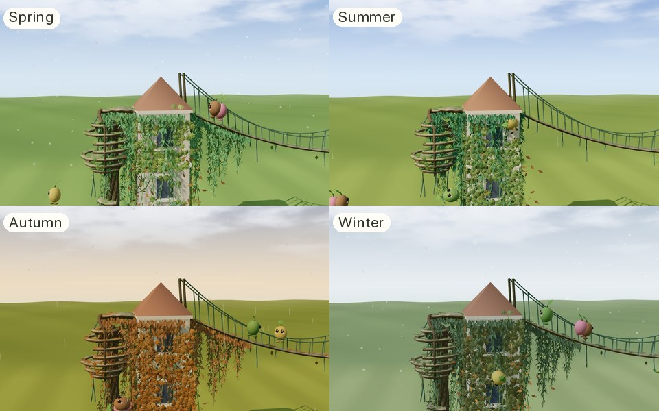
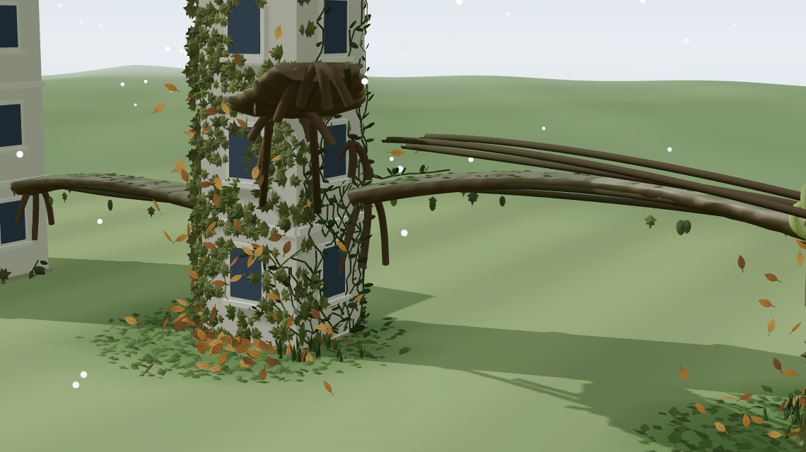

# Play

Jessica Hsiao · Procedural World Building

*Wildform, the game: the same simulation as the Lab, full-screen, with a HUD
instead of a sidebar and a playful voice instead of an event log.*

**Project → Play** is the front door: the premise in a line — *Two buildings
that won't talk to each other. Time to send in the plants.* — **Play**,
**Continue a saved world**, three steps of how to play, and a way to the Lab.
**Play** opens the game full-screen at `/play`, with none of the site's
navigation.

## Contents

- [Game and Lab](#game-and-lab)
- [The screen](#the-screen)
- [The opening](#the-opening)
- [The voice](#the-voice)
- [Weather](#weather)
- [Seasons](#seasons)
- [What the seasons look like](#what-the-seasons-look-like)
- [The win](#the-win)
- [Seeds planted](#seeds-planted)
- [Inhabitants](#inhabitants)
- [Leaving with unsaved changes](#leaving-with-unsaved-changes)
- [Type](#type)
- [Code](#code)
- [Limitations](#limitations)

## Game and Lab

The old Build page stays, renamed **Lab** in the tabs: the same game with every
control and number showing, for critiques and for taking it apart. (Its route
id is still `build`, so links and these docs hold; [Build](build.md) documents
the system both share.) The game is a new presentation over the same
`BuildGame` and `BuildViewport`; the simulation is untouched.

## The screen

- **Top centre — the objective**, always: *Get these two buildings holding
  hands*, and four steps lighting up as they happen: Plant → Sprout (a node
  forms) → Grow up (a structure matures) → Hold hands (west and east joined).
- **Bottom — the toolbar:** Build, Remove, blocks left (red at three or fewer),
  then Climber ↑, Spreader ↔, Draper ↓ in their own colours, seeds planted,
  then play/pause and a speed button that cycles 1×, 4× and 16×.
- **Top right — the world:** Save and the Worlds menu, the Lab's world bar
  re-dressed.
- **Top left — ← Wildform** to leave; it asks first if there are unsaved
  changes.

## The opening

On a first visit, a coach card walks through four beats. Each waits for the
player to do it, and checks the game's own state rather than a timer:

| Beat | Says | Done when |
| --- | --- | --- |
| Mind the gap | Plants can stretch about five columns. These buildings are eight apart. Give them a stepping stone. | a block is placed |
| Plant a pair | Plant a Climber on a wall facing the gap, then a Spreader right beside it. | both species are growing |
| Let them grow | Hit play and let them get to know each other. | growth is running |
| Wait for it… | Where they meet and pile up, something will grow. | a structure has formed |

*I've got this* skips it. Finishing or skipping is remembered per browser, and
reaching the goal ends it whatever beat it was on.

## The voice

The plants have personalities: the Climber is fearless, the Spreader wants
everything, the Draper is dramatic. Lines rise above the toolbar, three at most,
and fade.

Every line answers an event the game already logs — the Lab's plain event
list — through `narrator.ts`, so the voice can't claim anything that didn't
happen. A loaded world says nothing about its history. Examples:

| Logged | Said |
| --- | --- |
| Climber reached floor 2 | Floor 2! The Climber is not afraid of heights. |
| Spreader planted | Spreader planted. It wants to go everywhere. |
| Climber and Spreader began to overlap | They've met. It's getting crowded in here. |
| Mutation node: Climber + Spreader, floor 2 | Uh oh. Something's happening on floor 2… |
| Bridge growing toward another building | A Bridge is reaching for the other building! |
| Bridge matured · shades 14 cells | Bridge complete! Sturdy, leafy, slightly lopsided. |
| A veil forms: Draper over Climber | Draper over Climber: curtains. Very dramatic. |

It also speaks at 10, 3 and 0 blocks left, and when blocks join the two
buildings into one: *Nice try! Gluing them together with blocks doesn't count.*

## Weather

The game has no weather controls: the weather comes from the
[seasons](#seasons). Measured on the stepping-stone run, the sliders changed the simulation a
great deal — at 5% rain nothing grew past 2.8% coverage; at the default sun the
goal came at step 700, at four other sun directions not at all; a dry spell at
step 600 cut 1,713 plant layers to 164 — but almost none of it reached the
player: rain had no visual, a change took hundreds of steps to show, nearly
every move away from the default only made the goal harder, and nothing in the
goal asked for it. So the sliders stay in the Lab, and in the game the
conditions show up in the voice, when something is planted. (A tint on every
surface while a plant was picked was tried and taken out: not wanted in the
game. The Lab keeps it while weather changes.) Weather that changes on its own
— a forecast, a chapter's climate — came next: [Seasons](#seasons).

When a Climber or Spreader is planted, the voice rates the spot from the same
fields, naming the worse of light and water: *Spreader planted in the sun. It
wants to go everywhere.* · *Spreader on a shady wall… it'll sulk.* · *Climber
in full sun. It'd rather have a bit of shade.* · *Spreader planted somewhere
dry. It's thirsty.* — and *It won't spread from here* under 0.1.

## Seasons

The year turns on its own in the game: four seasons of 500 steps, each
setting the real rain, sun direction and a warmth the simulation grows by
(`seasons.ts`). They follow from the step alone, so a saved world comes back
in its season with nothing extra saved; a change of season is not an unsaved
change.

| Season | Rain | Sun | Warmth | Says |
| --- | --- | --- | --- | --- |
| 🌱 Spring | 0.55 | −58° | 1 | *Spring! Everything's waking up.* |
| ☀️ Summer | 0.45 | −58° | 1 | *A bit drier out. The Climber notices first.* |
| 🍂 Autumn | 0.72 | −62° | 0.8 | *Autumn rains. Climbers, rejoice.* |
| ❄️ Winter | 0.50 | −70° | 0.15 | *Winter's here. Everyone's huddling.* |

Sixty steps before each change the voice warns of it (*Winter's coming. Grow
while you can!*).

**Changes are gradual.** Each change of season blends over 150 steps centred
on the boundary — rain, sun direction and warmth easing together — applied
every five steps as growth advances (a field update costs about 2.6 ms), with
the scene's sun following. A switch at the boundary moved the sun a dozen
degrees in one frame. Over twenty seeds, easing kept the goal rate (6 of 20,
as switched) and softened winter's toll from 42% of the plants to 31%. (A test
that accidentally ran every season half-blended reached the goal in 10 of 20:
a milder year is an easier one — a dial for difficulty later.)

**Warmth** is the one new rule. Wildform had no temperature, so cold is a new
option on the growth model: below 1, each tip idles a step with probability
1 − warmth, and side shoots scale with it. At 1 — Explore, the Lab and the
Site — nothing is drawn for it and runs are identical (Explore's Midterm Demo
hash unchanged, platform at step 870; the Lab's three test games unchanged).

**Tuned by goal rate, not a single run.** Whether bridges form is sensitive to
small differences — a spring of 0.6 rain instead of 0.55 sent seed 1 down a
different path from step 0 — so each tuning played the stepping-stone run on
ten world seeds for 3,600 steps:

| Tuning | Goals reached (of 10) | Winter's toll |
| --- | --- | --- |
| No seasons | 4 (median step 840) | — |
| Harsh from summer on (400-step seasons) | 1 | 5% |
| Gentle all year | 3 | none (plants grew 3%) |
| **Chosen**: 500-step seasons, harsh only in winter | **4 (median 840)** | **a third of the plants on average** |

Spring is the lawn's default weather, so the first season plays as the game
did before, and winter comes after most goals form. On seed 1 a year ran: goal
at step 700 as before; winter cut 3,941 plant layers to 2,198; the next spring
grew them back to 3,812. The sun stays near −58°: four of five other
directions lost the goal outright, and the model's sun has one elevation, so a
season can't bring more sun, only light from a little further round.

**The badge**, top left: the season and year, the rain (🏜️ Dry · 🌤️ Dryish ·
💧 Damp · 🌧️ Rainy) and where the sun comes from, all the real values, and the
next season's countdown.

**Moods**, on each plant's button: how it feels about the conditions now. The
score is the growth's own fit — for Climber and Spreader the mean env over
every growable wall; for the Draper its mean vigour — compared with that
plant's normal, its score on the lawn in spring (0.64, 0.50, 0.54). The scores
move only a little through the year (Climber 0.62–0.66, Spreader 0.42–0.50,
Draper 0.52–0.55), so a fixed scale would never change; against its own
normal a plant reads 😄 from +2%, 🙂 within −3%, 😐 to −12%, 😟 below. In
winter's cold everyone is 🥶. Measured in the browser: spring 🙂🙂🙂, summer
😐🙂🙂, autumn 😄😐😐, winter 🥶🥶🥶 — the Climber loving autumn, as the
season's line says.

## What the seasons look like

*One world through its first year, captured from the game: spring (step 468),
summer (881), autumn (1,383), winter (1,617).*

The weather changed the growth but, apart from the sun's direction, nothing
you could see. Now the scene follows the season too (`seasonLook.ts`, drawn
by `src/build/seasonFx.ts`), blended by the same 150-step ease as the
weather, so it turns as gradually:

- **Leaves** on the walls, the ground cover, the Drapers and living
  structures are pulled toward the season's colour at their own brightness:
  fresh light green in spring, deep green in summer, orange in autumn (62% of
  the way), a dull brown-green in winter. Stems stay as they are. The tint is
  patched onto each leaf material the game draws, after the leaf's own aging,
  so a young tip is still young-green first.
- **The lawn, the sky and the light.** Summer: a deeper sky, warmer and
  stronger sun (2.9 against 2.6), a drier lawn. Autumn: a golden lawn, a warm
  horizon, lower light (2.3). Winter: a pale frosty lawn, a pale grey-blue
  sky and haze, soft cool light (1.8). A colour multiply can't grey the
  grass, so winter's lawn lifts red and blue more than green.
- **Weather in the air.** Rain follows the real rain value — none at 0.4 or
  below, every drop (900) at 0.8 — so autumn's 0.72 pours and summer's 0.45
  barely spits; in winter the same rain falls as snow. Autumn also has
  falling leaves, spring a few petals.
- **Winter's toll, visible.** When a plant layer withers, brown leaves drop
  from that spot on the wall, lie on the lawn a moment, and fade.

  

  They were round brown dots at first, which read as nothing in particular.
  Each leaf is now drawn as one: a pointed oval on a short stalk, widest
  below the middle, with a midrib, faint side veins, a darker rim and
  shading toward the stem. Falling, each turns and tumbles at its own rate —
  squeezed across as if seen edge-on — so it flutters rather than slides; it
  lands open. Autumn's falling leaves share the shape; spring's petals are
  rounded and notched. They're still single points, one per leaf, with
  the shape drawn in the fragment shader — no new geometry. The growth
  now keeps a list of the cells where layers withered (`drainWithered`);
  nothing else changed in it — Explore's Midterm Demo hash and the Lab's test
  games are unchanged. A cold snap can wither hundreds of cells in one
  stretch, so about 30 per stretch are shown.

Withering isn't only winter's. Counting the withered layers in the run above,
season by season: year 1 — spring 28, summer 406, autumn 691, winter 1,825;
year 2 — 374, 1,004, 555, 1,984. Winter drops the most, but crowded and
starved plants were always dying back through the year; the brown leaves now
show it, so a few fall in summer too.

The weather moves only while time does: paused, the flakes hold still like
the plants. The Lab keeps its one clear day — it doesn't ask for the seasons'
look.

## The win

When west and east are joined, the game pauses and a card says **They're
holding hands!** — *You used just 3 of 30 blocks. The plants did the rest.* —
with **Keep growing** or **Try a fresh lawn**.

## Seeds planted

Next to the plants, the toolbar counts the seeds the player has planted — the
blocks readout's twin, *9 seeds*. Tapping it opens the breakdown: Climber,
Spreader, Draper, each in its colour. The win card says how much the player
intervened, not a score: *3 blocks used · 9 seeds planted · Year 1, Summer*,
then *The plants did the rest.*

It is the Lab's count, kept on the game itself: only a planting that succeeds
counts, never growth, spreading or mutations (how, and how older saves are
handled, in [build.md](build.md#seeds-planted)). A world saved before seeds
were counted shows *3+* — the ones planted since it was opened — and the
breakdown says so. At phone width the breakdown opens leftward, inside the
screen.

## Inhabitants

Small creatures live on the green in the game: they walk only where plants
grow or on mature living architecture, arrive as it spreads (one for every 120
walkable cells, up to six), and go and see a structure when one joins the
ground they can reach. **Show Inhabitants**, at the foot of the Worlds menu,
hides them without stopping them; it's a display preference, so it never
marks a world unsaved. See [Inhabitants](inhabitants.md).

## Leaving with unsaved changes

Leaving the game — the ← chip or the browser's Back — or starting a fresh
lawn, with unsaved changes, opens a warning in the game's own look: **Leave
without saving?**, what would be lost (the player's changes, or growth since
the save), and **Keep playing** (the default, and Esc), **Save and leave**,
**Leave without saving**. An unnamed world can be named right there; signed
out, it offers **Sign in with Google to save it**, since the game has no site
bar to sign in from. "Unsaved" is the world menu's own rule — any change of
the player's, or 200 steps of growth — so the dot and the warning agree.

It fixed two things. Back left the game with no warning at all: the game now
keeps a guard entry on the history, and Back with something to lose puts it
back and asks. And at phone width, where the game hides the world menu, the
menu's own confirmation opened invisibly inside it — a modal nobody could
see, which made the page inert, so a phone player who tapped ← with unsaved
changes was stuck. Checked in the browser at 1440 and 390 wide: clean worlds
leave at once by chip and by Back; with changes, both warn, Keep playing and
Esc stay, Back again warns again, Leave without saving leaves, and Save and
leave refuses an empty name, then saves (to the dev store) and leaves. Closing
the tab still gets the browser's own prompt.

## Type

Everything the game says — title, objective, coach, voice, the win — is in
Fredoka, a rounded display face (Google Fonts, weights 500 and 600). Controls
stay in the app's sans. The panels are pale and rounded, floating on the
scene, unlike the site's dark chrome.

## Code

`src/game/`:

| File | What it holds |
| --- | --- |
| `GamePage.tsx` | The full-screen game: HUD, the opening, the voice, the win |
| `narrator.ts` | Logged events to playful lines; block warnings; planting verdicts |
| `seasons.ts` | The four seasons, the badge's words, moods |
| `seasonLook.ts` | What each season looks like, blended by step |
| `UnsavedDialog.tsx` | The warning before unsaved work is lost: leave, save and leave, or sign in to save |
| `PlayPage.tsx` | The front door in the Project tabs |
| `game.css` | Both, in the game's look |

`routes.ts` gains a third kind of route, the game at `/play`, which `App`
renders with no header. `BuildViewport` takes an optional `look`, which the
game passes and the Lab doesn't; `src/build/seasonFx.ts` draws it. The world menu gained two small options: open with My
worlds showing (for *Continue*), and a `startNew` the win card calls. Its
session also tells the game what is unsaved, whether saving is possible, and
can save without its own dialog — for the leave warning.

## Limitations

- **At phone width** the opening's coach and the world menu are hidden, so a
  first-time player on a phone gets the objective and toolbar but no guided
  opening, and can save only from the leave warning.
- **Signing in from the leave warning wasn't run headless** — Google's popup
  can't be driven there. Its code path is the site bar's own
  `signInWithGoogle`.
- **The world menu's Save, signed out, still says "Sign in (top right)"**, which
  in the game points at the menu itself.
- **In-scene labels** (*Mutation node*, a planting's surface rating) keep the
  Lab's plain wording.
- **Moods use the lawn's normal.** A very different town would shift each
  plant's average fit, and the faces with it.
- **One challenge**: the lawn. Chapters with their own environments and
  ratings are the next step.
- Checked in the browser with real clicks for the toolbar and play, and through
  the game's API for the growing: every beat of the opening advanced on its
  own, the voice spoke from real events, and the win card appeared at step 750
  of the stepping-stone run with 3 of 30 blocks.
