# Roosevelt Island

Jessica Hsiao · Procedural World Building

The real site the growth model is moving onto: Roosevelt Island and the Cornell
Tech campus, built from NYC Open Data rather than modelled by hand. This
document covers where each layer comes from, what the data does and does not
contain, how it becomes a scene, how the campus buildings become cells the
growth model can use, how much sun each wall gets over a real day, and what
grows where when the three species are let loose on the campus, through a
simulated year with plants that die back where they can't live — and the
roadside study, the same plants on the island's ground.
The growth model itself is in [Green Architecture](green-architecture.md).

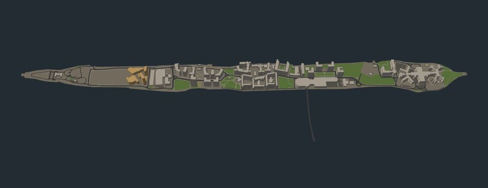

## Contents

- [Why a real site](#why-a-real-site)
- [The page](#the-page)
- [Sources](#sources)
- [What the data contains](#what-the-data-contains)
- [Cornell Tech](#cornell-tech)
- [From data to scene](#from-data-to-scene)
- [Campus cells](#campus-cells)
- [Sunlight over a day](#sunlight-over-a-day)
- [What the sun says about the campus](#what-the-sun-says-about-the-campus)
- [Growing on the campus](#growing-on-the-campus)
- [What grows where](#what-grows-where)
- [Seasons and die-back](#seasons-and-die-back)
- [Up close, and by building](#up-close-and-by-building)
- [The roadside study](#the-roadside-study)
- [Limitations](#limitations)
- [Next steps](#next-steps)
- [Notes](#notes)

## Why a real site

The invented building is a controlled experiment: every wall, ledge and window
was placed so that one rule at a time could be tested against it. What it can't
do is start a conversation about a place. Moving the same rules onto buildings
people know makes the results something to argue with: which side of The House
the vine takes, whether the campus's low buildings shade each other enough to
matter.

The Project is meant to hold several studies, each the same growth model in a
different setting:

1. **Building:** the invented building on the Explore page. It stays as the
   controlled experiment.
2. **Cornell Tech:** the campus buildings, with real sun angles for the island.
3. **Roadside:** plants spreading along the edges of roads and sidewalks, where
   water runs off the road surface.

They are studies inside the Project, not numbered topics: topics belong to the
Playground (see [Playground and Project](app-structure.md)).

## The page

**Project → Site** shows the island from the snapshot, with two studies of
the same three species from Explore: **Buildings**, on the Cornell Tech
walls and roofs, and **Roadside**, on the island's ground. The Study switch at
the top of the sidebar chooses which one Play, Planting and the readouts
belong to (Roadside unlocks once its ground has been built, after the campus).

- **Drag to move** around, like a map. Right-drag, or ⌘/Ctrl/Shift-drag, to
  orbit; scroll to zoom. A compass in the corner points north, because the
  island runs south-west to north-east and the views follow it rather than
  north.
- **Growth**: Play / Pause, Step, Reset, at 1×, 4×, 16× or 64× (1× is 8 steps
  a second; the campus has sixteen times the invented building's wall, so it
  gets a faster speed). Play stops itself after 600 steps with nothing grown.
- **Planting**: *Automatic* seeds the foot of every campus wall. *Manual*
  starts empty; choose a species and click any wall or roof cell on the campus
  to plant it there, then press Play. In Manual, Reset becomes Clear.
- **Hover** a building to see its name, height and year. On the campus, hover
  gives that cell's species and hours of sun, its moisture in the Moisture
  view, or, in Manual, what a click would plant.
  **Click** to select a building and see its record in the sidebar.
- **Sunlight** picks the day: the June solstice, an equinox, the December
  solstice, or **Year**, the default, which moves the light through the
  seasons during the run and shows the year and month. **Die-back**, on by
  default, lets plants wither where they can't live. Under them, a chart of
  coverage over the run, total and by species, with the winters shaded.
  Changing any of these mid-run carries the growth on under the new
  conditions.
- **Environment** has Rain; **Species** switches each species on or off
  (which starts again) and shows its share of the campus.
- The sidebar lists the Cornell Tech buildings, each with a bar of its walls
  in full sun, part sun and shade on that day, a second bar of what each
  species holds of it now, and its coverage. **By direction** gives the same
  for north-, east-, south- and west-facing walls and for roofs. Choosing a
  building selects it and flies the camera to it without changing the bearing.
- **Up close**, within 160 m of what the camera looks at, real leaves are drawn
  over the coloured cells.
- The **View** popover chooses the display (Final, Species, Sun hours,
  Moisture, Sunlight),
  switches between the Island and Cornell Tech cameras, and turns each layer
  (buildings, green space, roads, sidewalks, parking) on or off.

| 21 June | 21 December |
| --- | --- |
| 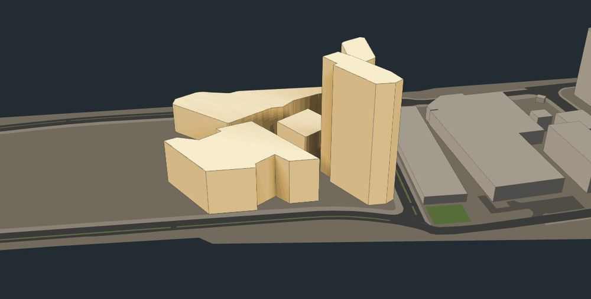 | 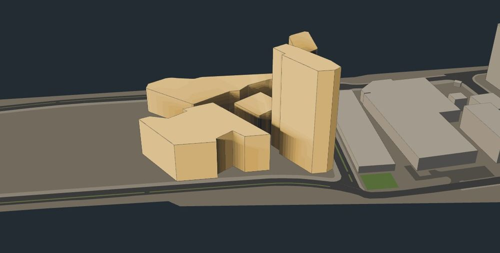 |

## Sources

All of it is NYC Open Data. `scripts/fetch-roosevelt-island.mjs` fetches it and
writes `public/site/roosevelt-island.json`; the app reads only that file.

| Layer | Dataset | What it gives |
| --- | --- | --- |
| Shoreline | Borough Boundaries, clipped `gthc-hcne` | Manhattan's boundary; the ring containing Cornell Tech is the island |
| Buildings | Building Footprints `5zhs-2jue` | Outline, roof height above ground, ground elevation, year, type |
| Parks | Planimetric Open Space (Parks) `y6ja-fw4f` | Park outlines, unnamed here |
| Other open space | Planimetric Open Space (Other) `b7j8-z8a7` | Recreation areas (subtype 2510) and vacant land (2520) |
| Roads | Planimetric Roadbed `i36f-5ih7`, Median `ees7-4ufv` | Road surface and medians |
| Sidewalks | Planimetric Sidewalk `52n9-sdep` | Sidewalk surface |
| Parking | Planimetric Parking Lot `7cgt-uhhz` | Surface lots over 2,000 sq ft |
| Campus names | DOB Job Application Filings `ic3t-wcy2` | The address filed for each building number |

To refresh the data:

```bash
node scripts/fetch-roosevelt-island.mjs
```

It prints a summary of what it wrote. The figures and numbers in this document
are from the snapshot of 2026-10-12.

## What the data contains

From the 2026-10-12 snapshot:

| | Count | Area |
| --- | --- | --- |
| Land (the island outline) | 117 vertices | 585,817 m² |
| Building footprints | 68 | 116,952 m² |
| Green space (recreation, parks, vacant) | 35 polygons | 105,384 m² |
| Roads (roadbed and medians) | 71 polygons | 80,369 m² |
| Sidewalks | 51 polygons | 34,381 m² |
| Parking | 16 polygons | 19,508 m² |

The land area checks out: Roosevelt Island is usually given as about 147 acres,
which is 595,000 m², within 2% of the outline's area.

Two things in the data were not what I expected:

- **The city's parks list has none of the island's parks.** NYC Parks' own Parks
  Properties layer returns nothing on Roosevelt Island, because the parks there
  (Four Freedoms, Southpoint, Lighthouse) are run by the state, not by NYC
  Parks. The planimetric layers, digitised from aerial photographs, still
  outline them. The planimetric parks layer holds only 1,503 m² on the island;
  almost all the green is in the "recreation area" subtype of Open Space
  (Other), at 101,869 m².
- **The Cornell Tech grounds are unclassified.** Within 130 m of the campus's
  centre there is one recreation polygon, two roadbed polygons and four medians,
  and no parks, sidewalks or parking. The lawns and paths between the campus
  buildings are not mapped as any surface, so they draw as bare land.

## Cornell Tech

Six footprints sit on the campus, built between 2015 and 2020. They were named by
looking up each one's Building Identification Number (BIN) in the Department
of Buildings' job filings, which give the address, not by matching shapes on a
map:

| Building | Address | Roof height | Built | BIN |
| --- | --- | --- | --- | --- |
| The House | 1 East Loop Road | 86.9 m | 2017 | 1089538 |
| Graduate Hotel | 22 North Loop Road | 70.1 m | 2020 | 1090301 |
| Tata Innovation Center | 11 East Loop Road | 32.3 m | 2017 | 1089785 |
| Verizon Executive Education Center | 34 North Loop Road | 24.4 m | 2019 | 1090298 |
| Bloomberg Center | 2 West Loop Road | 23.8 m | 2017 | 1090299 |
| 8 North Loop Road | 8 North Loop Road | 11.6 m | 2015 | 1090300 |

The Tata Innovation Center opened as "The Bridge". The filings for 8 North Loop
Road describe a one-storey building owned by NYC Economic Development
Corporation, and don't name it.

Heights are the city's `height_roof`, which is in feet above the building's
base; the table converts it to metres. The filings give a proposed height for
The House of 255 ft and the footprint says 285 ft. The footprint value is used,
because it is the measured roof rather than the planned one.

## From data to scene

- **Projection.** Longitude and latitude become metres on a flat plane centred on
  the island: +x east, +z south, so north is −z. That is the convention the
  growth model already uses, so the sun can be placed by its real compass
  bearing. Across 3 km a flat projection is off by far less than the footprints'
  own accuracy.
- **Choosing what is on the island.** A feature is kept when more than half of
  its outline's vertices fall inside the island. Testing the centroid fails for
  long thin shapes: a sidewalk wrapped round a block has its centroid in the
  road. Testing a single vertex lets in the Queens waterfront.
- **Simplification.** Every outline is simplified with Douglas–Peucker at 0.2 m,
  below what the footprints resolve. The Graduate Hotel's curved façade drops
  from 27 vertices to 13. Simplifying a closed ring needs a split first: its two
  ends are the same point, so the line between them has no direction, and on
  the first run every vertex of the island outline was dropped.
- **Buildings** are extruded straight up from the footprint to the roof height,
  so each one is a single flat-roofed volume. The Cornell Tech buildings are
  drawn from their cells instead (next section), so they can be painted with a
  field one cell at a time. The island is drawn flat; the
  ground elevations (0 to 7.3 m) are kept in the snapshot but not used yet.
- **Ground layers** all lie at y = 0 and are drawn without writing depth, in a
  fixed order (green, parking, road, median, sidewalk), so the order alone
  decides which shows where two overlap. Lifting each layer a few centimetres
  would flicker at a distance, because a 24-bit depth buffer with a 2 m near
  plane resolves only about 3 cm at 1 km and about a metre at the 6 km zoom limit.
- **Picking.** All buildings are one merged mesh, with a triangle range per
  building, so one ray test finds the building under the cursor and selecting
  one only repaints its range of vertex colours.

The snapshot is 124 KB, or 47 KB gzipped.

## Campus cells

The growth model needs every wall and roof as cells that know their
neighbours. On the invented building those come from a hand-written list of
walls, windows and ledges. For the campus they come from the footprints:

- **Every outline edge is a wall** from the ground to the roof, cut into 1 m
  cells. A real edge is rarely a whole number of metres, so its cells are
  stretched to fit, never by more than half a cell over the whole edge.
- **Every footprint is a flat roof**, gridded at 1 m, keeping the cells whose
  centres fall inside the outline.
- **Every vertex that turns by more than 20° is a corner**, inside or outside.
  Shallower turns are the facets of a curved façade.
- **Walls that face into a neighbour are dropped.** 8 North Loop Road shares a
  corner with The House; a wall cell is removed if a point half a cell out from
  it is inside another campus building.
- **Outlines are turned to a common winding** so that every wall's normal
  points out of its building, and courtyards (none on campus, but the code
  handles them) the other way.

The same `assembleBuilding` that builds the invented building then finds the
neighbours and flags. Refactoring it out of the invented building's code
changed nothing there: its cells, fields and a 600-step growth run hash
identically before and after.

Measured in Node, the six buildings at two cell sizes:

| | 1 m | 0.5 m (used) |
| --- | --- | --- |
| Cells | 50,052 (39,521 wall, 10,531 roof) | 202,639 |
| Build | 254 ms | 929 ms |
| A June day of sun | 187 ms | 710 ms |
| Field texture | 1024 × 133 | 1024 × 331 |
| Reachable from the ground | 100%, roofs included | 100% |
| One-way neighbour links | 2,526 of 394,337 | 4,999 of 1,608,460 |

The invented building, for comparison, is 15,792 cells at 0.25 m. Both the
build and the sun run in a Web Worker, so the page keeps drawing and orbiting
while they do. The campus started at 1 m, enough to read which walls get sun;
growth moved it to 0.5 m, where a vine is a strand rather than a stripe.

Almost all the one-way links are where a wall meets a roof: 2,267 of the
2,526, the other 259 at corners between walls. The roof grid runs east–west and
64 of the 78 walls don't, so a step off a wall top lands nearest a roof cell
whose own step back lands on a different wall cell. 1,578 of those 2,267 are on
the angled walls; the rest are on the 14 walls that are aligned with the grid,
where a stretched wall cell sits between two roof cells. Every cell is still
reachable, which is what growth needs.

## Sunlight over a day

The invented building's sunlight field is one sun at a fixed 38° from a chosen
bearing. A real site asks a different question: **over a day, how much sun
does this wall get?** `sunPath.ts` answers it.

- **The sun's path.** Every half hour of daylight, the sun's position for
  Roosevelt Island's latitude (40.76° N) and the day's declination, by the
  standard solar-geometry formulas: elevation from latitude, declination and
  hour angle, azimuth from north. Below 2° the sun counts as down.
- **Shadows.** For each sample, every campus cell facing the sun casts a ray
  toward it, tested against every building on the island, campus and context.
  It is the same exact ray test as the invented building's sunlight field. Two
  filters keep it fast without changing the answer: a building too far from the
  campus, against the sun, to shade it at that sun height is skipped for the
  whole pass, and a building whose bounding box the ray climbs over is skipped
  before its edges are tested.
- **Sun hours** is the number of half hours in which a cell faces the sun with
  nothing in the way. Gardeners call six hours or more *full sun*, three to six
  *part sun*, and under three *shade*, and plant labels use the same terms, so
  the field says directly what could grow where.
- **Sunlight** weights each half hour by how squarely the beam arrives and how
  strong it is. The beam is weaker when the sun is low, because it crosses more
  air; Meinel's clear-sky approximation, I = 1.353 × 0.7^(AM^0.678) kW/m² with
  AM = 1 / sin(elevation), gives 0.95 kW/m² with the sun overhead and 0.42 at
  10°. Each cell's total is shown as a share of what open flat ground gets on a
  clear day in June.

| Clear day | Sun above 2° | Direct sun on open ground |
| --- | --- | --- |
| 21 June | 15 h | 7.47 kWh/m² |
| Equinox | 12 h | 4.58 kWh/m² |
| 21 December | 9 h | 1.61 kWh/m² |

## What the sun says about the campus

Walls by hours of direct sun, from the Node harness on the same code the page
runs (the percentages are each building's wall cells):

| Building | June: full / part / shade | Equinox | December | December roof, mean |
| --- | --- | --- | --- | --- |
| The House (87 m) | 84 / 14 / 2% | 59 / 2 / 39% | 39 / 18 / 43% | 9.0 h |
| Graduate Hotel (70 m) | 88 / 11 / 1% | 33 / 54 / 13% | 18 / 23 / 59% | 6.6 h |
| Tata Innovation Center (32 m) | 65 / 32 / 3% | 46 / 30 / 25% | 38 / 23 / 39% | 9.0 h |
| Bloomberg Center (24 m) | 63 / 29 / 7% | 30 / 57 / 13% | 19 / 16 / 65% | 8.1 h |
| Verizon Executive Education Center (24 m) | 36 / 45 / 20% | 20 / 33 / 47% | 1 / 14 / 85% | 8.0 h |
| 8 North Loop Road (12 m) | 9 / 65 / 26% | 0 / 9 / 91% | 0 / 0 / 100% | 0.4 h |
| All campus walls | 71 / 24 / 5% | 41 / 31 / 28% | 27 / 19 / 54% | |

- **In June almost everything is in sun.** 71% of all wall cells get six hours
  or more, and only 5% are in shade.
- **In December more than half the walls are in shade**, and the low buildings
  among the towers lose the most. Verizon's walls go from 36% full sun to 1%;
  8 North Loop Road, against the foot of The House, gets no wall cell to three
  hours and its roof averages 0.4 h.
- **The tallest keep their sun.** The House and the Tata Innovation Center still
  have 38–39% of their walls in full sun in December, and every roof but 8 North
  Loop Road's still averages 6.6 to 9 hours.

So for planting, the season matters more than anything else here, and in
winter the place a sun-loving vine would struggle is the low middle of the
campus, not the tall buildings. That is the kind of claim the growth model
will be able to test once it runs on these cells.

## Growing on the campus

The growth rule is Explore's, unchanged, running on the campus cells. What
changes is what feeds it.

**Light from the real sun.** The species' light preferences were set on the
invented building's 0–1 scale. On the campus a cell's light is its hours of
direct sun on the chosen day divided by eight, capped at 1. With that one
choice the species' default preferences land on the gardeners' categories
without being touched:

| Species | Light preference | ≈ Sun hours | Gardeners' term |
| --- | --- | --- | --- |
| Moss | 0.15 | 1.2 h | shade |
| Ivy | 0.35 | 2.8 h | shade to part sun |
| Flowering vine | 0.8 | 6.4 h | full sun |

**Moisture** is the invented building's rule as it stands: rain caught on
walls and carried down them, more on roofs and at roof edges, water running off
a tall wall onto a lower roof beside it, and drying where the light is strong.
The city data has no ledges, windows or balconies, so none of the marks those
leave on the invented building appear here. A wind-driven term (more rain on
the side storms come from) was considered and left out: I couldn't source a
prevailing storm direction for the island I'd trust.

**Geometry** is what the data supports: corners, roof edges and the line where
a wall meets a lower roof.

**Seeds and tips scale with the wall.** The species' seed counts and tip caps
were set on the invented building, whose walls measure 64 m at the foot. The
campus's measure 1,022 m (2,044 ground cells at 0.5 m), 15.97 times as long,
so every seed count and tip cap is multiplied by that: 320 seeds are aimed
where the invented building gets 20 (304 land; the rest fall on a cell another
species took first), and ivy can run 767 tips. Seeds stay at least
3 m apart within a species, as on Explore.

**Manual planting** uses the same tips: a click plants one seed of the chosen
species on that cell, at the current step, counted against the species' tip
cap. A seed in the wrong light dies within a few steps, exactly as an
automatic one would — ivy clicked onto The House's eight-hour south-east wall
doesn't take.

**What's drawn.** Each grown cell is coloured on the building's surface: its
species' green, drier cells toward olive, nudged per cell in lightness. Explore
draws real leaves, two or three per cell, but its renderer reserves room for
every leaf up front: on 202,639 campus cells that is 2.0 million instances,
about 160 MB of buffers, for leaves that would be a fraction of a pixel at
campus distance. Leaves for close-ups belong with a level-of-detail pass.

Measured in Node: a step takes about 0.1 ms with ~300–400 tips running, and
rebuilding the fields after a change of day or rain takes 9–28 ms. 64× is 512
steps a second, so 6,000 steps take about 12 seconds when the browser keeps
up; the headless test browser managed about 25.

| June, step 1,000 | June, step 6,000 (Species view) |
| --- | --- |
| 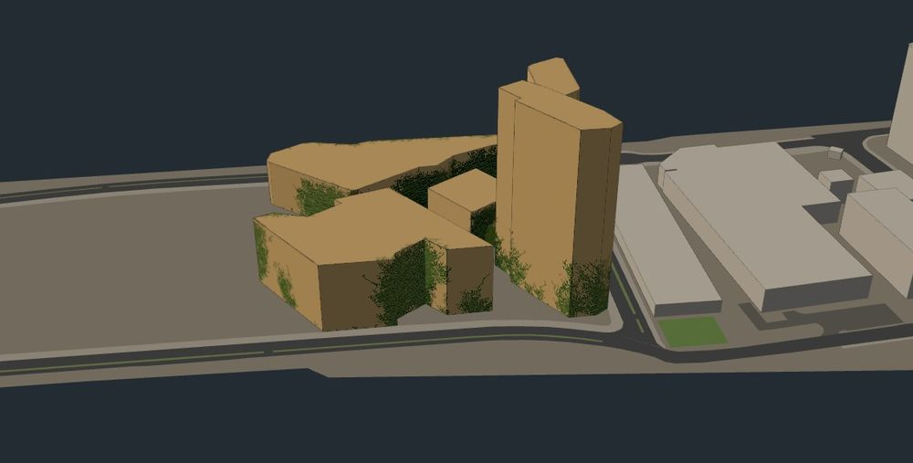 | 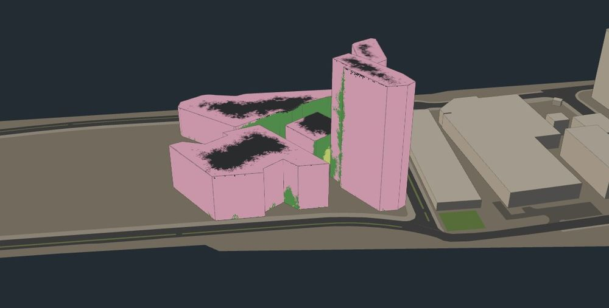 |

## What grows where

Automatic planting, the default species and rain, seed 1, run for 6,000 steps
on each fixed day with die-back off (it is on by default now; see the next
section for what it changes). Coverage of all campus cells, by species:

| Day | Step 1,000 | Step 6,000 | Ivy / moss / vine at 6,000 |
| --- | --- | --- | --- |
| 21 June | 26.3% | 91.9% | 17.9 / 2.1 / 71.9% |
| Equinox | 33.3% | 83.7% | 37.1 / 11.7 / 35.0% |
| 21 December | 30.3% | 78.8% | 16.3 / 35.7 / 26.8% |

And who holds the walls at step 6,000, by the light class of the wall on that
day:

| Day | Full-sun walls (6 h+) | Part-sun walls (3–6 h) | Shade walls (under 3 h) |
| --- | --- | --- | --- |
| June | vine 95.9%, ivy 3.4% | ivy 70.8%, vine 26.5% | ivy 58.1%, moss 37.3% |
| Equinox | vine 78.2%, bare 11.4% | ivy 88.4%, vine 9.3% | moss 49.3%, ivy 47.2% |
| December | vine 83.7%, bare 14.1% | ivy 41.5%, vine 24.5%, bare 18.1% | moss 76.9%, ivy 19.7% |

- **The species sort themselves the way a gardener would plant them.** The
  flowering vine takes the full-sun walls, ivy the part-sun ones, moss and ivy
  the shade. Nothing in the model knows the gardeners' categories; it is the
  species' light preferences meeting the real sun.
- **The season decides the mix.** In June 71% of the campus walls are full
  sun and the vine holds 72% of the campus; in December more than half the
  walls are in shade and moss becomes the largest species, at 36%.
- **Everything still fills, given time.** By step 6,000 the campus is 79–92%
  covered whatever the day. The light decides *who* holds a wall, not yet
  *whether* anything can: plants don't die back where they can't live. That is
  stage 4: let the day change during a run and let growth withdraw from cells
  that turn hostile, so what's left at the end is what survives a year.

| December, step 6,000 (Species view) |
| --- |
| 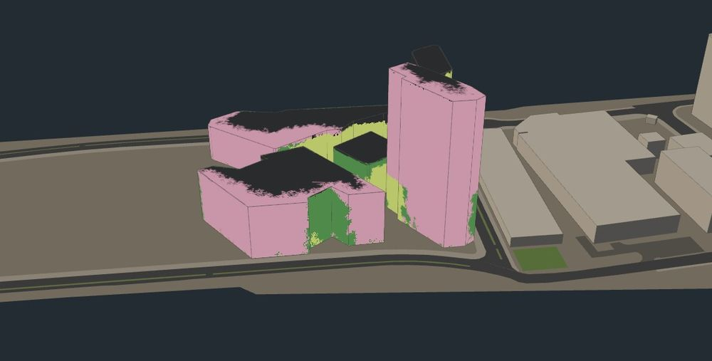 |

## Seasons and die-back

Everything above is one day, held fixed, with growth that only ever adds.
Stage 4 lets the year turn and lets plants die.

**A year of light.** A year is 2,400 steps, 600 a season, and a run starts at
the March equinox, when planting would. The sun's declination follows the
year (−23.44° at the December solstice, +23.44° at the June one), and each
cell's sun hours are interpolated between the three traced days by it:
between December and the equinox while the declination is negative, between
the equinox and June while it is positive. Light, and the moisture that
depends on it, are refreshed twelve times a year. Interpolating hours by
declination is an approximation; tracing every day would mean 0.4–0.7 s of
shadow rays per refresh.

**Warmth.** Light alone would let the vine grow on a south wall in December.
Growth's *vigour* — a multiplier on every chance to grow, branch or send a
side shoot — follows a warmth curve: a cosine through the year, lagging the
sun by a month, because the air is coldest in January and warmest in July
rather than at the solstices. Vigour is a tenth of full in deep winter and
full in high summer. The curve has the right shape; it is not New York's
temperature record.

**Die-back.** Each grown cell's hostility is how far its species' env falls
short of 0.5: h = max(0, 1 − env / 0.5). Each step it withers with probability
0.01 × h², swept every 25 steps as one draw standing for all of them. Two
rules make it a plant rather than paint:

- **Roots live.** A seed cell never dies back. It is the rootstock, and side
  shoots from it regrow the plant when the season turns.
- **A climber's stem carries what is above it.** When a cell of ivy or the
  vine dies, everything grown from it dies too. Moss has no stems; its cells
  die one by one.

The rate and threshold were chosen by running four years of the campus at
four settings and watching two things: how often the species holding a wall
is the one suited to its light (by the wall's yearly average sun hours), and
whether the winter shows.

| Die-back (rate, survive below) | Year 4, March: covered | Right species | Winter retreat visible |
| --- | --- | --- | --- |
| off | 74.0% | 78.0% | no — nothing dies |
| 0.004, 0.35 | 62.8% | 85.9% | barely: summer and winter within 0.3 points |
| 0.004, 0.5 | 62.8% | 85.7% | yes: 65.1% → 62.8% |
| **0.01, 0.5** (used) | 61.4% | 87.0% | yes: 65.0% → 61.4% |

(These were run with the fields refreshed 24 times a year; the shipped
model refreshes twelve, which moves the figures by a point or so. The
results below are the shipped model's.)

### Ten years

Automatic planting, default species and rain, seed 1. Walls are classed by
their yearly average sun hours (a quarter each of the solstices, half the
equinox):

| | No die-back, year 10 | With die-back, year 10 September | → March |
| --- | --- | --- | --- |
| Covered | 95.0% | 88.9% | 86.0% |
| Wall held by the species suited to it | 73.3% | 84.6% | 88.6% |
| Full-sun walls | vine 97.7% | vine 93.2% | vine 91.8% |
| Part-sun walls | vine 58.3%, ivy 41.3% | ivy 53.7%, vine 39.1% | ivy 54.9%, vine 28.4%, bare 16.5% |
| Shade walls | ivy 69.6%, vine 18.1%, moss 12.2% | ivy 81.8%, moss 13.1%, vine 1.2% | ivy 82.4%, moss 13.1%, vine 0.1% |

- **Without die-back, a summer's mistake is permanent.** The vine climbs into
  part-sun and shaded walls during the warm months and, with nothing to remove
  it, ends up holding 58% of the part-sun walls and 18% of the shaded ones.
- **With it, the winter corrects them.** Each winter the vine is cut back out
  of the walls it can't hold — on part-sun walls from 39% to 28%, on shaded
  ones to almost nothing — and ivy keeps them. The share of grown wall held by
  the suited species rises from 73% to 85–89%.
- **The campus breathes.** Coverage rises each summer and falls each winter
  by about three points, and the chart shows the vine's line dipping every
  winter while ivy's stays level.
- **It still nearly fills.** 86–89% after ten years. Between them the three
  species can live on almost every wall, so die-back decides *which* plant,
  far more than *whether*. Of the wall left bare in March, 60% is part-sun
  wall the vine lost that winter and ivy hasn't reached yet.
- **Moss stays small over a year** — 3% of the campus against 36% on a fixed
  December day — and the reason is timing. On the walls shaded over the year,
  moss's env beats ivy's on 80% of cells in December but only 6% in June. Its
  season is the one in which vigour lets almost nothing grow, so ivy, favoured
  in summer, takes the shade first, and first arrival keeps a cell.

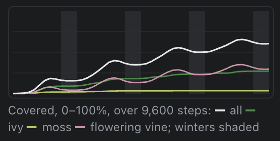

| Year 4, September | Year 4, the following March |
| --- | --- |
| 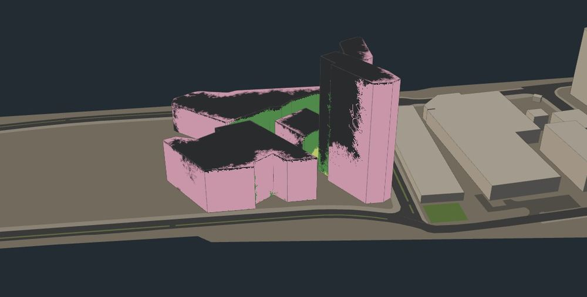 | 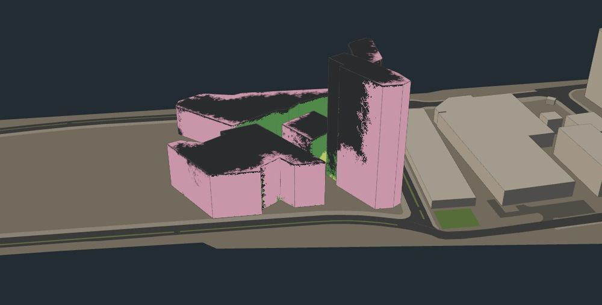 |

The page and Node agree to the cell: 131,483 cells grown at step 8,400 (64.9%)
and 122,273 at step 9,600 (60.3%) in both.

On a fixed day, die-back changes little — 91.9% to 89.0% covered in June,
78.8% to 77.2% in December — because one day's light never changes: a cell
that was hostile when the vine entered it was already unlikely to be entered.
It is the turning year that sends plants into walls they can't keep.

**Cost.** Measured in Node: 0.11 ms a step in year 1, 0.20 ms by year 10 (about
0.07 ms growth, 0.08 ms die-back, 0.05 ms the monthly refresh averaged out).
At 64× that is about a tenth of a second of work per second. The die-back
sweep painting was checked in the browser against a repaint from scratch: no
cell differs.

## Up close, and by building

**Leaves near the camera.** The coloured cells read correctly from any
distance; close up they are a mosaic. So within 70 m of the point the camera
looks at — and only when the camera is within 160 m of it, in the Final view —
real leaves are laid over them: Explore's ivy, moss and vine shapes at about
twice the size (the cells are twice as wide), two per cell for the climbers,
one moss clump, coloured by the same dry-to-lush rule. A rebuild is one pass
over the grown cells and the matrices for those in range: at year 4,
September, 131,604 leaves around The House and 164,485 around the campus's
centre, 40–55 ms in Node. It happens at once when the view settles and at most
once a second while growth plays. Each species can hold 90,000 leaves; past
that, cells would be thinned evenly.

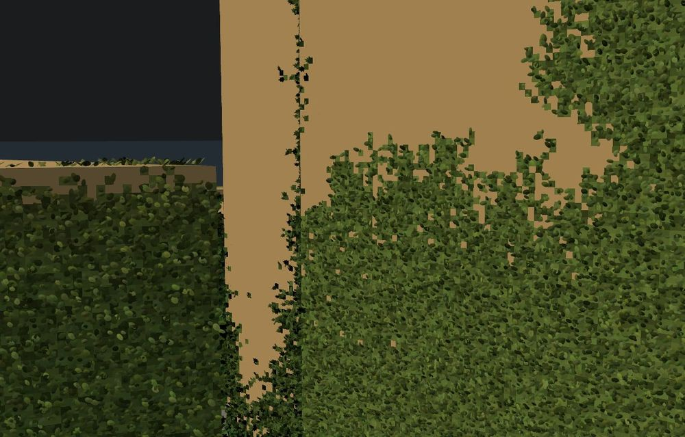

**By building and by direction.** The sidebar counts, twice a second, what
each species holds of each building and of each wall direction. Year 4, the
same run as above:

| | September: covered (ivy / moss / vine) | Following March |
| --- | --- | --- |
| Graduate Hotel | 78% (32 / 1 / 45) | 66% (35 / 1 / 31) |
| Verizon Executive Education Center | 70% (35 / 17 / 18) | 66% (35 / 17 / 14) |
| Tata Innovation Center | 69% (27 / 4 / 38) | 69% (27 / 4 / 37) |
| Bloomberg Center | 68% (25 / 0 / 43) | 60% (25 / 0 / 35) |
| 8 North Loop Road | 53% (45 / 8 / 0) | 54% (46 / 8 / 0) |
| The House | 50% (18 / 2 / 30) | 48% (18 / 2 / 28) |
| North-facing walls | 74% (55 / 9 / 10) | 67% (57 / 9 / 0) |
| East-facing walls | 95% (37 / 3 / 55) | 87% (38 / 3 / 46) |
| South-facing walls | 71% (9 / 1 / 62) | 70% (8 / 1 / 61) |
| West-facing walls | 79% (32 / 3 / 44) | 71% (33 / 3 / 35) |
| Roofs | 12% (0 / 0 / 12) | 13% (0 / 0 / 13) |

- **Winter takes the vine off the north walls entirely** — 10% in September,
  0% by March — and leaves the south walls alone, at 61–62% vine through the
  year. East and west walls lose about a sixth of their vine.
- **The low, shaded buildings are ivy and moss country.** 8 North Loop Road
  never holds any vine; Verizon is the only building where moss is a real
  share, at 17%.
- **The roofs barely green.** 12–13%, all vine. Seeds go in at the foot of
  the walls, and a roof is reached only by climbing to it; The House's roof is
  87 m up.

## The roadside study

The third study: the same three plants, the same rule, on the ground instead
of the walls — where on the island's verges, medians and lawns would they take
hold, and what puts them there?

### The ground

**A 1 m grid along the island.** The island is 3.2 km long and about 250 m
wide, running south-west to north-east, so the grid is laid along its long
axis: 3,155 columns by 277 rows, a fifth of the area an east–west grid would
need. Every square whose centre is on land and outside a building footprint
is a cell: **468,875** of them, built in about 0.1 s in Node. Neighbours are
grid offsets.

**Surfaces from the city's layers**, painted in the order the page draws them:

| Surface | Cells | Habitat (my assumption) | Why |
| --- | --- | --- | --- |
| Road | 63,743 | 0 | Driven on. Its cells only shed water |
| Sidewalk | 33,377 | 0.15 | Paved: a plant has only the cracks and edges |
| Parking | 19,036 | 0.25 | Paved, trodden less than a sidewalk |
| Lawn | 95,478 | 0.5 | Mown |
| Unmapped ground | 253,227 | 0.8 | Land no layer covers: mostly planting and lawn |
| Median | 2,482 | 0.9 | Left alone |
| Vacant lot | 1,532 | 1 | Left alone |

*Habitat* multiplies every species' env and suitability on that cell. The
city data says what a surface is, not how often it is mown, swept or driven
over, so these numbers are assumptions, and the results on lawns and paving
follow directly from them.

**Light by drawing shadows.** On flat ground a prism's shadow is exact: its
footprint swept away from the sun by height ÷ tan(elevation). Each half hour,
every building's edges sweep parallelograms into a shadow mask, and every cell
outside the mask gets that half hour of sun. Same answer as the campus's rays
for a flat surface, at a cost proportional to the shadowed area: 0.56–0.72 s a
day in Node for half a million cells, where rays would test every cell against
every building.

**Moisture with runoff.** Pavement sheds its rain onto the unpaved ground
nearby. An unpaved cell gets rain × (1.0 + 1.5 × the paved share of the cells
within 3 m); a crack in pavement keeps 0.3 of the rain; then the sun dries it
and it saturates, as on the walls. The island is flat, so water is taken to go
to the nearest unpaved edge, which is what the 3 m box stands for. A soil catch
of 0.6 — the roofs' figure — was the first try, and left the open ground so
dry that four years grew 5% of the island.

**Seeds along pavement edges.** Automatic planting puts seeds on growable
cells next to pavement: 26,916 such cells, 1,184 seeds. This stands for roads
and paths carrying seeds — the study's main assumption, and, as the controls
below show, the source of most of its roadside pattern. The seed and tip
counts are 60 times the species' own (not scaled to the edge length, which
would mean 420× and tens of thousands of tips). Manual planting works on any
cell off the road.

**Which plants.** Explore's three, unchanged: ivy is a common ground cover;
moss wants damp shade; the flowering vine stands in for bindweed, which
sprawls along sunny verges. Year, warmth and die-back are the campus's.

| Final view, year 4 March | Species view |
| --- | --- |
| 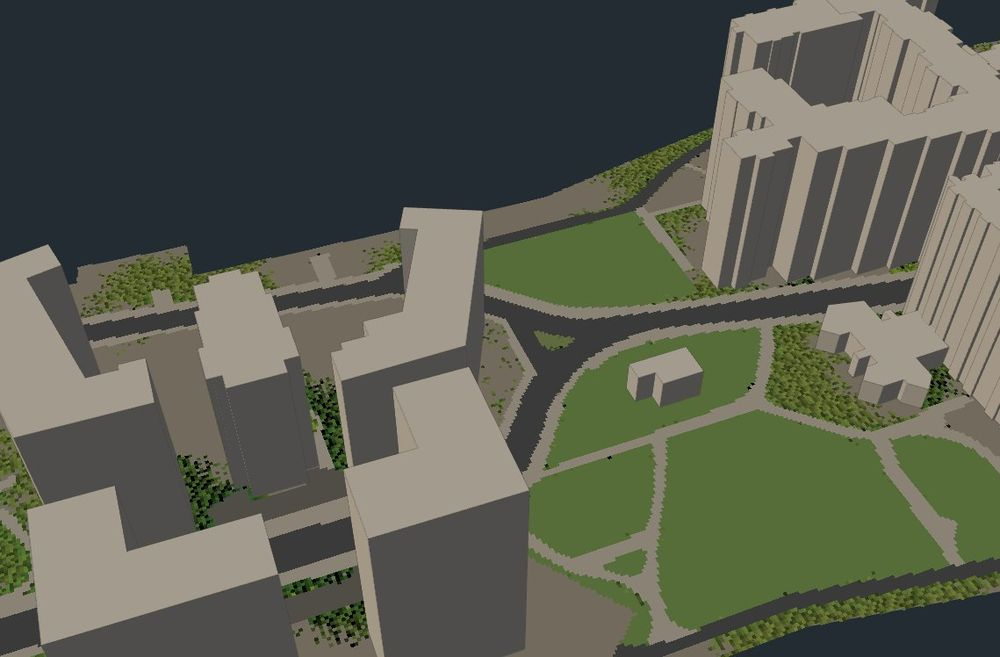 | 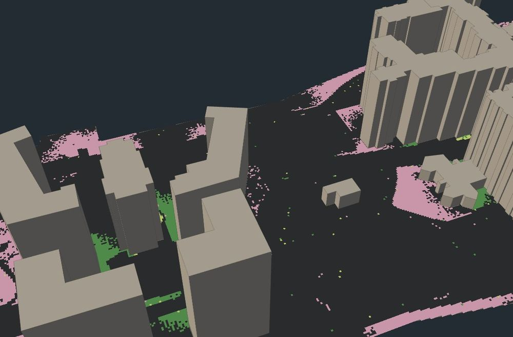 |

### What it shows

Seed 1, default species and rain, the year turning, die-back on, four
simulated years (to March of year 5). Growable cells only; the road is
excluded.

| Surface | Covered |
| --- | --- |
| Vacant lots | 85.3% |
| Medians | 62.3% |
| Unmapped ground | 29.1% |
| Lawns | 0.5% |
| Sidewalks, parking | 0.0% |
| **All ground** | **19.0%** (ivy 2.9, moss 0.3, vine 15.7) |

- **The species sort by sun on the ground too.** On ground with six hours or
  more of sun a year (on average), 20.5% is vine and 0.1% ivy; on ground in
  shade, 18.9% is ivy and 0.1% vine — the shadows north of the towers are ivy.
- **Lawns and paving stay bare**, because the habitat factors say so: at 0.5,
  a mown lawn's best cell is too poor for a tip to enter often or a plant to
  survive die-back, and at 0.15–0.25 a crack is worse. That is the assumption
  speaking, not a finding.
- **Moss barely appears**, at 0.3%. It needs damp shade, and the island's
  shaded ground is where ivy, favoured over the summer, gets first.

### Does the roadside get greener — and why?

In the default run, unpaved ground within 2 m of pavement is 43.3% covered
against 18.3% farther away. Two things could do that: seeds start at the
pavement edge, and pavement sheds water onto it. The controls separate them
(four years each, unpaved ground only):

| Run | Near pavement | Farther |
| --- | --- | --- |
| Default: seeds at the edges, normal rain | 43.3% | 18.3% |
| Seeds scattered at random, normal rain | 17.8% | 17.4% |
| Random seeds, half the rain | 3.5% | 0.6% |
| Random seeds, half the rain, no runoff | 0.4% | 0.4% |
| Seeds at the edges, half the rain | 22.5% | 1.0% |

- **At normal rain, the roadside pattern is all seeding.** Scatter the seeds
  and the strip near pavement grows no more than the ground beyond; switching
  runoff off changes nothing either. Water isn't what limits growth at that
  rain, so extra water doesn't help.
- **In a dry year, runoff decides.** With half the rain, the ground that
  catches pavement runoff is six times as covered as the ground beyond, with
  the seeds placed at random — and without runoff, the difference disappears.
- **Both together make the city's familiar pattern.** Seeds at the edges and a
  dry year: the strip along the pavement is 22.5% green and everything else
  1%. The only plants are the ones the road both brought and watered.

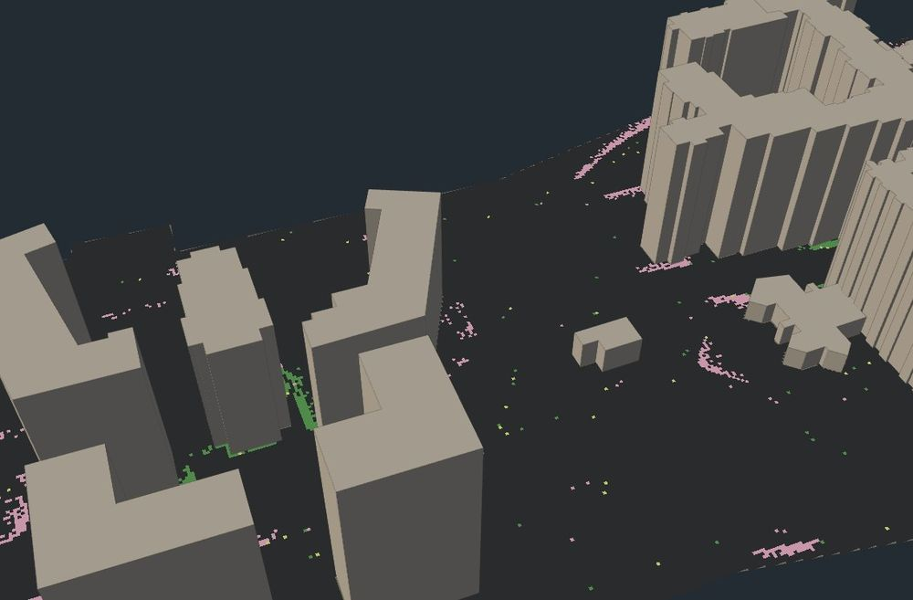

Page and Node agree: 77,043 cells grown at step 9,600 (19.0%) in the default
run, and 14,328 (3.5%) in the dry one. A step costs 0.13–0.23 ms in Node. The
incremental painting through die-back was checked against a repaint from
scratch: no cell differs.

## Limitations

- **Massing, not architecture.** Every building is a single extruded footprint.
  There are no windows, ledges or setbacks, and those features are what the
  growth model follows. The Bloomberg Center's roof is a large solar canopy in
  reality; here it is a flat roof.
- **Flat ground.** Ground elevation is ignored, and the Roosevelt Island Bridge's
  roadbed lies on the water, at the same level as the island.
- **One building has no height.** A parking structure (BIN 1089349) has no roof
  height on record and is drawn at 3 m, which the sidebar says when it is
  selected.
- **Clear sky, direct sun only.** No clouds, and no light from the sky or
  reflected off other buildings, so a north wall's value is zero where in
  reality it gets diffuse light. Fine for comparing walls with each other;
  wrong as an absolute amount of light.
- **Solar time.** The half hours are in solar time (the sun due south at noon),
  not clock time. At this longitude solar noon is 56 minutes after noon on
  summer clocks. That changes when a wall gets its sun, not how much.
- **Context is massing too.** The other island buildings cast shadows from
  their single-height footprints. Trees, which in reality shade the low campus
  buildings, aren't in the data at all.
- **The final view's light is a stand-in.** In the Final display the scene is
  lit from a fixed south-west direction, unrelated to the computed sun.
- **No glass.** The footprints don't say how much of each wall is glazed, so
  every wall is growable. On a real glass wall a vine needs a trellis.
- **A year is three days.** The year's light is interpolated between the
  solstices and the equinox by declination, not traced for every day, and
  warmth is a cosine, not temperature data.
- **Die-back is light and moisture only.** No frost, no drought year, no
  pruning; and the plants still don't change their environment.
- **The roadside's habitat factors are assumptions.** How often each surface
  is mown, swept or driven on isn't in the data; lawns and paving stay bare
  because the factors say so. Seeding along pavement is an assumption too, and
  the controls show it makes most of the roadside pattern at normal rain.
- **The ground is flat and 1 m.** No slope, so runoff goes to whatever is
  unpaved within 3 m; and 1 m cells are coarse against a curb strip. No
  leaves on the ground — coloured cells only.
- **Leaves only near the camera.** From further away the growth is coloured
  cells; see *Up close, and by building*. Leaves carry no age and don't
  animate.

## Next steps

1. **Feedback:** let plants shade and hold water against what they grow on.
2. **Die-back on Explore,** so the invented building's results survive a year
   too.

## Notes

- **The page never calls the API.** The city edits these datasets daily (the
  footprints were updated the day before this snapshot). If the app fetched them
  live, a figure captured today could stop matching its numbers next month. The
  snapshot fixes one state, and re-running the script is the deliberate way to
  move it.
- **Headless Chrome timings are not a normal browser's.** The campus build took
  10 s in the test browser against 0.25 s in Node at 1 m, and about 11 s against
  0.94 s at 0.5 m, because headless Chrome
  warms its JIT up slowly: the invented building's build ran 3.4 s, 1.8, 1.0,
  then 0.39 on four repeats, and even a Map lookup benchmark ran ten times
  slower than in Node. That is why the campus work runs in a Web Worker, and why
  the timings quoted here are Node's.
- **The roadside layer looked invisible.** The quad was drawn all along: from
  the island view its ungrown cells are the same colours as the page's own
  ground layers, and the first hover test happened to land on the river. A
  "fix" that made it double-sided turned it nearly black — a face seen from
  behind is lit with its normal flipped, from below — so the winding was
  worked out properly instead and the material left one-sided.
- **The campus was painted too dark at first.** THREE.Color holds linear
  values and the cell textures are sRGB; writing the linear values straight in
  made every cell darker than its colour — the bare campus brown rather than
  amber, and the Sun hours view darker than its own legend. Colours are now
  converted on the way in; the sun figures above were recaptured after the fix.
  Explore was already converting correctly.
- **Names come from records, not from looking.** Identifying the campus
  buildings by eye from a 3D view would have been easy to get wrong: my first
  guess was three or four campus buildings, and the data has six. The DOB filings
  tie each building number to an address.
