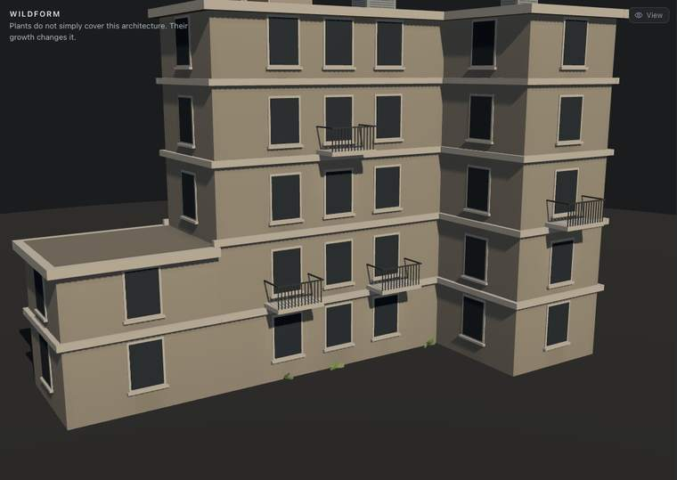
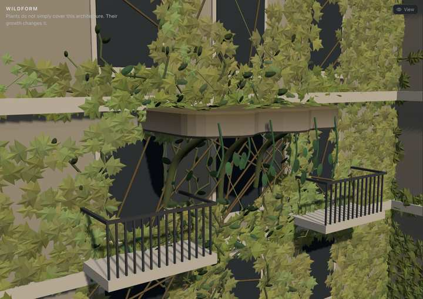

# Wildform midterm (Explore, archived)

Jessica Hsiao · Procedural World Building

*Explore, rebuilt for the midterm review. The working title stuck: the whole
project is now **Wildform**, and this page — out of the Project tabs since,
reachable from Progress under an "Archived" banner — is its midterm
prototype. Build runs the same simulation ([Build](build.md)). Every name the
page shows lives in `src/wildform/names.ts`.*

> Plants do not simply cover this architecture. Their growth changes it.

The project began as plants growing over a building, steered by its
environment ([Overgrowth](green-architecture.md)). Wildform takes the next
step: **when two compatible plants meet, their growth generates
architecture, and that architecture changes the environment the plants grow
in.** For the midterm it is one complete loop, small enough to explain in a
minute:

    environment → plant growth → plants grow over each other → a Living Platform forms
         ↑                                              ↓
    future growth changes  ←  its shade changes the sunlight field

One building, two species, one interaction rule, one mutation, one
feedback. Everything else — more species, more rules, windows, bridges,
cities — is future work.

## Contents

- [What the page shows](#what-the-page-shows)
- [The building](#the-building)
- [Two species](#two-species)
- [The growth rule](#the-growth-rule)
- [Layers](#layers)
- [The interaction rule](#the-interaction-rule)
- [The Living Platform](#the-living-platform)
- [The feedback](#the-feedback)
- [The Midterm Demo](#the-midterm-demo)
- [Code](#code)
- [Cost](#cost)
- [Limitations](#limitations)
- [Next](#next)
- [Notes](#notes)

## What the page shows

**Project → Explore** opens on the bare building with three small sprouts at
the foot of the main front: two Climber seeds and one Spreader. The sidebar:

- **Start**: *Midterm Demo*, the chosen seeds that reliably build a platform
  (see below), or *Random*, seeds from a seed number, with *New seed*.
- **Environment**: Rain and Sun direction. Changed mid-run, the fields change
  under the growth and plants respond (see *The feedback*).
- **Simulation**: Play / Pause, Step, Reset; 1×, 4×, 16× (1× is 8 steps a
  second); the step and the number of growing tips.
- **Species**: Climber and Spreader, each with its share of the building,
  and the share that is layered — one grown over the other.
- **Mutations**: the number of Living Platforms, and — while an encounter is
  pending — the grammar's checklist, each condition ticked or not (hover for
  the numbers).
- **Events**: the last five things that happened, by step — *Climber reached
  floor 2*, *Interaction detected where a platform can stand*, *Living
  Platform formed at floor 3*, *Sunlight updated: 97 cells now in its
  shade*, *39 Spreader cells lost their light*.
- **Timeline**: Start, Growth, Before, Mutation, After — jumps that re-run
  the simulation to that step (it is deterministic, so it lands on the same
  state). They unlock once the run has reached the mutation.
- **Advanced**: Mutations on/off — the same run with the grammar switched
  off, to compare — and the costs.

When a platform forms, a small label beside it says *Living Platform
formed*, for four seconds. The **View** popover has Final, Sunlight,
Moisture, Suitability (per species), Architecture and Interaction, and two
cameras: Perspective (the presentation view — the whole front, both
planting spots and where the platform will form) and Front.

| Step 0: bare, three sprouts | Step 870: the platform forms | Step 1,670: the Climber has taken its shade |
| --- | --- | --- |
|  |  |  |

## The building

The earlier Explore's invented building, reused as it is (`building.ts`): an
L-shaped five-storey block with a two-storey wing and roof terrace; windows
in bays, a ledge at every floor line, balconies, a cornice, rooftop units,
an inside corner. It is the substrate, not the subject, and it already had
what growth needs to respond to.

What is new is that it can change. The world (`world.ts`) keeps its own copy
of the building's flags, overhangs and volumes, and a Living Platform is
added to those lists — so the same field code that computed the environment
before computes it after.

## Two species

One growth rule; two sets of needs and a direction each (`species.ts`).

| | Climber | Spreader |
| --- | --- | --- |
| Goes | **up** (vertical weight 0.85) | **sideways** (lateral weight 0.55, vertical −0.05) |
| Light it likes | 0.5 — tolerates shade | 0.85 — seeks sun |
| Water it needs | 0.4, moderate | 0.3 |
| Support (edges, corners, ledges) | weight 0.5 | weight 0.25, plus a 0.35 bonus for stepping onto a ledge |
| Straightness / crowding | 0.45 / 0.35 — long, sparse strands | 0.1 / 0.05 — packs dense |
| Branching | 0.03 + 0.04·env | 0.06 + 0.06·env |
| Tips at most | 16 | 22 |
| Drawn as | thin stems to every cell, one small pointed leaf on 70% of cells | short runners, three broad lobed leaves per cell, flat to the wall and turned sideways |

They read apart by shape, not only colour: a Climber stand is a network of
thin directional lines up the inside corner; a Spreader stand is a dense
horizontal mat along the ledges.

## The growth rule

Growth is simulation state (`growth.ts`), advanced one step at a time.
Each active tip:

1. may die: chance 0.005 + 0.12·(1 − env)²;
2. scores its eight neighbouring cells —

       score = 1.4·suitability′ + vertical·rise + lateral·(1 − |rise|)
             + straightness·(same direction as it was going)
             + ledge bonus − crowding·(its own species' neighbours) + jitter (±0.2)

   where suitability′ is the cell's suitability times the substrate factor
   for what is on top of it (see *Layers*);

3. enters the best one if its suitability′ is over 0.1, with chance
   0.05 + 0.95·suitability′²; otherwise it stalls and tries again (giving up
   one time in ten);
4. having grown, may branch into the second best.

Each step each species also puts out side shoots from its own grown cells —
a quarter of a shoot plus `shoots` per 100 cells, at most two a step. The
fields behind it are the earlier Explore's (`fields.ts`):

    moisture match = smoothstep(0.06·need, need, moisture)
    light match    = clamp(1 − 1.1·|sun − preference|, 0.08, 1)
    env            = moisture match × light match
    suitability    = env × (1 − support + support·architecture)

A tip only ever moves to a neighbour, and new tips only start on grown
cells, so each species' growth stays connected — nothing teleports.
Everything is drawn from one seeded stream, never the clock: the same preset
grows the same building, cell for cell, at any speed, in the browser or in
Node.

## Layers

Every cell holds a **stack** of up to three layers of plant, bottom to top,
and new growth always goes on top. So a plant takes the others into account:
what is already in a cell, and which species is on top.

**What it grows onto.** A tip's suitability for a cell is multiplied by a
substrate factor for whatever is on top there now (suitability′):

| Growing onto | Climber | Spreader | Why |
| --- | --- | --- | --- |
| Bare wall | 1 | 1 | the fields decide |
| a Spreader's mat | **1.6** | 0 | the mat is something for the Climber to grip |
| a Climber's stems | 0 | **1.2** | the light-seeking Spreader rides them up off the wall |

Nothing grows straight onto its own species, so a two-deep stack always
holds both — and a third layer can follow, Climber over Spreader over
Climber. Crowding counts only a species' own neighbours.

**The top shades the ones beneath.** Each layer above a plant leaves it 0.75
of the light. When something grows over a plant, its env is worked out again
under that light, and if it falls more than 0.12 below what it grew in, it
starts to wither. The sun-loving Spreader under a Climber does; the
shade-tolerant Climber under a Spreader hardly minds — its light gets closer
to what it likes. A Climber's stem carries what grew from it, so a withered
Climber layer takes its descendants; the Spreader is a mat and dies back
piece by piece. When a lower layer goes, the ones above close down over the
gap.

So a cell's stack is a history, and its order is a result: who arrived
first, who grew over whom, who survived being covered. Each layer is drawn
7 cm further off the wall than the one beneath, and the **Layers** view
shows each cell's stack — the top species' colour, warmer and brighter for
each layer under it.

**How much layers.** Stacks form where the two species meet, so layering is
local: in the demo 2.9% of the building is two or three deep by step 1,670
(the Climber holds 5.2%, the Spreader 19.6%); across 20 random runs, 0–7.2%.
Sweeps of the shading (0.55–0.8), the substrate factors and the Climber's
vigour moved it between about 0.1% and 3% — the species live in different
places, the Climber up the shaded inside corner and the Spreader along sunny
ledges, and a covered Spreader soon withers.

How it got here: first each cell belonged to whichever species reached it
first, and they could only touch along a seam; then they could share a cell,
in separate layers with no order; now they stack, and the order matters.

## The interaction rule

`grammar.ts` holds the rules — one, for now:

    Climber + Spreader + a suitable place = Living Platform

Every 10 steps the simulation finds where one has grown over the other —
cells whose stack holds both, highest first. For each the rule names
a **site** — the floor line nearest it, on that wall, a 3.4 m span centred on
it — and tests five conditions there:

| Condition | About | Passes when |
| --- | --- | --- |
| Both mature and layered here | the plants | each species has ≥ 10 cells within reach (the span, from 1.8 m below the slab to 0.6 m above), averaging ≥ 40 steps old, and ≥ 4 of those cells hold both |
| On a facade, above the ground floor | the place | a wall, not a roof; the floor line at least 3 m up and 3 m below the top |
| Free space outward | the place | no balcony, cornice or earlier platform overlapping the span within 2.4 m in height; no other part of the building in front of the slab; ≥ 5 m from any other platform |
| Not across a window | the place | no window overlaps the slab, 0.1 m below it to 0.3 m above |
| Supported by the plants below | the plants | at least half the wall in the 1.5 m under it is solid, and at least 35% of that is grown |

When every condition holds, the platform forms; at most two per run, so the
demo stays one clear idea. A rule is data — its two species, how it picks a
site, a list of named conditions (each marked as being about the place or
about the plants), and what it builds — so another mutation would be another
entry in `RULES`, not more special cases. The place conditions all passing is
what the event log calls *Interaction detected*.

## The Living Platform

`platformMesh.ts` builds real scene geometry, in a frame on the wall (x
along it, y up, z out), and it stays part of the world:

- **The slab**, 3.4 m × 1.9 m × 0.34 m, in the building's stone, darker
  underneath, with soil on top. Its outer edge isn't ruled: it swells and
  dips by up to 0.15 m between rounded corners — grown rather than cast. It
  casts and receives shadows.
- **The Climber's roots**: three thick curving struts rising out of the wall
  1.3–1.8 m below and carrying the slab's outer edge — the climber holding up
  what it built.
- **Tendrils** of the Climber hanging from the rim, with fourteen of its
  leaves.
- **A mat** of 46 Spreader leaves across the top.

It grows in over 1.6 seconds: the roots draw out along their length first,
then the slab pushes out of the wall (scaled from 2% to full depth), then the
leaves open. The animation is only for the eye; in the simulation the
platform exists, and has changed the fields, from the step it formed.

## The feedback

When a platform forms (`World.addPlatform`):

1. It joins the building's **overhangs**, so the sunlight rule shades the
   band of wall under it at the sun's angle, and its **volumes**, so it
   throws a shadow onto anything else. The sun, moisture and suitability
   fields are recomputed by the same code as before — the shade is what the
   rule says once the platform exists, not a painted patch. The wall under it
   also dries less, since evaporation follows the sun.
2. The band it is rooted in becomes a **ledge and frame** (support), and the
   wall under it gains **support** in the architecture field — the roots are
   something to climb.
3. **Plants that lose their conditions wither.** Every cell remembers how
   suitable its species found it when it grew; if env later falls more than
   0.12 below that, it may wither (chance 0.24 × the fall beyond 0.12, per
   step) — a Climber layer taking what it grew from it, a Spreader layer
   alone. It is the same withering as being grown over (see *Layers*). Roots
   never wither.

In the Midterm Demo the platform forms at **step 870** and shades **97**
cells. At that moment they hold **39 Spreader cells and 8 Climber**. The same
run with mutations switched off, against the run with them on:

| Cells in the platform's shade | With the platform | Without (Mutations off) |
| --- | --- | --- |
| At formation (step 870) | Climber 8 · Spreader 39 | Climber 8 · Spreader 39 |
| 200 steps later | 31 · 0 | 19 · 71 |
| 400 steps later | 41 · 3 | 24 · 71 |
| 800 steps later | **66 · 13** | **34 · 71** |

The Spreader, which wants sun, withdraws from the new shade; the Climber,
which tolerates shade and now has the roots to climb, moves in. Without the
platform the Spreader fills the patch (71) and the Climber gets to 34 by
growing over it. Over the run 321 Spreader layers wither, from shade and from
being grown over.
That is the loop: plants → platform → shadow → changed suitability →
changed growth.

## The Midterm Demo

A live presentation can't depend on luck. With random seeds, 4 runs in 20
grow a platform within 4,000 steps, mostly after step 1,400 — too late and
too rare. The demo's start is chosen instead: from a sweep of 72 layouts
(sun direction, where each species is planted along the front, seed number),
the one where the platform forms early, in sun, on the main front at floor 3 (the 6 m floor line),
re-run each time the rule changed, and last scored by how cleanly the
platform's shade changes the growth against the same run with mutations off.
It is the same planting as the first demo, with a different seed and sun.

- Sun −15°, rain 55%, seed 11; Climbers at 10.4 m and 2.9 m along the main
  front, the Spreader at 5.5 m.
- The platform forms at step **870** — about 27 seconds at 4×, 7 at 16×.
  The two first grow over each other at a valid place in the same 10-step
  window, so *Interaction detected* and the formation share the step.
- The simulation still runs every step: only the start is chosen. The page
  and Node agree to the step and the cell count.

## Code

`src/wildform/`, kept apart from the Site's `src/site/` so nothing it does
can move the Site's measurements:

| File | What it holds |
| --- | --- |
| `names.ts` | Every name the page shows: title, species, mutation |
| `species.ts` | The two species' needs, directions and looks |
| `world.ts` | The building, its fields, and the architecture plants add; recomputing the fields |
| `growth.ts` | The two species as simulation state, in stacks of layers: tips, the rule, substrate and shade, withering |
| `grammar.ts` | The interaction rules, their sites and conditions |
| `sim.ts` | One run: steps, evaluations, mutations, events, the demo preset |
| `platformMesh.ts` | The Living Platform as geometry, and its growth animation |
| `wildVegetation.ts` | The two species drawn, by shape |
| `WildViewport.tsx` | Scene, views, platforms appearing, annotations, the timeline's re-runs |
| `WildformPage.tsx`, `wildform.css` | The presentation sidebar |

Reused unchanged: `building.ts`, `buildingMesh.ts`, `fields.ts`
(`computeSun`, `computeMoisture`, `computeGeometry`), the seeded generator
from `growth.ts`, and from `vegetation.ts` its leaf shapes, age shader and
instance batches, now exported. The earlier Explore page and viewport
(`GreenExplorePage.tsx`, `GreenViewport.tsx`) were removed; they are in the
git history at commit `1912b17`. The Site still uses the shared modules, and
its Explore baseline hashes are unchanged.

## Cost

Measured in Node: **0.07–0.085 ms a step** over 3,000 steps of the demo
(under three milliseconds a second at 4×; working out a covered layer's
light, and finding the layered cells every 10 steps, are the added cost);
**5–6 ms** to recompute the fields
when a platform forms or the rain or sun changes. The plants are three
instanced meshes; after withering they are rebuilt, at most four times a
second.

## Limitations

- **One rule, one building.** The grammar has one entry; the platform is
  one shape; the building is invented.
- **The platform is not a surface.** Nothing grows on top of it in the
  simulation — the leaves there are part of its geometry — and its underside
  shades the wall but isn't cells.
- **Random starts are unreliable.** 4 in 20 random runs build a platform in
  4,000 steps, and in 9 of 20 the Spreader ends below 1% — when its seeds
  land in shade, or the Climber grows over it early.
- **Layering is local.** Stacks form where the species meet — 2.9% of the
  building in the demo — not all over the wall. The Midterm Demo is
  chosen for that reason, and says so.
- **Withering is the only death.** A plant never dies of anything but a
  worse environment than it grew in; there are no seasons here (the Site
  has them).
- **The sun is fixed in height** (38°) with a choice of direction, as in the
  earlier Explore — not the real sun of the Site.

## Next

The most useful next rule closes a second loop: **Spreader + the platform
itself → a planted terrace** — the Spreader growing onto the platform's top
(making it a surface with cells), and a terrace there holding water, so the
wall beneath grows wetter and the Climber thrives. That would make
architecture generated by plants the substrate for the next generation —
architecture generating architecture — with the same grammar, one more
entry.

## Notes

- **The climber died out at first.** Side shoots drew a random grown cell
  and skipped it if it was the other species'. With 2 climber cells among
  5,000 spreader cells the climber was never drawn, and in almost every
  layout it stopped at 1–5 cells. Each species now draws shoots from its own
  cells, with a floor of a quarter of a shoot a step.
- **One smothered cell took two thousand.** When layering arrived, a
  withered layer still took everything its species grew from it. For the
  Spreader that meant one smothered cell near its root could take over two
  thousand cells with it — a mat collapsing at once. It now dies back piece
  by piece; the Climber's stems still carry.
- **The interaction note and the formation can share a step.** The grammar
  is evaluated every 10 steps; in the current demo the two first grow over
  each other at a valid place in the same window in which everything else
  already holds. In the separate-layer overlap version the note came 130
  steps earlier; the run decides, and the message says what happened.
- **The climber was drawn as brown sticks.** The age shader thickens a stem
  to 0.04 m; at that the climber read as twigs. Its stems are now at 0.55 of
  that, and greener.
