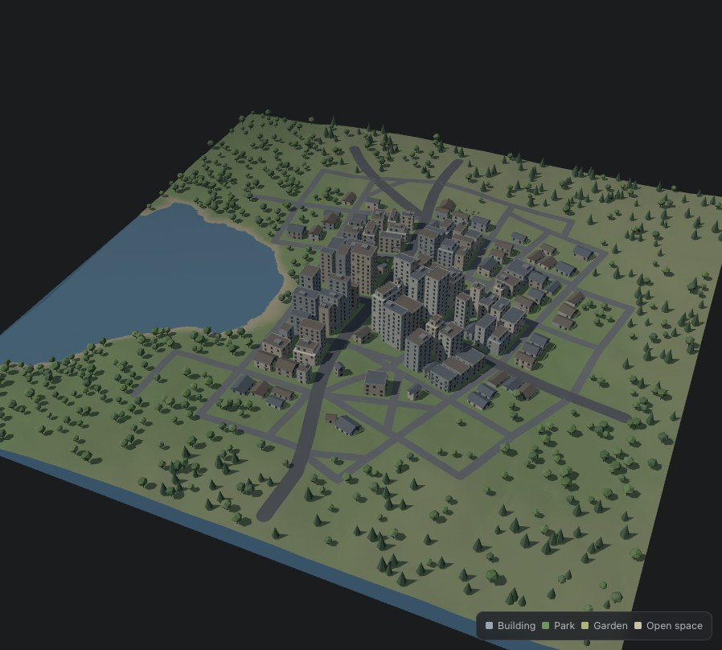
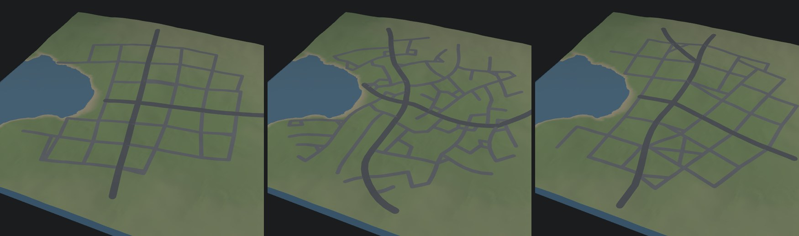
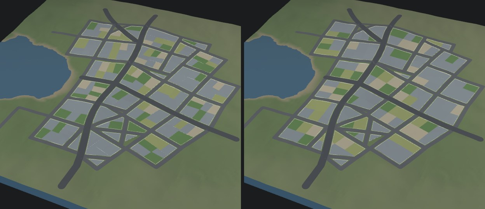
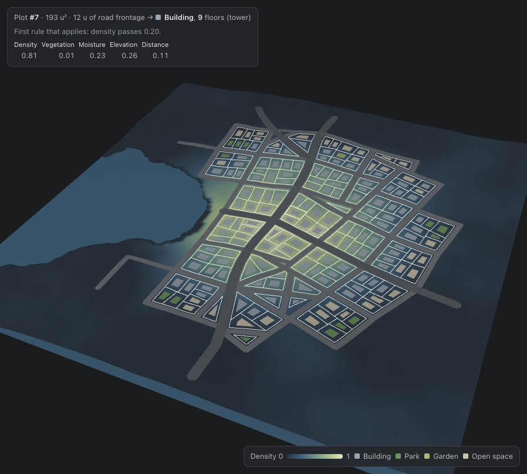
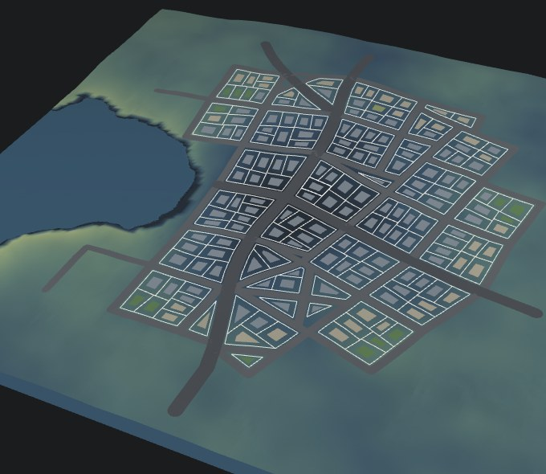
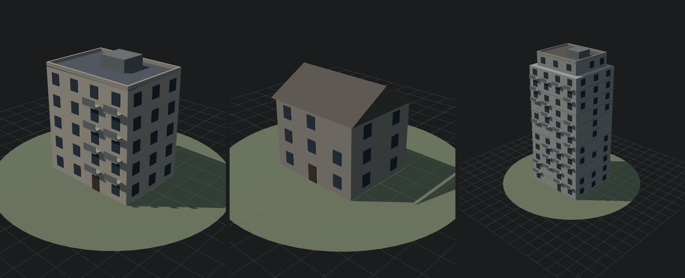
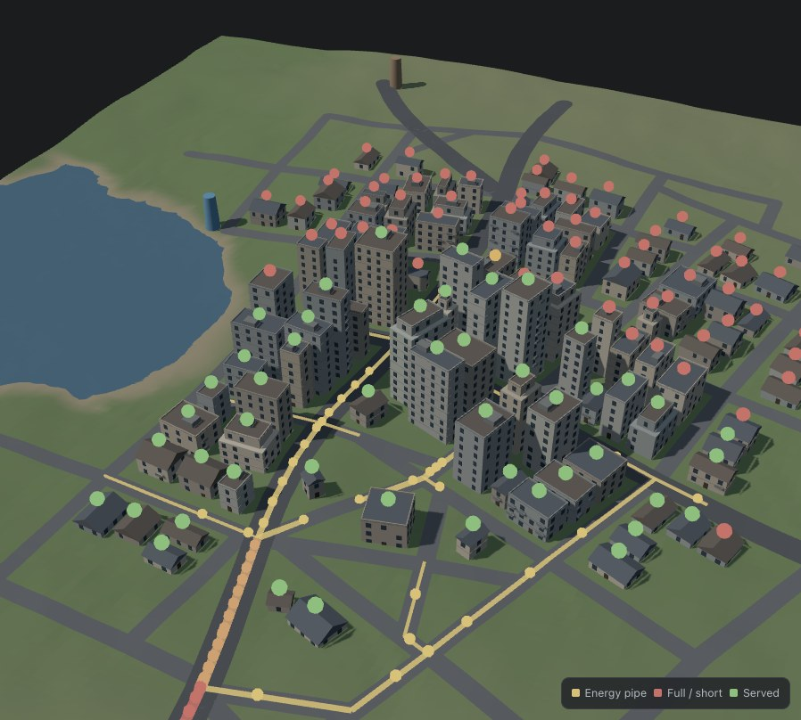
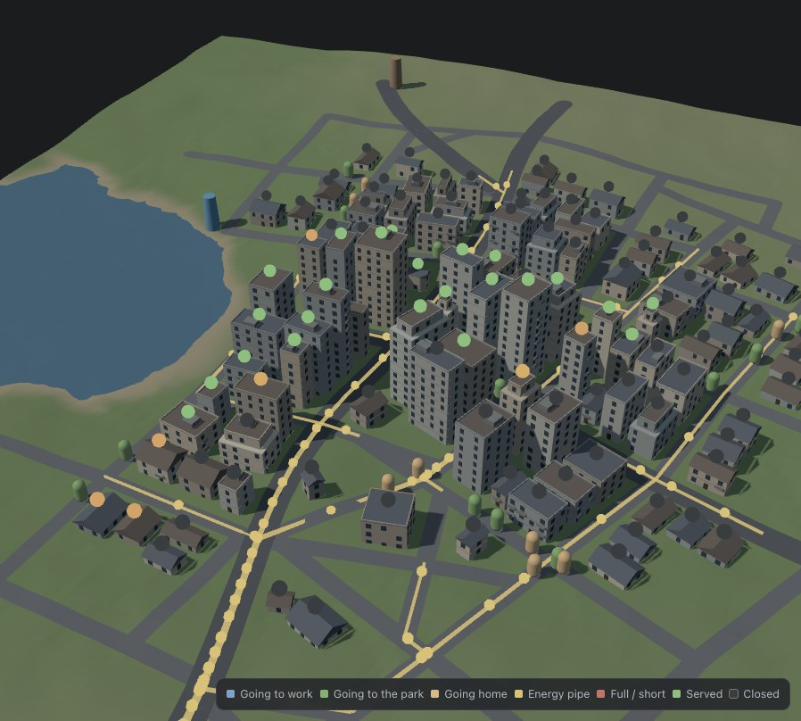
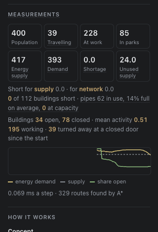

# Topic 10 — City

Jessica Hsiao · Procedural World Building

*Explore how procedural rules transform terrain into organized environments
through road networks, spatial subdivision, zoning maps, and parametric
architecture.*

A city and site generator, taken apart into the five steps of the Week 9
lecture: grow roads over a terrain, read the blocks off them, cut the blocks
into plots, decide each plot from continuous maps, and put a parametric
building or planting on it. Then, for Assignment 2, the city is set running:
inhabitants with schedules travel its roads, water, energy and waste flow
through networks under its streets, and the two are coupled so that people
make demand and shortages close buildings. Each step is an experiment with
its own controls, and each later step runs on the output of the earlier
ones. It is a learning environment, not a city builder: every number the
page shows is measured from the site on screen.

[← back to the README](../../README.md) · [study notebook index](../README.md)



## Contents

- [What is on the page](#what-is-on-the-page)
- [The pipeline](#the-pipeline) — one deterministic chain, memoised per stage
- [A. Road networks](#a-road-networks) — one growth algorithm, three sets of goals
- [B. Plots](#b-plots) — faces of the road graph, cut by straight lines
- [C. Zoning maps](#c-zoning-maps) — continuous fields, discrete decisions
- [D. A parametric building](#d-a-parametric-building)
- [E. The site](#e-the-site) — the maps deciding everything
- [F. Inhabitants](#f-inhabitants) — schedules and A* routes on the generated roads
- [G. Resource flow](#g-resource-flow) — supply, demand, and the network between
- [H. Urban dynamics](#h-urban-dynamics) — five rules coupling people and resources
- [The simulation loop](#the-simulation-loop) — fixed step, play, pause, step, reset
- [Cost](#cost)
- [Saving a world](#saving-a-world)
- [Connection to Wildform](#connection-to-wildform) — what can be lifted out
- [Limitations](#limitations)
- [Notes](#notes)

## What is on the page

Eight tabs, **A Roads · B Plots · C Zoning · D Building · E Site** and
**F Agents · G Resources · H Dynamics**. Each shows
its own controls, its own measurements and a four-part explanation —
concept, algorithm, parameters, and what it could do for Wildform. Choosing a
tab also sets which layers are shown; the **Show** toggles change them after.

| Experiment | Controls |
| --- | --- |
| **All** | **Seed** (1–999), **New seed**, **Reset** (every parameter back to default; seed and tab stay) |
| **A Roads** | Strategy (Grid / Organic / Layered), Road density, Road width, Irregularity |
| **B Plots** | Subdivision (Regular grid / Irregular), Plot size, Cut irregularity |
| **C Zoning** | Map (Density, Vegetation, Moisture, Elevation, Distance), Noise scale, Noise intensity, Centre reach; Build threshold, Green threshold, Soft band — with the seven decision rules listed and a live count against each |
| **D Building** | Width, Depth, Floors, Roof (flat / pitched), Roof slope, Balcony probability, Facade variation |
| **E Site** | The decision thresholds, Max floors, and D's roof slope, balconies and facade variation |
| **F–H, all** | Play / Pause, **Step** (one simulated minute), Reset (back to 06:30, day 1), Simulation speed (1–120 simulated minutes per second) |
| **F Agents** | Population (10–800), Movement speed; click an inhabitant on the road to inspect it |
| **G Resources** | Resource shown (Water / Energy / Waste), Resource supply, Resource demand, Network capacity, and the shortage policy (Nearest first / Shared equally) |
| **H Dynamics** | Population and movement speed, and all of G's — with the five rules listed and a live value under each |
| **Show** | Roads · Plot boundaries · Zoning map · Buildings · Vegetation, as each tab allows |

In B, C and E, **hovering a plot** opens a probe: its area, its road frontage,
the category it became and why — the rule that fired, or for a plot in the
soft band, the probability and the plot's roll — and in C and E the five map
values it read. At phone width the columns stack: the scene, then the
controls, then the worlds library.

## The pipeline

```
seed ─► terrain ─► roads ─► blocks ─► plots ─┐
            │                                 ├─► zones ─► buildings, trees
            └────────► maps (fields) ─────────┘
```

Every stage is a pure function of the seed and the parameters before it, in
its own module under `src/city/`, with no three.js and no React in any of
them:

| Module | Stage |
| --- | --- |
| `ground.ts` | The site terrain, and the `Ground` interface everything else asks |
| `roads.ts` | Road growth: priority queue, local constraints, three strategies, tidying |
| `blocks.ts` | Faces of the planar road graph, inset to the kerb |
| `plots.ts` | Subdivision, frontage, dead-end crossings |
| `geometry.ts` | The polygon toolkit: split by a line, oriented box, inset, tests |
| `fields.ts` | The five maps on a 128² grid |
| `zoning.ts` | The decision list, the random control, coherence |
| `building.ts` | One building as a list of parts |
| `site.ts` | Footprints fitted to plots, the type ladder, vegetation |
| `sim/graph.ts` | The road network as a weighted graph; A* for trips, Dijkstra's tree for distribution |
| `sim/places.ts` | E's buildings and parks as places with a door, a junction, residents and jobs |
| `sim/inhabitants.ts` | Schedules, routes and walking, one simulated minute at a time |
| `sim/resources.ts` | Plants, networks, and the allocation rule with its two policies |
| `sim/urban.ts` | `CitySim`: the three modes, the five coupling rules, statistics and history |
| `cityMeshes.ts`, `CityViewport.tsx`, `sim/simMeshes.ts` | The only three.js — draping, instancing, the simulation layer |

The page memoises each stage on its own inputs, so a slider re-runs its stage
and everything after it and nothing before: a zoning threshold re-zones the
existing plots without regrowing a road, and a Show toggle sets `.visible`
and rebuilds nothing at all.

## A. Road networks



*Grid, Organic and Layered on the same seed and terrain.*

**Concept.** Roads are grown rather than drawn, after Parish & Müller (2001):
a network starts as one junction near the middle of the site and spreads by
proposing new segments, the way a town grows out from a crossroads.

**Algorithm.** A priority queue of proposed segments. Each proposal popped is
put through the same five **local constraints**, whatever the strategy:

1. it must stay on land, inside the site, and on ground under 16°
2. if it crosses a road, it stops there and the crossing becomes a junction
3. if it ends near a junction, it snaps onto it
4. if it stops just short of a road, it is extended to meet it
5. it may not leave a junction at under 30° to a road already there; if it
   ends crowded against another road, it is joined straight onto that road

A proposal that survives becomes a road, and the strategy's **global goals**
propose what grows from its end. That is the whole difference between the
three:

| Strategy | Global goals |
| --- | --- |
| **Grid** | Straight on, and a branch at ±90°, every *spacing*. The four first arms and their straight continuations are primaries — two avenues crossing at the centre — and every branch is secondary. Irregularity jitters angle and length and leaves some branches out |
| **Organic** | Short steps (0.42 × spacing). Each turn is read from a noise field *at the road's position*, so neighbouring streets bend alike, and a fan of seven headings is scored for flat ground, so roads follow the contours. Branches now and then, at loose angles |
| **Layered** | Primaries first: long steps that follow the terrain, an occasional fork. Every *spacing* along a primary, secondaries are queued off both sides at right angles — **behind every primary in the queue**, so the arterial network is finished before the first lane is laid. Secondaries then grow small grids aligned to the road they left |

Constraint 2 is what keeps the graph **planar** — every crossing is a node —
and that is what makes Experiment B possible. A test checks it for all three
strategies: no two roads cross without a junction, and every road samples as
land under 16°.

After growth, a **tidying** pass: a dead end that points at a road within
reach is joined to it, if that closes a real loop; a stub shorter than a step
is removed. Organic networks need it most — they trim 12–24 stubs each.

**Measured** on seeds 1–5 at the defaults (density 50%, width 5, irregularity
30%):

| | Grid | Organic | Layered |
| --- | --- | --- | --- |
| Road | 1.8–3.0 km | 2.5–3.9 km | 2.6–3.5 km |
| Segments | 47–89 | 220–339 | 98–131 |
| Junctions / dead ends | 21–45 / 3–5 | 62–95 / 15–22 | 37–53 / 4–6 |
| Proposals grown / connected / refused | 36 / 21 / 49 | 267 / 35 / 120 | 65 / 28 / 47 (means) |
| Main reason refused | edge of town (26) | crowding (75) | edge of town (26) |
| Time | 0.2–0.8 ms | 0.7–1.8 ms | 0.2–0.5 ms |

The test suite also checks the grid is a grid: at irregularity 0, more than
90% of its length lies within 10° of its two axes, and less than 60% of an
organic network's does.

## B. Plots



*Irregular bisection (left) and a regular grid (right), with categories dealt
at random.*

**Blocks are the faces of the road graph.** At each junction the roads
leaving it are sorted by angle. Walk along a road and at every junction take
the next road clockwise from the one you arrived on, and you trace one face
with the face on your left; each directed road is walked once. Enclosed faces
come out counter-clockwise — positive area — and the outer face of the network
comes out clockwise and is discarded. Dead ends are pruned first, repeatedly,
because a cul-de-sac inside a face is walked up one side and down the other,
leaving a zero-width spike no inset survives.

**Each face is inset to the kerb** — each side moved in by half *its own*
road's width plus a 1.2-unit setback, since a primary is wider than a lane.
New corners are where neighbouring offset lines meet; a side shorter than the
offset turns round, is removed, and the corner re-solved — the one event of a
straight skeleton this needs. The result is checked for self-intersection,
not trusted. Faces too small to survive are counted: 1–7 per site for grid and
layered, 14–20 for organic, whose loops are smaller.

**Plots are cut with one operation**, splitting a polygon by a line. It works
on concave blocks: the crossings are sorted along the line and paired, and
each piece traced by jumping across a pair. Sutherland–Hodgman clipping, the
usual tool, cannot do this — on a concave block it returns the pieces joined
by zero-width bridges. A test cuts a U across both arms and checks for three
pieces whose areas sum to the original.

- **Regular grid** — lines at the plot size along one axis of the block's
  minimum-area box and 1.4× it along the other: lots deeper than wide.
- **Irregular** — recursive bisection (Vanegas et al., 2012): cut across the
  piece's own long axis, near the middle, until it is under 1.4× the target
  area. Cut irregularity moves the cut up to a quarter of the length off
  centre and tilts it up to 17°.

**Frontage.** Every plot measures how much of its outline lies on the kerb. A
plot with under 3 units has no usable road — recursive bisection can cut a
deep block's middle off from every street, and that is a real property of the
method rather than a bug; zoning makes such plots gardens. **Dead ends** run
through blocks, since they were pruned before tracing, so any plot within half
a road width of one is dropped: 0 on grid and layered networks, 2–14 on
organic ones.

**Measured** (seeds 1–5): 77–169 plots per site on a grid network, 56–94 on
organic, 102–174 layered. The regular grid gives no landlocked plots on grid
and layered networks — every lot fronts a street — and irregular bisection
gives 0–5. But "regular" is only regular on regular blocks: on organic blocks
the grid's plot areas vary more than bisection's (coefficient of variation
0.38–0.45 against 0.23–0.34), because a fixed lattice laid over an irregular
block leaves irregular remainders.

Categories in this tab are **dealt at random** in fixed shares (62% building,
14% park, 12% garden, 12% open) — deliberately, as the control for C.

## C. Zoning maps



*Density on the ground, each plot's decision as a tile, and the probe on
plot #7.*

**Concept.** A map is a number at every point; a decision is one of a few
answers per plot. Zoning is the rule between them.

**The five maps**, each in [0, 1], on a 128² grid read back bilinearly:

| Map | Formula |
| --- | --- |
| Elevation | height above the waterline, 0 at the shore, 1 at the top |
| Distance | from the city centre, over half the site width |
| Moisture | 0.6 × nearness to water (e-folding over 18 units) + 0.4 × (1 − elevation) + noise |
| Density | a smoothstep bell, 1 at the centre and 0 at the reach, × (0.4 + 0.6 × flatness) + noise; 0 on water |
| Vegetation | 0.55 × moisture + 0.45 × (1 − density) − 0.15 + noise |

The noise is three octaves of value noise, and the only term with no physical
meaning: it stands for everything a real plan would know and this one does
not.

**The decision.** Each plot reads the maps at its centre and takes the first
rule that applies:

1. too small or too thin to build on → open space
2. moisture ≥ 0.80 — wet ground → park
3. density passes the build threshold → **building**
4. …but under 3 units of road frontage → garden
5. vegetation ≥ the green threshold → park
6. moisture ≥ 0.50 → garden
7. otherwise → open space

Rule 3 is where a continuous value becomes a yes or a no, two ways. A **hard
threshold** builds exactly the plots whose density clears it — a test checks
exactly that, and that raising it never builds a plot that was not built
before. A **soft band** turns density into a probability, smoothstep from 0 at
threshold − band to 1 at threshold + band, and each plot rolls its own seeded
die against it. The die belongs to the plot, so moving a slider does not
reshuffle plots it does not move.

**Does it work? Coherence.** Of each plot's four nearest neighbours, the share
in the same category, averaged. Categories dealt at random score near the sum
of their squared shares wherever they land; districts score higher.

| Seeds 1–5, defaults | Grid | Organic | Layered |
| --- | --- | --- | --- |
| Dealt at random (B) | 0.36–0.51 | 0.30–0.45 | 0.38–0.49 |
| By the maps, hard threshold | 0.80–0.82 | 0.68–0.83 | 0.74–0.82 |
| By the maps, band ±0.08 (default) | 0.75–0.87 | 0.67–0.82 | 0.74–0.83 |
| By the maps, band ±0.20 | 0.71–0.79 | 0.64–0.74 | 0.68–0.75 |

The maps roughly double it. Widening the soft band to ±0.20 costs about 0.07
in every strategy — that is the frayed district edge, measured.

**What the noise controls — measured, and not what I expected.** I expected
noise *intensity* to fragment the districts. At the default 90-unit scale it
does nothing measurable (layered, seeds 1–5, hard threshold):

| Noise scale | Intensity 0.35 | Intensity 1 |
| --- | --- | --- |
| 20 u | 0.77 | **0.70** |
| 40 u | 0.78 | 0.77 |
| 90 u (default) | 0.79 | 0.80 |
| 240 u | 0.84 | **0.88** |

Fragmentation is set by **scale**. Noise much broader than a plot (90 units is
six plots) moves *where* the district boundaries fall but keeps each district
whole; only noise near plot size breaks them up. And at 240 units, full
intensity makes the city *more* coherent: one broad swell adds to the centre's
bell instead of cutting across it.



*The vegetation map: high where wet and unbuilt, low in the centre — density
feeding back into green.*

## D. A parametric building



*Facade variation 0, a pitched roof at 0.6, and a tower at 1.*

A building is a function — numbers in, a list of **parts** out. Each part is
a scaled box (wall, band, window, door, balcony slab, rail, roof slab, parapet,
plant room) or one prism (the gable), with a position, size and colour in the
building's own frame. Nothing is loaded from a model.

- **Body** — one wall box, floors × 3 units.
- **Windows** — one per bay on every face; bays 2.8 units at no variation. The
  ground floor of the front gets a door in the middle bay.
- **Balconies** — decided **per bay**, on the front and back, then stacked on
  every floor above the ground. They were first rolled per window, which
  scattered them; seed 1's front got one in sixteen.
- **Roof** — flat: a slab, a parapet and, on three floors or more, sometimes a
  plant room; pitched: a gable whose ridge runs along the longer side, rising
  half the short side × tan(slope).
- **Facade variation** — 0 is perfectly regular. Raising it widens the bays,
  varies the window size, blanks some windows, may add floor bands and set the
  top floor back, widens the colour range, and knocks balconies out of their
  stacks — each a seeded roll, so a seed is a building.

Tests pin it down: the same parameters give identical parts; five floors is a
15-unit wall; balcony probability 0 gives none and 1 gives every eligible
window (a 14 × 10 block of five floors: 4 bays × 4 floors × 2 faces = 32); a
45° roof on a 10-deep house rises 5.

Every part kind is one `InstancedMesh`, so the renderer draws any number of
buildings in ten draw calls.

## E. The site

All four together, and the maps run it: dense ground builds tall, sparse
ground builds low and leaves room for green, wet ground stays planted.

**Height and type** come from density. Floors rise above the threshold as a
power of 1.6 — `1 + (maxFloors − 1) × f^1.6`, where *f* is how far density is
from the threshold to 1 — so most of the town stays low and the height
gathers in a peak. One or two floors is a house with a pitched roof, three to
six an apartment block, seven or more a tower.

**The footprint** is the plot's minimum-area box, turned so the front faces
its longest stretch of kerb, cut to the type's limits, set back from the
street, then narrowed — width first, keeping the depth — until all four
corners are inside the plot. A test checks every building's corners.

**The plot can veto the type.** A tower whose footprint will not fit becomes
an apartment block of at most 6 floors; if that will not fit, a house of at
most 2. Lot size limiting building type is how real zoning works, and it
rescued about a third of the plots that otherwise stood empty — 58 of 167
over seeds 1–3 and the three strategies. The page counts both: 1–12
buildings stepped down per site, 1–20 plots too awkward even for a house.

**Vegetation** — parks get trees on a jittered grid thinned by the vegetation
map, gardens get shrubs and a few trees, open plots a scattering, houses
sometimes a tree behind. Outside the blocks, the countryside is planted by
the vegetation map alone, kept off roads and steep ground, with conifers on
high ground. A test checks no tree stands on a road.

**Measured** (seeds 1–5, defaults):

| | Grid | Organic | Layered |
| --- | --- | --- | --- |
| Buildings | 32–123 | 26–50 | 44–112 |
| Houses / apartments / towers (means) | 36 / 30 / 14 | 20 / 12 / 7 | 36 / 26 / 10 |
| Stepped down / unbuildable | 1–10 / 1–11 | 6–9 / 9–17 | 4–12 / 8–20 |
| Trees and shrubs | 659–915 | 694–899 | 649–837 |
| Building parts | 1,088–5,008 | 691–1,849 | 1,773–4,587 |

Organic towns are the smallest: their blocks are fewest and most irregular,
so they lose the most to the inset, the dead ends and the fit.

## F. Inhabitants


*An inhabitant on the way to work, selected.*

**Concept.** An agent is a schedule and a position. The city it lives in is
not built for it: the homes, workplaces and parks are E's buildings and park
plots, and the only way between them is A's roads.

**Places.** Each building becomes a place with a door — a point in front of
its street face — joined to the nearest junction. Houses hold about one
resident per 45 u² of floor; apartment blocks have homes above and jobs on
the ground floor; towers are offices, about one job per 30 u². Parks have
neither. On seed 1's layered city that is 112 buildings with 445 homes and
729 jobs, and 13 parks.

**Routes.** The road network becomes a graph — junctions are nodes, roads
are edges weighted by length — and a trip is the route A* finds between the
junctions nearest two doors, with the doors added at each end. The
straight-line distance to the goal never overestimates a road distance, so
A* returns the shortest route; a test checks it against Dijkstra's for every
third junction, and checks every consecutive pair of route nodes is joined by
a road. Routes are cached by junction pair: 300 people need 210–356 distinct
searches (seeds 1–3), each expanding about ten junctions.

**Schedules.** Everyone runs the same loop — at home until a personal leave
time between 06:45 and 09:15, to work, a 7–9 hour shift, to the nearest park
to the workplace for 20–110 minutes, home. A test runs two days and checks
that no inhabitant ever skips a step of it and that everyone comes home.

**Walking** is the inhabitant's speed — the shared movement speed × a
personal 0.85–1.15 — along the route polyline, nothing else. Nobody sees
anybody: congestion is not modelled. The default speed is slow on purpose.
At 80 units a minute, a real walking pace on this site, the average trip
takes 2.5–2.6 simulated minutes and no more than 15–21 of 300 people are ever
on the road at once; at the default 15 it is 11.3–11.9 minutes, with a peak
of 46–57 in the late afternoon.

**Inspecting.** Click near anyone on the road: a ring marks them, and the
inspector shows their task, destination, distance and time to go, schedule,
home and workplace, trips and how often they were turned away. It reads the
simulation live, and follows them indoors.

## G. Resource flow



*Energy at 30% pipe capacity: the buildings along the trunk are served, the
rest of the town is short — for the network, not for supply.*

**Concept.** Buildings consume, plants produce, and a network in between
limits what reaches whom. A shortage can come from too little supply or from
pipes too narrow to carry it, and they look different on the map.

**Plants** are placed from the ground and the plan: water works at the
junction nearest open water, the power station at the junction farthest from
the centre, the waste depot as far as it can be from both.

**The network** is Dijkstra's shortest-path tree from the plant over the road
graph — each junction fed by its parent toward the plant, pipes under the
streets. Pipe capacity follows road width, so a primary carries 1.6× a lane:
the arterials the layered strategy grows first are also the city's mains.
Waste runs the same algorithm with the arrows reversed — buildings ask for
collection, the depot's capacity is the supply.

**Demand** in G follows two daily curves, written as steps: the share of
residents at home (0.35 at night, 0.9 in the morning, 0.45 by day, 1 in the
evening) and of jobs in use (1 from 09:00 to 17:00, less either side). Each
person asks for 1 water, 1 energy and ½ waste a minute. Supply 100% is the
peak of that curve summed over the city.

**Allocation**, every minute, by one rule: buildings are served in order of
distance along the network, and each gets the least of what it asks for,
what the plant has left, and the spare capacity of the tightest pipe on its
way. What it does not get is a shortage, put down to whichever limit bound —
*supply* or *network*. Tests check that nobody gets more than asked, the
plant never gives more than it makes, no pipe carries more than its capacity,
and every unit of demand is delivered or accounted short.

**Who goes short** is a policy, and the page offers two:

- **Nearest first** — the end of the line gets whatever is left, possibly
  nothing. It makes a legible map: green near the plant, red at the far end.
- **Shared equally** — every building is rationed to supply ÷ demand before
  the pipes are applied, so a shortfall is spread thin.

Pipes limit both the same way, nearest-first, since a full pipe is full
whoever is downstream.

The page shows supply, demand, the shortage and its cause, **unused supply**
(made and delivered to nobody), how many buildings are short, and the pipes —
how many carry anything, how full on average, how many are at capacity.

## H. Urban dynamics



*400 inhabitants against supply sized for 300, nearest first: the far side of
town has closed.*

Five rules, every simulated minute. They are listed on the page with a live
value under each:

1. **Demand comes from people.** A building asks for 1 water, 1 energy and
   ½ waste a minute per person inside it, plus a standing 10% of what it
   would ask if full.
2. **Supply is allocated** along each network by the chosen policy, and the
   pipes cap each branch.
3. **Activity follows supply.** A building's activity moves 1/60 of the way
   each minute — about an hour's time constant — toward its worst-supplied
   share of water and energy, with uncollected waste counting half.
4. **Closures.** A building under 0.4 activity closes and reopens over 0.6;
   the gap keeps it from flickering. Workers who arrive at a closed workplace
   are turned away, to the park.
5. **Statistics** are counted from 1–4.

Supply at 100% is sized for 300 inhabitants indoors plus every building's
standing load, so the population slider is the obvious lever.



**Measured: the two policies fail in opposite ways.** Seed 1, layered, at
noon on day 2 (buildings closed of 112, and mean activity):

| | Nearest first | Shared equally |
| --- | --- | --- |
| 300 inhabitants | 0 closed, 1.00 | 0 closed, 1.00 |
| 330 | **53 closed**, 0.54 | 0 closed, 0.93 |
| 400 | 82 closed, 0.25 | 0 closed, 0.81 |
| 600 | 97 closed, 0.11 | 0 closed, 0.58 |
| 800 | 105 closed, 0.06 | 0 closed, 0.46 |
| Supply 80% (300 people) | 82 closed, 0.26 | 0 closed, 0.80 |
| Supply 40% | 108 closed, 0.03 | 0 closed, 0.40 |
| Supply 30% | 112 closed, 0.01 | **112 closed**, 0.32 |

Nearest first is a cliff: ten percent more people than the plants are sized
for closes nearly half the town — 53 of 112 on seed 1, 41 of 65 on seed 2,
41 of 72 on seed 3. The last buildings in line get nothing, and since a
building runs on its *worst* resource and the three plants stand in different
corners, each network starves a different end of town. Shared equally never
closes anything until supply falls below the 0.4 threshold, and then closes
everything at once. Neither is a good city; the contrast is the point. Network
capacity is the same under both policies — at 50% pipes, 93 buildings closed
either way — because pipes always limit nearest-first.

**Closures lag the shortage.** Activity takes time to climb back over 0.6,
so a building can stay closed after its supply returns: at 16:30 on day 2
with 400 inhabitants, 33 buildings were closed and fully served. And the town
breathes: closures rise through the working day and the night, when everyone
is indoors, and fall to none in the late afternoon, when workers leave the
towers and many are on the road, asking for nothing. A test checks that
buildings closed at 450 inhabitants reopen when the population falls to 150.

## The simulation loop

One fixed step of one simulated minute, for all three experiments. **Play**
accumulates real time × the speed and runs as many whole steps as it covers —
a slow frame runs more steps, never a longer one — so a run is the same at
any speed and any frame rate. **Step** runs exactly one and pauses. **Reset**
rebuilds the simulation from the seed. Every random draw — homes, jobs, leave
times, shifts, paces — comes from one seeded stream, and a test runs two
copies for 900 minutes and checks every position and every activity value
agree.

The simulation lives apart from the drawing. `CitySim` knows nothing of
three.js; `SimLayer` reads it each frame and writes instance buffers — a
capsule per traveller, a bar per pipe, beads running along each pipe in the
direction of flow (more on fuller pipes), a column per plant, a pin per
building. Sliders that change parameters are pushed into the running
simulation with `setParams`; only the city, the seed, the experiment and
Reset build a new one, so moving a slider never restarts the day.

## Cost

Everything after the terrain is cheap. Over seeds 1–5 in Node, roads, blocks,
plots, maps and the site layout together take 3.6–18.2 ms; the terrain's
droplet erosion takes 135–161 ms alone. In the browser, the readout on seed 1
said *whole site 156 ms: terrain 141, roads 2.3, blocks 0.5, plots 1.5, maps
2.9, buildings and trees 8.1*. So the stage memoisation matters for one slider
only — the seed — and everything else is fast enough to recompute on every
change.

Drawing: one mesh each for terrain, water, roads, plot fills and outlines; ten
instanced meshes for building parts and three for trees, however many there
are. The render loop is the shared one, and idles when nothing moves — and
while a simulation plays, it keeps drawing.

The simulation is cheaper still. A step takes 0.003–0.010 ms with only
inhabitants (seeds 1–3, 300 people), 0.013–0.043 ms allocating three
resources, and 0.021–0.046 ms coupled — 0.025–0.046 ms at 800 people. At the
top speed of 120 minutes a second, that is about 5.5 ms of work per real
second.

## Saving a world

The worlds library saves the seed and every parameter of all eight
experiments, and the tab that was open — not the geometry, and not a
running simulation, which a loaded world restarts at 06:30 on day 1. Every stage is a
deterministic function of what is saved, and regenerating takes about the
time of one terrain build, so storing thousands of polygons would save under
a fifth of a second. A loaded world opens on the tab it was saved from.
Unknown or out-of-range values are repaired, and a test round-trips the shape.

## Connection to Wildform

The algorithms were kept apart from the renderer so they can be lifted out.
What each could do for Wildform, and what it needs:

| Module | Use in Wildform | Needs |
| --- | --- | --- |
| `roads.ts` | Grow paths across a site from its entrances, steered by slope, joining where they meet, instead of laying them by hand | A `Ground`: land, slope, height, water distance |
| `blocks.ts`, `plots.ts` | Divide a site into beds, terraces or habitats, each with a known edge on a path — and know which have none | The road network |
| `fields.ts`, `zoning.ts` | The same pattern Wildform's growth already uses — fields of sun, moisture and shelter — turned into a decision per cell: where a species may root, where a structure may stand | Any set of fields |
| `building.ts` | Generate the host buildings plants climb, so each site has its own; bays, balconies and setbacks are the ledges and shelter the growth model looks for | Nothing — numbers in, parts out |
| `geometry.ts` | Polygon splitting, oriented boxes and insets for any planar layout | Nothing |
| `sim/graph.ts` | Routes for inhabitants over any graph of walkable places — living platforms, branches, bridges between buildings; and distribution trees from a source | Points and lengths |
| `sim/inhabitants.ts` | Inhabitant movement and schedules: a creature with a nest, a feeding ground and a resting place, routed over whatever has grown | Places with a junction |
| `sim/resources.ts` | Water and nutrient distribution through a structure from a root, a gutter or a cistern, with the far tips going short first — or sharing, by policy | A graph, a source, demands |
| `sim/urban.ts` | Resource-driven growth: activity that drifts toward supply is growth that follows light and water; closures are dieback; inhabitants change where demand is | All of the above |

`Ground` is the seam: five questions about a point. Wildform's world can
answer them about its own terrain and run the rest unchanged.

## Limitations

- **One plan per site.** The roads grow from one centre; a real region has
  several towns, and their networks would meet.
- **Plots read the maps at their centre**, not averaged over their area. A
  plot straddling a sharp edge in a map takes whichever side its centre is on.
- **The inset is not a full straight skeleton.** It handles the edge-collapse
  event and drops anything that still self-intersects, so narrow blocks are
  lost rather than shrunk — 14–20 per organic site.
- **Dead ends are not cut into blocks.** Plots under them are dropped instead
  of split along the road.
- **Footprints are rectangles.** An L-shaped plot gets a rectangle that fits
  inside it, not an L-shaped building.
- **The terrain under a building is not levelled.** Buildings are sunk to
  their lowest corner, so the uphill side is buried slightly.
- **No water crossings.** A road that meets water turns or stops; there are
  no bridges.
- **Inhabitants do not meet.** No congestion, no queues, no shared trips;
  they are counted, not crowded.
- **Places join the road at one junction**, the nearest to the door, which
  can be across a block from it.
- **One plant per resource**, and the network is a tree: no loops, so no
  second way round a full pipe.
- **Activity is a single number.** A building is open or closed; there is no
  partial service, no storage, no prices.

## Notes

**The first terrain cut the city in two.** Topics 5 and 6's terrain floods
its lowest 16%, and on seed 1 that was one lake across the middle of the
site. The site is now tilted along a seeded direction, so low ground and
water collect along one side as a shore, and floods 12%.

**Organic roads refused to grow at first** — 86 segments on seed 1 where a
network was expected. The crowding rule rejected any road ending near
another, and a bending street ends near *itself*: its own previous segment
was inside the separation distance. The road's own chain, two junctions back,
is now exempt.

**Then they grew into triangles.** Rule 5 was changed from refusing a crowded
road to joining it onto the road it crowds, which closed loops — but a branch
would merge straight back onto the street it left a few junctions earlier,
and 40 of seed 1's 58 organic faces were too small to survive the inset —
the 19 I listed were all triangles of 56–83 units². A merge must now reach a road more than four junctions away.

**Buildings did not fit their plots.** Footprints were shrunk in both
dimensions at once, which put the depth under its minimum after a single
step. Shrinking width first fixed some; most of the rest were genuinely
awkward wedges, which is what the type ladder is for.

**A plot sat on a road.** The dead-end check tested plot corners against the
road and road points against the plot, and missed a plot side passing a dead
end's tip — two plots on seed 1's organic network. It now uses the true
segment-to-segment distance; a test checks every plot corner and side
midpoint against every road.

**The readout did not add up.** "Grew" was the edge count minus the
connections, but splitting a road at a junction adds an edge, so grew,
connected and refused summed to more than the proposals (183 against 162). Each
outcome is now counted where it happens, and a test checks they sum.

**Balconies scattered.** See D: rolled per window they read as noise, and
real buildings stack them.

**Every building closed by half past eight.** The first coupled run closed all
112 buildings in the first two hours with no shortage on the panel. Dijkstra
relaxed each junction's distance but never pushed it onto the queue, so the
tree stopped at the plant and every building was *unreachable* — a cause the
summary line did not yet show. A test now checks the tree reaches every
junction.

**Pipes sized at a third of demand starved everything.** With each lane's
pipe carrying 35% of the reference load, and the water works on a junction
with two pipes, 271 of 417 units of water were short at default settings.
A lane's pipe now carries the whole reference load; capacity becomes the
limit only when the slider says so.

**The shortage cause was misattributed.** At 30% capacity the panel said 0.7
units were short for supply — impossible with the plant half idle. The cause
was being decided from values already updated by the allocation. The three
limits are now compared before anything is given, and a test checks that
thin pipes produce only network shortages and a weak plant only supply ones.

**The nearest-first cliff** is a finding, not a bug, but it was not the
design: the experiment was meant to respond gradually to population. Rather
than tune it away, the other extreme was added as a policy, and the table in
H is the comparison.

**The streets were empty.** At a realistic walking pace a trip lasts under
three simulated minutes and at most 21 of 300 people are on the road; the
default speed is now 15, a stylised pace, and the slider goes to 150.

