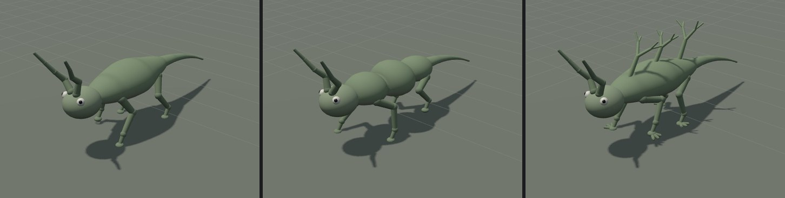
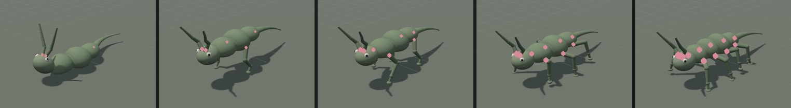
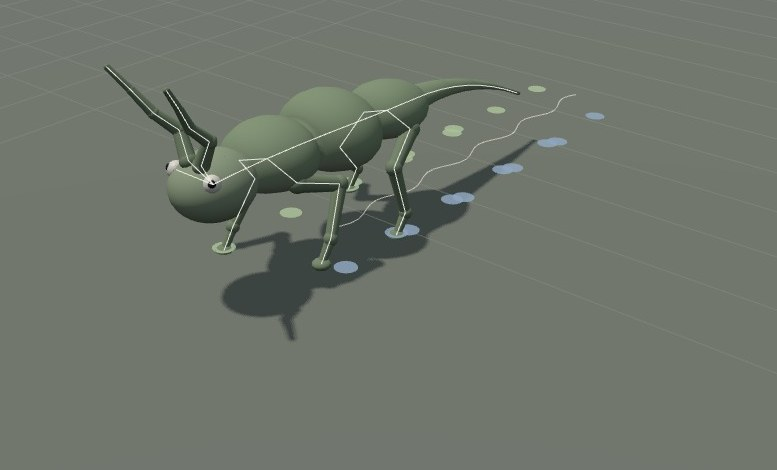
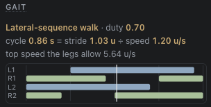
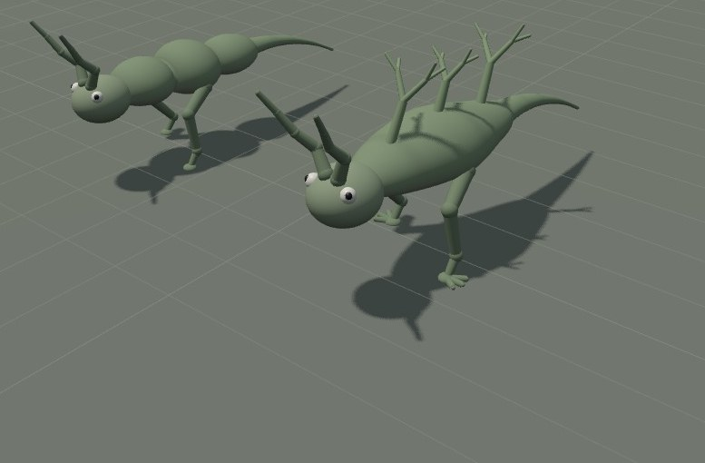

# Topic 11 — Creatures

Jessica Hsiao · Procedural World Building

*An interactive creature laboratory: a body grown from a genome, legs placed
by gait and inverse kinematics, senses and decisions that choose how it
moves, and mutation that makes the next one.*

From the Procedural Creature Architecture lecture (DESIGN 6197/4197): body
plan, anatomy, perception, locomotion, traits, behavioural control,
procedural animation, and variation. The lecture's demo was a creature
creator; this page is a smaller version built to take the techniques apart.
It is not a modelling tool. Each system has its own tab and its own debug
overlay, and every number on screen is measured from the creature on screen.

[← back to the README](../../README.md) · [study notebook index](../README.md)


## Contents

- [What is on the page](#what-is-on-the-page)
- [The architecture](#the-architecture) — a genome in, a pose out, three.js last
- [A. Body morphology](#a-body-morphology) — a profile swept along a spine, skinned to it
- [B. Anatomy](#b-anatomy) — appendages on anchors, a ride height solved for the legs
- [C. Locomotion](#c-locomotion) — gaits as tables of phases, planted feet, two-bone IK
- [D. Behaviour](#d-behaviour) — senses from the body, a decision list, a speed
- [E. Variation](#e-variation) — genotype, phenotype, mutation and repair
- [Debug overlays](#debug-overlays)
- [Cost](#cost)
- [Saving a world](#saving-a-world)
- [Connection to Wildform](#connection-to-wildform)
- [Limitations](#limitations)
- [Notes](#notes) — what went wrong, and what it taught

## What is on the page

Five tabs, **A Body · B Anatomy · C Motion · D Behaviour · E Variation**, over
one creature. Each tab shows its own controls and a four-part explanation:
concept, algorithm, parameters, and what it could do for Wildform. Each tab
also switches on the debug overlays that explain it. A to C and E show the
creature in a studio; D puts it in a habitat.

| Tab | Controls |
| --- | --- |
| **All** | **Seed** (1–9999), **Randomize** (the next seed's creature), **Reset** (the seed's creature again, undoing every edit and mutation), **Play / Pause**, **Step** (one 1/60 s step), **Animation speed** (0.1–2×) |
| **A Body** | Topology (Continuous / Segmented / Branching), Symmetry (Bilateral / Radial / Asymmetric), Body length, width, height, Segment count, Segment variation, Overall scale; Colour, Stripes |
| **B Anatomy** | Legs (0 / 2 / 4 / 6 / 8), Leg length, Leg segments (2–4), Attachment position, Attachment spread; Tail (on/off), length, segments; Head size; Eyes (0–8), size, placement; Antennae / horns (0–6), length; Wings (on/off), length |
| **C Motion** | Animation mode (Idle / Walk / Run), Walk in place; Movement speed, Stride length, Step height, Body sway; the gait readout and a footfall diagram |
| **D Behaviour** | Detection radius, Curiosity; Energy and Hunger, which set the live state; Follow with camera; the six decision rules with the one that fired highlighted; Restart habitat |
| **E Variation** | Mutation strength, **Mutate current creature**, the genes the last mutation changed, and the whole genotype with those genes marked |
| **Debug** | Skeleton · Joints · Attachment points · Sensor radius · Movement target · Locomotion path |

**Click the creature** to inspect a joint. The inspector names the joint and
its path up the hierarchy (*Root › Spine 4 › Spine 3 › Spine 2 › Leg R2 hip ›
Leg R2 knee*) and what it does. A leg joint shows its bone lengths, IK reach,
gait offset and whether its foot is planted right now. A spine joint shows
the girth of the skin bound to it; an eye shows the field of view; an
antenna shows its stiffness. The **Statistics** panel shows body segments,
limbs, joints, the current animation and behaviour, speed, energy and
hunger. Below the tiles: the gait's name, the ground-contact error, footfalls
and early steps, and the traits read off the body. At phone width the
columns stack.

## The architecture

```
genome.ts     Genome ─── repair ──► a valid genome          (≈ 40 numbers)
                │
skeleton.ts     ▼ buildCreature
              Creature: joints, spine, limbs, eyes, antennae, wings, fronds,
                        skin rings, senses, traits          (rest pose, body frame)
                │
gait.ts         ▼                      behavior.ts
animate.ts    Body ◄──── Command ───── think(Brain, Habitat)
              pose: a position per joint, a frame per spine bone
                │
lab.ts        Lab: studio or habitat, fixed 1/60 s steps, the parent beside its offspring
                │
creatureMeshes.ts, labMeshes.ts   ▼  three.js: skinned body, instanced limbs, overlays
CreatureViewport.tsx, CreaturesPage.tsx
```

Everything above the last two rows is plain TypeScript with no three.js, so
it runs in Node and the tests drive it directly. The genome is the only input.
The skeleton is built once per genome, and a frame only poses it: no geometry
is rebuilt while the creature moves. A slider rebuilds the skeleton and the
meshes once, keeping where the creature stands and its gait clock.

Everything is seeded. A seed rolls a genome, and the genome carries its own
**body seed** for the rolls that make a body its own: each segment's girth,
an asymmetric creature's uneven legs. The body seed is a gene rather than a
hash of the others for a reason. If it were derived from the other genes,
dragging the body-length slider would reshuffle every segment. The habitat
is seeded too, and a test replays five minutes of behaviour exactly.

## A. Body morphology



**A body is a hierarchy before it is a shape.** The **root** sits in the
middle of the torso. From it, the spine runs forward through the chest to
the head, and back through the tail to its tip. Each spine joint hangs from
its neighbour on the way to the root. Everything else hangs from a spine
joint: hips, wing roots, frond roots. Eyes and antennae hang from the head.
The default creature has 45 joints.

**The skin is a profile swept along the spine.** The torso's half-girth is a
function of position along it, *f(t)* for t from rear to front, multiplied by
half the width and half the height to give an elliptical ring. The belly is
flattened to 78% of the back's height.

| Topology | Profile | Spine bones in the torso |
| --- | --- | --- |
| Continuous | sin(π t)^0.5, one smooth swell, with per-segment girths blended by cosine interpolation | segments + 3, at least 5 |
| Segmented | each segment bulges as 0.5 + 0.5 sin(π u)^0.6 and pinches between, times its own girth, inside a gentle envelope | 2 × segments + 1 (one per bulge, one per pinch) |
| Branching | a compact core, sin(π t)^0.45, carrying binary trees on its back (below) | segments + 1, at least 4 |

Each segment's girth is 1 ± 0.45 × *segment variation*, rolled from the body
seed. Behind the torso, the tail tapers to a tip of 0.03 units; ahead of it,
the neck blends from the chest girth to a collar inside the head. Without a
tail, the rump is a rounded cap. The head is an ellipsoid on the head joint,
oriented by the spine's front frame.

**Skinning.** The skin is one `SkinnedMesh`: 60–220 rings, 22 segments round,
and one bone per spine joint, bound at the rest pose. Each ring is weighted
between the two spine bones either side of it, linearly by distance. When
the spine bends, the skin bends smoothly between bones instead of breaking
into tubes. This is the rigging the lecture describes, done with three.js's
own skinning on the GPU, so a frame writes one position and one rotation per
spine bone and nothing else.

**Branching.** A branching creature carries 2–5 **fronds** along its back.
Each is a binary tree two forks deep: a trunk that forks sideways, then each
branch forks fore and aft, with every bone 0.68 of its parent's length. That
makes seven bones. Its toes fork too, into three digits. The fronds are
anchored to the spine, so they ride its sway. They are swept back by speed
(an angle of 0.35 × speed/(speed + 1.5) per level) and sway with a phase lag
that grows toward the tips: secondary motion without a physics solve.

## B. Anatomy



**Every appendage has an anchor**: a position along the spine, plus an offset
in the spine's own frame (forward, up, right). That is the difference between
a limb and a decoration placed near the body. When the spine bends, sways or
follows a curved path, the anchor's frame moves, and everything on it goes
too. The debug overlay *Attachment points* marks each one: hips, antenna
sockets, wing roots, frond roots, the tail base.

**Changing the leg count rebuilds the skeleton.** Two, four, six or eight
legs are that many hips, each with its own chain of joints, IK lengths and
gait phase. They are never copies of one mesh. Bilateral legs come in pairs
spread along the torso from *Attachment position* by *Attachment spread*. On
a segmented body each pair snaps to its own segment, front to back. Radial
legs stand round the body at equal angles, and asymmetric ones roll each
leg's length (0.82–1.18×) and attachment separately.

**Leg segments** change what the IK solves:

| Segments | Bones | What the IK solves |
| --- | --- | --- |
| 2 | thigh, shin (0.5 / 0.5) | hip → knee → toe |
| 3 | thigh, shin, foot (0.38 / 0.42 / 0.2) | hip → knee → ankle; the foot stands up on its toes, back toward the heel for upright legs, straight up for sprawling ones |
| 4 | coxa, femur, tibia, tarsus (0.16 / 0.34 / 0.34 / 0.16) | the coxa holds the leg out sideways and 20° up, as an insect's does; then coxa end → knee → ankle |

**The ride height is solved, not set.** The body sits at the height where
every foot stands at 80% of its IK reach, splayed out by 15% of the reach for
two or four legs (under the body, like a mammal) or 55% for six, eight or
radial legs (sprawling, like a spider). With uneven legs, the lowest such
height wins, so every leg can reach. Legs too short to lift the belly are
caught by **repair** (see E): the leg is lengthened to the shortest that can.

**Knees bend the way animals' do.** The IK pole points forward for a hind
knee, backward for a front elbow, and up and out for a sprawling leg.

**Eyes** sit on the head ellipsoid by azimuth and elevation, set into it by a
third of their radius. Pairs move from 18° off the nose (*placement* 0,
forward-facing like a hunter) to 80° (*placement* 1, on the sides like prey),
and an odd eye sits on the midline. **Antennae** are chains of five point
masses (see C). **Wings** are three finger bones from the shoulder with a
membrane between them. They fold along the back and half open and beat at a
run. They do not fly: flight is a future extension, not a menu option that
does nothing.

## C. Locomotion





Four layers, each feeding the next, all in `animate.ts`:

1. **Root motion.** The head moves forward at the current speed and turns
   toward the wanted heading. It turns no tighter than a radius of half a
   body length, plus 0.25 rad/s on the spot so a standing creature can face
   a new way. Its track is recorded every 0.03 units.
2. **Spine.** Every spine joint sits on that track, as far behind the head
   as it is in the rest pose: follow-the-leader. The body bends round every
   turn the head made, which is what makes a long creature look like one
   animal rather than a rigid stick. On top of that, legged bodies sway in a
   standing wave locked to the gait (chest and hips swing opposite ways),
   bob down twice per cycle, and wag the tail more toward its tip.
3. **Feet.** Each leg runs the gait cycle. In **stance** its toe is pinned
   to the ground where it landed. In **swing** it travels on a half-sine arc
   of height *step height* to where its rest position *will be* half a stance
   after landing, so it lands ahead and the body walks over it.
4. **Legs.** The hip comes from the posed spine through its anchor.
   Two-bone IK finds the knee. The thigh, the shin and the line from hip to
   target form a triangle with three known sides, so the law of cosines
   gives the angle at the hip, and the pole picks which way the knee points.

**A gait is a table.** Every leg runs the same cycle from 0 to 1. It is on
the ground for the first *duty* of it and in the air for the rest, and its
cycle runs *offset* behind the clock's. Walk, trot, tripod and wave differ
only in these numbers. That is why a different leg count needs a different
table and not different code:

| Legs | Walk | Run |
| --- | --- | --- |
| 2 | alternating, L 0 / R ½, duty 0.62: both feet down at the changeover | alternating, duty 0.36: a flight phase between steps |
| 4 | lateral sequence: left hind, left fore, right hind, right fore a quarter apart, duty 0.70, never fewer than two feet down | trot: diagonal pairs together, duty 0.45 |
| 6 | alternating tripod: L1, R2, L3 then R1, L2, R3, duty 0.6, always a triangle of three down | the same tripod at duty 0.5 |
| 8 | wave gait: each leg lifts a quarter cycle after the one behind it, the sides half a cycle apart, duty 0.75 | alternating tetrapods: L1, R2, L3, R4 then the rest, duty 0.5 |
| radial | a wave round the ring, duty 0.75 | alternate legs, duty 0.5 |

One subtlety: a leg *lands* when the clock reaches 1 − offset, so a sequence
of footfalls is written with negated offsets. The first version had the
quadruped walk in diagonal sequence and the wave running front to back until
this was found; the test now checks the footfall order directly.

**The speed chooses the gait, never a menu.** Walk and Run in the studio are
speeds, 1× and 2.2× *movement speed*. The run blend rises between 1.3× and
2.2× the walking speed, and the pattern switches at half, with each leg's
offset blended over about 0.2 s so no planted leg is thrown into mid-swing.
The gait clock advances by speed ÷ stride. **Stride, speed and cycle are
one equation** (cycle = stride ÷ speed), so the page has sliders for two of
them and shows the third. Three sliders would mean feet sliding whenever they
disagreed. A legless body has no feet to phase: it **slithers** (below).

**Contact holds because nothing writes to a planted toe**, and because the
stride is limited to what the legs can reach. A planted foot can travel past
its hip, front to back, only as far as the leg can stretch: 95% of its reach.
Each leg's budget subtracts its rest offset, the full sideways sway and the
full bob, with a 10% margin for turning. The stride is capped at budget ÷
duty, and the speed at the stride over the shortest cycle (0.28 s) at the
*current* duty. Measured over the 277 legged creatures among seeds 1–300,
walking and running in place for ten seconds, every planted foot was exactly
where it landed after the first two seconds: contact error 0 for all 277,
both gaits. A test checks the same for seeds 1–120.

**Early steps.** The schedule assumes the speed and heading it planned for.
When the creature speeds up or turns hard mid-stance, the hip runs away from
a planted foot. If the foot is about to be out of reach (past 96% of it), it
steps early: a normal swing to the predicted landing, then it holds until the
schedule calls for a stance and rejoins it. Over one simulated minute for
each of 113 legged creatures (seeds 1–120):

| Path | Steps taken early | Creatures with exact contact | Worst slip |
| --- | --- | --- | --- |
| Straight, walk or run | 927 of 106,815 (0.87%) | 113 of 113 | 0 |
| Circle in the studio | 2,100 of 106,850 (1.97%) | 113 of 113 | 0 |
| Habitat, steered by behaviour | 3,835 of 83,129 (4.61%) | 112 of 113 | 2.3% of leg length |

Even on a straight path some steps are early. They are not start-up: 883 of
the 927 come after the first two seconds. They are concentrated: three
creatures, seeds 82, 103 and 120, take 829 of them. All three have legs that
allow strides of only 0.28–0.59 units, at or near the shortest cycle. Every
other creature took at most 100 in its minute.

**Slithering** is a sine wave fixed to the ground. Each point of a legless
body is displaced sideways by sin(2π s / λ) at its own distance *s* along the
path, with λ the body length ÷ 1.25. So as the body advances, every point
slides along one S-shaped track, as a snake's does, instead of the whole
wave travelling with the body. A test checks every spine joint against the
wave at its path position, to 10⁻⁶.

**Secondary motion.** Antennae are chains of five point masses, integrated
with Verlet. Each step, each mass keeps 90% of its velocity, is pulled toward
its rest position, sags a little, and is then put back at its segment length
from the one before (follow-the-leader projection). Long thin antennae are
floppy and short thick ones are stiff horns. They lag when the head turns and
spring back.

## D. Behaviour


The habitat is a disc of radius 24 with nine rocks, sixteen berries and three
landmarks (a burrow, a pool and a lookout stone), placed by a seeded rejection
sampler that keeps them apart.

**Perception comes from the body.** Each step, a berry is perceived:

- by **sight** if it is within range and inside the field of view. Range is
  the detection radius × (0.75 + eye size) × √scale. The field of view runs
  from 120° for forward eyes to 300° for side eyes, plus 8° for each eye past
  two; radial creatures see all round.
- by **smell** if it is within 1.2 × antenna length + half a body length. Only
  creatures with antennae can smell.
- by **touch** if it is within 0.6 body lengths of the head, whatever else.

A creature with forward eyes misses a berry beside it that a side-eyed one
sees, and the test checks exactly that. A creature without eyes or antennae
finds food only by bumping into it.

**The decision is a priority list.** It is read top to bottom every step, and
the first rule that holds sets the state. It has the same structure as Topic
10's zoning decision, and is as legible: the panel highlights the rule that
fired.

| # | When | State | What it asks for |
| --- | --- | --- | --- |
| 1 | resting, and energy < 0.85 | Rest | stop; energy +0.06/s |
| 2 | energy < 0.2 | Rest | stop |
| 3 | a rock in the corridor ahead, or the edge | Avoid | turn away, harder the closer it is; 55–85% walking speed |
| 4 | hunger > 0.5 and a berry perceived | Seek food | head for the nearest; faster the hungrier, up to 2.2× walking (a run); eat on arrival |
| 5 | a wander goal not reached | Wander | walk to it, slowing on arrival |
| 6 | otherwise | Idle | pause 1–6 s (shorter if curious), then pick a goal |

Rule 1 is hysteresis: without it, a creature at 0.2 energy would rest one
step, recover past the threshold, walk one step, and flicker. The feeler for
rule 3 is 0.8 body lengths + 0.9 s of travel + 0.6 units, and a rock counts
if the body's corridor would pass within it. A new wander goal is a landmark
with probability 0.7 × curiosity, otherwise a point within ±97° of the
heading at (2.5 + 11 × curiosity) × (0.5–1.5) units.

**Behaviour asks for a speed; the gait follows.** Nothing in the behaviour
code chooses an animation. *Seek* at high hunger asks for 2.2× the walking
speed, the locomotion's run blend crosses a half, and the creature breaks
into a trot or a tripod run because of how fast it is going.

**Energy couples the body to the behaviour.** Moving costs (0.003 + 0.01 ×
(speed / walking speed)² × effort) per second, where *effort* is the cube
root of the body's mass relative to the default creature. Hunger rises by
0.008 + 0.006 × pace per second, and each berry takes 0.55 off it. A berry
regrows 30 s after it is eaten.

**Measured** over ten simulated minutes on seeds 1–5, default creature:

| Seed | Idle | Wander | Seek | Avoid | Rest | Berries eaten | Closest to a rock |
| --- | --- | --- | --- | --- | --- | --- | --- |
| 1 | 12% | 48% | 12% | 10% | 18% | 11 | 0.75 u |
| 2 | 17% | 51% | 9% | 9% | 13% | 13 | 0.75 u |
| 3 | 12% | 56% | 11% | 6% | 15% | 13 | 0.75 u |
| 4 | 17% | 51% | 8% | 10% | 13% | 13 | 0.75 u |
| 5 | 16% | 51% | 11% | 7% | 15% | 13 | 0.75 u |

The closest approach is the same 0.75 units on every seed. That is the
collision guard's clearance (0.3 body widths) holding, not coincidence. The
head never enters a rock, and a test checks it.

**Bigger bodies rest more.** Across the same five seeds, scaling the default
creature by 0.6, 1 and 1.6 gives a rest share of 11.0%, 15.1% and 20.9%.
Mass grows with the cube of scale and effort with its cube root, so the
effect is real but gentle.

**Eyes help, but a wider view did not.** Over the same five ten-minute runs,
with antennae removed so smell does not interfere:

| Eyes | Field of view | Berries eaten, seeds 1–5 | Total |
| --- | --- | --- | --- |
| none | 0° (touch only) | — | 48 |
| two, forward (placement 0) | 120° | 13, 13, 13, 13, 13 | 65 |
| two, sideways (placement 1) | 300° | 11, 13, 10, 13, 13 | 60 |

Sight is worth about a third more food. I expected the 300° view to do
better than the 120° one. It did not: it tied on three seeds and fell short
on two. Thirteen looks like a ceiling. Hunger rises about 0.014 a second at
a walk, and only a creature over 0.5 hungry eats, so ten minutes leave room
for roughly fifteen berries at most. The forward-eyed creature hit that
ceiling on every seed, which means finding food was rarely what held it
back. So the comparison measures how often finding food *was* the
bottleneck, and there the wider view lost. My guess at why, not measured: a
berry seen far to the side means a sharp turn, and a body that cannot turn
tighter than half its length swings wide and arrives late. Five seeds is a
small sample. The safe claim is only that wider is not simply better.

## E. Variation



**About forty numbers are the creature.** The genotype holds 26 numeric genes,
each with its range in one table (`GENES`), plus five choices (topology,
symmetry, legs, tail, wings) and the body seed. The phenotype (skeleton,
mesh, gait, senses, traits) is `buildCreature(genome)`. The Variation tab
lists every gene and marks the ones the last mutation changed.

**Mutation** is point mutation:

- each gene is hit with probability strength × 0.35, and at least one always is;
- a real gene moves by a Gaussian of σ = strength × 25% of its range;
- an integer gene moves by one step, or two at high strength;
- a choice moves to a neighbouring option (legs go up or down by a pair, and
  losing the last pair is rarer at low strength);
- the body seed is inherited, so a mutant keeps its parent's individual quirks.

Measured over 1,000 random parents at each strength, a mutation changes 2.2
genes on average at 20% strength, 5.5 at 50% and 11.0 at 100%. The count
includes genes repair adjusted as a consequence.

**Repair keeps it an animal.** Every genome, whether from a slider, a
mutation, a saved file or a random roll, goes through `repair`. It clamps
each gene into range and then applies the rules a record can break *between*
genes:

- a segmented body has a segment for every leg pair;
- a legless body is at least 2.5 widths long, enough to slither;
- radial symmetry needs four legs or more;
- legs are long enough to lift the belly.

Of 3,000 mutants, 0 failed to come back unchanged from a second repair, and
the test builds every one. Mutation explores; repair keeps the result inside
the space of bodies that hold together. The visible side effect: drag the
legs from 8 back to 4 and the four segments stay. Repair adds what anatomy
needs, but does not take away what it no longer needs.

**Parent and offspring stand side by side**, walking in place in step, the
parent on the left. Each mutation makes the creature on screen the parent of
the next. *Reset* goes back to the seed's original.

## Debug overlays

| Overlay | What it shows |
| --- | --- |
| Skeleton | a line from every joint to its parent: the hierarchy itself |
| Joints | a marker on every joint, coloured by kind: spine, legs, senses, wings and fronds |
| Attachment points | where each appendage is anchored to the spine |
| Sensor radius | the sight wedge, the smell and touch rings, and a ring on each berry perceived now, coloured by the sense that found it |
| Movement target | the berry, rock, landmark or point it is heading for, and a line to it; in the studio, the circle it walks |
| Locomotion path | the body's trail and a footprint at every touchdown, left feet blue and right feet green |


The markers keep a constant size on screen, and the skeleton is drawn over
the body so it can be seen through it.

## Cost

In Node, building a creature from a genome takes 0.04–0.08 ms on average over
seeds 1–200. One fixed step of the habitat (behaviour, root motion, spine,
IK for every leg, antennae, wings and fronds) takes 0.008–0.012 ms for the
default creature's 45 joints. At 60 steps a second that is under a
millisecond of work per real second. Drawing is one skinned mesh, one head,
and four instanced meshes for every limb bone, knuckle, eye and pupil,
whatever the anatomy. The render loop is the shared one: it runs while the
creature plays and idles when paused and still.

## Saving a world

The worlds library saves the genome, the seed's original genome (what Reset
restores), the parent and generation, the tab, the animation settings and
the overlays. It does not save geometry or the live state. Every stage is
rebuilt from the genome in a fraction of a millisecond, and a loaded creature
wakes up rested at the start of its habitat. A stored genome is rebuilt key
by key from the defaults: unknown keys are dropped, wrong types fall back,
and the result goes through repair. A test round-trips the shape and feeds it
nonsense.

## Connection to Wildform

The topic is kept independent of Wildform. Nothing here imports from it, and
it imports nothing from here. The modules are written so they could be
lifted out:

| Module | Use in Wildform | Needs |
| --- | --- | --- |
| `genome.ts` | One genome per inhabitant species, mutated and repaired: new varieties that still hold together | Nothing |
| `skeleton.ts` | Inhabitants grown from numbers rather than modelled, with anchors so a creature's parts follow its body | A genome |
| `gait.ts`, `animate.ts`, `ik.ts` | Inhabitants that walk over living platforms with feet that stay where they land, whatever their leg count | The ground's height under a foot, where it now assumes 0 |
| `behavior.ts` | Inhabitant schedules made reactive: perceive plants and structures, decide by rules, ask the body for a speed | Food, obstacles and landmarks as points |
| the follow-the-leader spine | Anything long that should follow a path: a vine's growing tip, a procession | A path |

## Limitations

- **The ground is flat.** Feet land at height 0, and there is no terrain.
  Walking on Wildform's platforms would need the IK target's height read from
  the surface.
- **Contact is exact only on a schedule's own terms.** In the habitat, 4.6%
  of steps are early, and one creature of 113 slips by 2.3% of its leg length.
  A planner that adjusted each landing for the *coming* turn would do
  better.
- **No balance.** The body is posed, not simulated. A biped with its legs at
  the back does not tip over, and a heavy head is never too heavy.
- **Turning is path-limited.** The body follows the head's track, so a
  creature cannot spin on the spot. It turns about 0.25 rad/s standing still
  and no tighter than half a body length while moving.
- **Wings do not fly, and nothing swims.** Both are future extensions; the
  wings fold and beat for balance at a run.
- **Repair adds but does not remove.** Segments added for eight legs stay
  when the legs go back to four.
- **One creature.** The habitat has no other animals, so there is no
  competition, predation or inheritance by selection. Mutation is by hand.

## Notes

**Eight legs gave NaN.** The first eight-legged test creature was the default
genome with its leg count changed, never repaired: eight legs on three
segments. Snapping four pairs to three segments indexed a segment that did
not exist. `buildCreature` now repairs whatever it is given, so a phenotype
is only ever built from a genome that holds together.

**The quadruped walked in the wrong order.** The gait offsets were written as
the order legs should land, but a leg lands when the clock reaches 1 −
offset, so a lateral sequence came out diagonal and the eight-leg wave ran
backward. The offsets are now negated, and a test checks the footfall order.

**Feet slid on two creatures in five.** The first sweep over 277 random
legged creatures, walking the studio circle, found the IK unable to reach a
planted foot on 119 of them, by up to 28% of leg length. Broken down, it
happened on straight paths too, so turning was not the main cause. Two
causes:

- The speed cap used the run's duty factor and ignored the cadence floor.
  A walk keeps each foot down longer, so it allows less speed. On seeds 22
  and 60 a foot was asked to travel 0.48–0.54 units when its leg could
  manage 0.36–0.44.
- Sway and bob move the hip while the foot cannot move. On seed 38, a wide
  body swayed 0.32 units sideways on legs that could not absorb it, and lost
  0.21 units of contact.

Both now come out of each leg's travel budget, sway is capped at 12% of the
shortest leg's reach, and the speed cap uses the current duty. Straight-line
contact went to exact for all 277. On the circle, 5–6 still slipped, by at
most 2.8% of leg length: the outside legs of a turning body travel further.

**Then the habitat broke it again.** Steered by behaviour, which changes
speed and heading constantly, 35 of 55 creatures lost contact somewhere,
with a median of 3% of leg length and a worst of 38%. A foot placed for a
slow body is outrun when the body speeds up mid-stance. No schedule can know
the future, so the fix is the standard one: a foot about to be outrun steps
early. That left 112 of 113 exact, and the early steps are counted on the
page rather than hidden.

**Only the head could be clicked.** Instanced and skinned meshes cache their
bounding sphere at the first raycast. A creature walking in place keeps
walking in its own coordinates while the view slides it back, so after a few
seconds the cached spheres were metres from the limbs, and every ray missed
everything but the head, an ordinary mesh. Picking now refreshes the spheres
on each click. It was found by a scripted scan that clicked a grid of points
over the creature and found only the head.

**The bodies were hollow.** The skin's triangles were wound inward, so the
renderer culled the near wall and drew the inside of the far one, lit from
the wrong side. On the default creature it read as shading. On the contact
sheet of twelve random creatures it was obvious: several looked like empty
shells. The winding is reversed, and every figure in this chapter was
recaptured after the fix.

**Random creatures were mostly antennae, and mostly grey.** The first contact
sheet drew every gene from the middle of its range. That gave three
antennae at two-thirds of a body length, which dominated the silhouette, and
a colour in the middle of the palette, which is slate. Random rolls now
favour two short antennae and draw colour uniformly; the sliders still reach
every extreme.
