# Topic 8 — Branching

Jessica Hsiao · Procedural World Building

A branching and forest lab. One pipeline, every stage of which can be taken
apart on the page:

```
L-system grammar → branch skeleton → tree geometry → four LODs → distribution → instanced forest
```

A string is rewritten by a grammar, a turtle walks the string and leaves a
branch graph behind, the graph becomes tapered tubes and leaf clumps, each tree
is built four times at falling detail, a point process scatters it over the
ground, and every tree in the forest is drawn at the level its distance from
the camera calls for.

[← back to the README](../../README.md) · [study notebook index](../README.md)


## Contents

- [What is on the page](#what-is-on-the-page)
- [The grammar](#the-grammar) — parallel rewriting, and how fast it grows
- [The turtle](#the-turtle) — symbols to a branch graph, and why the roll
- [Geometry](#geometry) — tubes, taper, leaves
- [Presets](#presets) — four outcomes of one pipeline
- [Distribution](#distribution) — five point processes, and one number to tell them apart
- [Levels of detail](#levels-of-detail) — what each level drops, and choosing one per tree
- [Rendering and performance](#rendering-and-performance)
- [Architecture](#architecture)
- [Notes](#notes)

## What is on the page

Three views, chosen above the controls:

| View | Shows |
| --- | --- |
| **Tree** | One tree, close up, at the manually chosen LOD. *Turtle progress* scrubs through the walk in the order it was drawn |
| **LOD lineup** | The same tree at all four levels, left to right, each pinned to its level, with triangle counts |
| **Forest** | The tree instanced across a 90 × 90 square by the chosen distribution, each tree at the level its distance calls for |

| Section | Controls |
| --- | --- |
| **Presets** | Pine Forest, Ancient Oak Grove, Dense Young Forest, Alien Coral Field |
| **L-System** | A grammar library (the four presets' grammars and six from *The Algorithmic Beauty of Plants*), an editable axiom and rules, iterations, branch angle, angle variation, branch roll, tropism, seed. A table of the string's length after each rewrite, and the start of the string with its symbols coloured by role |
| **Tree Geometry** | Segment length, length decay, trunk thickness, thickness decay, length variation, leaf size, density, shape and placement, tree scale |
| **Distribution** | Strategy, tree count, and only the parameters that strategy reads — minimum spacing, cluster count and radius, jitter — plus scale, rotation and tree-type variation |
| **Level of Detail** | Auto LOD, three distance thresholds and a hysteresis band, or a manual level; a table of each level's segments, leaves and triangles |
| **Display** | Show skeleton, colour by generation, show leaves, show LOD colours, show LOD rings |

The overlay in the corner counts trees in view and per level, and the
triangles drawn against what the same trees would cost at full detail.

## The grammar

An L-system is a string and a set of productions. Every iteration, every
symbol is replaced by its production **at once**; a symbol with no production
copies itself. The parallel replacement is what distinguishes it from an
ordinary grammar and what makes it a model of growth: a branch that appeared in
iteration 2 has been rewritten more times by iteration 10 than one that appeared
in iteration 9, which is exactly why the lower limbs of the pine are longer —
they are older.

```
axiom:  FFA
A = F[+A][-A][+A]

n = 1:  FFF[+A][-A][+A]
n = 2:  FFF[+F[+A][-A][+A]][-F[+A][-A][+A]][+F[+A][-A][+A]]
```

Growth is geometric, and the derivation table on the page makes that the
first thing a user sees. Measured, for the presets' own grammars:

| Grammar | Symbols after each iteration |
| --- | --- |
| Oak, `A = F[+A][-A][+A]` | 3 · 15 · 51 · 159 · 483 · 1,455 · 4,371 |
| Pine, `A = F[+B][+B][+B][+B]A`, `B = F[-C][+C]B`, `C = F` | 2 · 19 · 72 · 161 · … · 1,451 · 1,792 (iteration 10) |
| ABOP 1.24a, `F = F[+F]F[-F]F` | 1 · 11 · 61 · 311 · 1,561 · 7,811 · 39,061 · 195,311 — iteration 8 would pass 250,000 and is refused |

The oak triples every iteration; the pine grows only polynomially, because its
apex `A` is the only symbol that spawns new branches and each branch `B` only
lengthens. That difference is the difference between a sympodial tree — every
fork is a new leader — and a monopodial one, where a single leader runs the
whole height.

The expander refuses an iteration whose string would pass 250,000 symbols
**whole**, before building it: the next length is the sum of the production
lengths, known in advance. Cutting a string off part-way would draw a tree that
no grammar describes. The page says which iteration was refused.

## The turtle

The turtle walks the string with a position and an orientation (a quaternion).

| Symbol | Meaning |
| --- | --- |
| `F` | Move forward one segment and draw it |
| `f` | Move forward without drawing |
| `+` `-` | Turn about the turtle's up axis — the textbook's left and right |
| `&` `^` | Pitch down and up |
| `/` `\` | Roll about the heading |
| `[` `]` | Push and pop the turtle's whole state |
| anything else | Nothing — a placeholder the grammar rewrites, like `A` or `X` |

**Generation is bracket depth.** A segment's generation is how many `[` are
open when it is drawn: the trunk is 0, a branch off it 1, a branch off that 2.
*Colour by generation* shows exactly this, and the length decay, the thickness
decay and the LOD levels all act on it.

| 35% of the walk | Skeleton, by generation | Geometry, by generation | The tree |
| --- | --- | --- | --- |
| 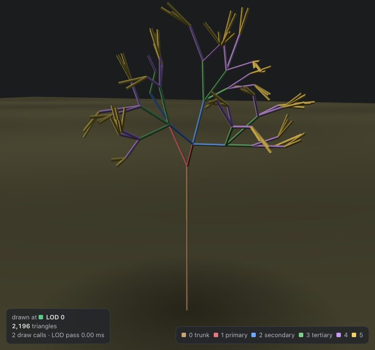 | 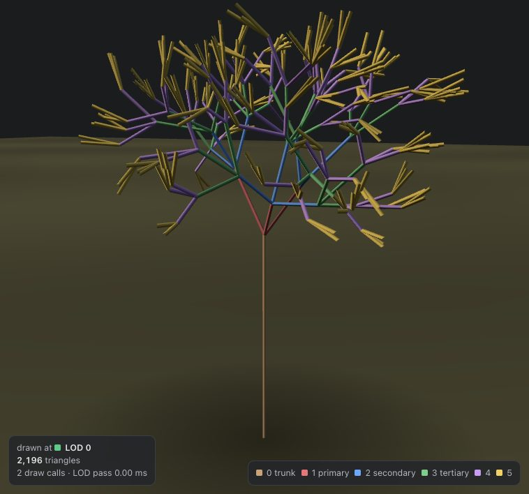 | 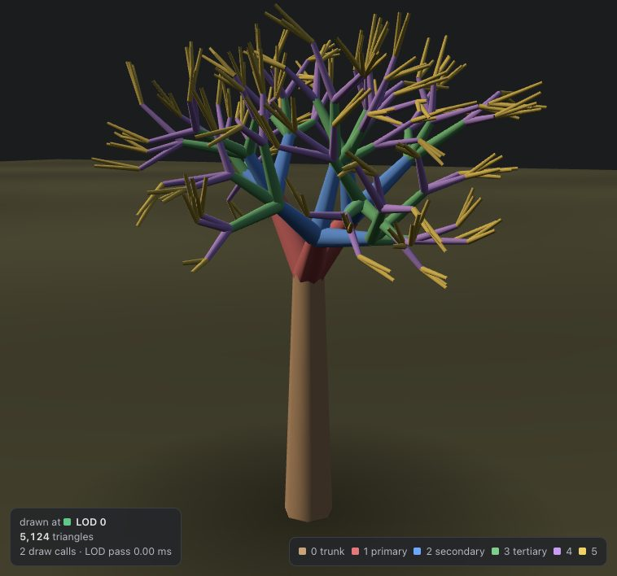 | 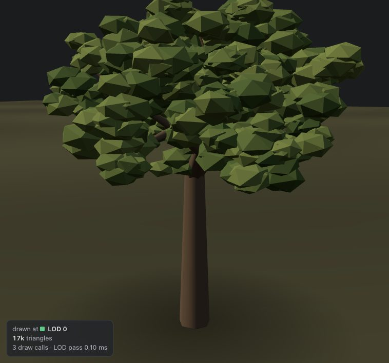 |

**Why a 2D grammar still makes a 3D tree.** The textbook grammars only use `+`
and `-`, which turn in a single plane — drawn literally, every one of them is a
pressed flower. Each new branch is therefore rolled about its own heading as it
starts, by the *branch roll* times the branch's index. At 137.5°, the golden
angle, no two branches line up for a long time, which is how real plants
arrange leaves around a stem. Set the roll to 0 and the page draws the flat
figure from the book:

| Branch roll 0° | Branch roll 137.5° |
| --- | --- |
| 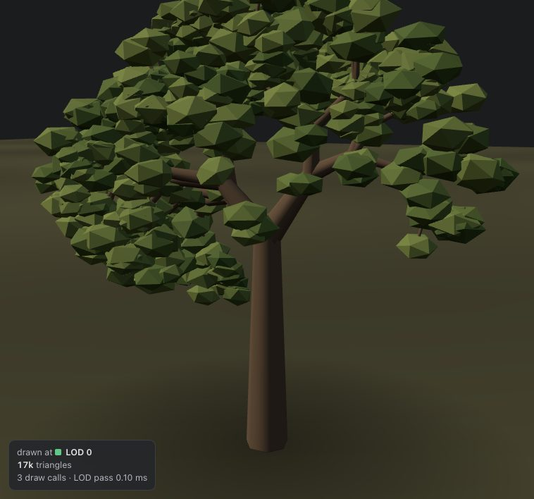 |  |

**Tropism** bends each step's heading toward the sky (positive) or lets it
droop (negative) in proportion to the step's length, so a limb drawn as many
short `F` bends exactly as much as one drawn as a few long ones. A trunk that
already points straight up is unaffected, which is why the pine's laterals
droop and its leader does not.

**Randomness never reshuffles.** Every turn and every step draws its random
number whether the variation is on or not. Drawn only when needed, moving
*angle variation* off zero would change which number every later symbol got,
and the tree would jump to a different shape instead of bending smoothly away
from the regular one. Leaves are seeded from a separate stream for the same
reason: changing leaf density never moves a branch.

## Geometry

Each segment becomes an open tapered tube — two rings, `2 × sides` triangles, no
caps. Written straight into typed arrays rather than built as a
`CylinderGeometry` per segment and merged; a tree is hundreds to thousands of
pieces.

- **Taper along a limb.** A limb starts at its generation's radius,
  `trunk × decay^g`, and narrows to the next generation's at its tip. So where a
  branch leaves a limb the two are about the same thickness, and the joint does
  not step.
- **Rings carried down a limb.** Each segment's ring orientation is the
  previous segment's, projected onto the new segment's plane — parallel
  transport, done crudely. Picking it fresh per segment twisted every joint by
  however far the arbitrary choice moved, a visible kink at every step on a
  five- or seven-sided tube.
- **Leaves are small solids, not cards.** A flattened icosahedron per clump
  (20 triangles). A card is invisible edge-on, and lit double-sided it reads as
  paper; a blob reads as foliage from every side, which is what one "leaf"
  stands for at this scale. Each clump gets its own shade between two greens.
- **Where leaves go** is a setting: *twigs and tips* puts them on every segment
  of the last two generations and on every limb's tip; *tips only* puts them on
  the tips alone — the coral's polyps.

## Presets

Each is a complete setting of the pipeline — grammar, turtle, leaves, colours
and forest. Nothing in the code branches on which one is chosen.

| Pine Forest | Ancient Oak Grove | Dense Young Forest | Alien Coral Field |
| --- | --- | --- | --- |
| 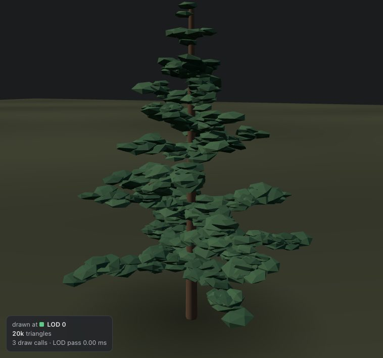 |  | 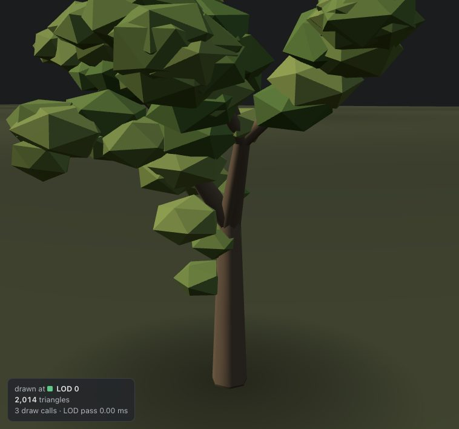 | 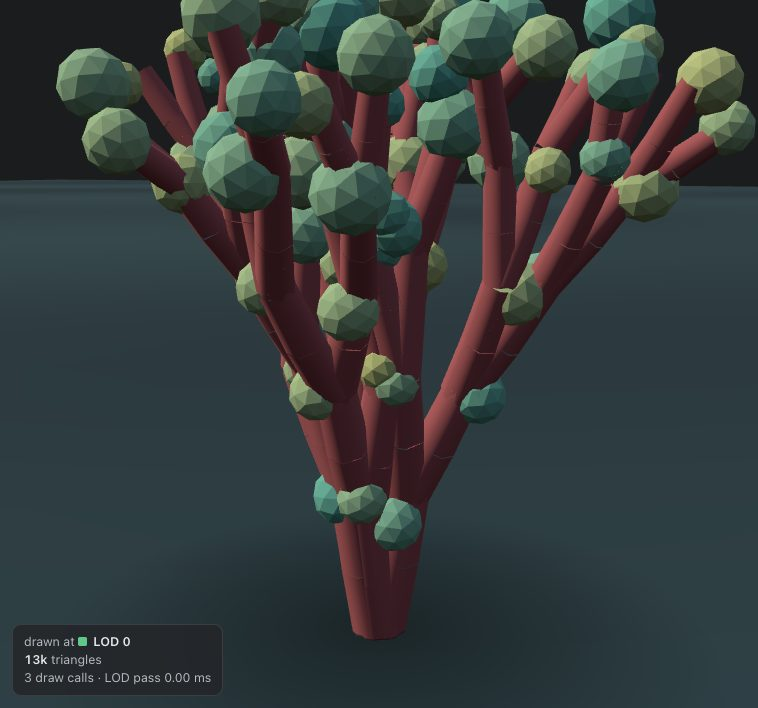 |
| Monopodial: a leader that keeps growing, whorls of four, 72°, tropism −0.14. 479 segments | Sympodial three-way forks, 40°, thick trunk, 14° angle variation. 366 segments | The oak's grammar at 4 iterations instead of 6. 41 segments | `X = FF[+X][-X]` from four stems: pure dichotomy, no leader, strong upward tropism. 248 segments |
| Poisson disk, 360 trees | Poisson disk, 80 trees, 8.5 apart | Clustered, 1,400 trees | Clustered, 450 trees |

The pine's cone is the grammar's doing, not a taper applied afterwards: every
whorl is placed by the apex, then only ever lengthens, so the lowest whorl is
the oldest and the longest.

**The coral is the point of the four.** It uses the same turtle and the same
machinery as the trees, given a rule that only ever forks in two and never
keeps a leader. Its leaves are placed on tips only, and its thickness decay is
0.84 rather than the oak's 0.62, so its fifth generation is still 42% of its
base — a coral's limbs barely thin. Nothing in the code knows it is not a tree.

## Distribution

Where the trees go is deliberately ignorant of terrain, unlike Topic 5. There
the ground decided where things grew and the point process was hidden beneath
the rules; here the ground is flat and the point process *is* the subject.

| Uniform random | Grid | Jittered grid | Clustered | Poisson disk |
| --- | --- | --- | --- | --- |
| 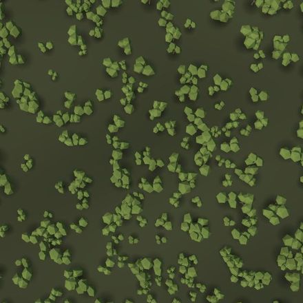 | 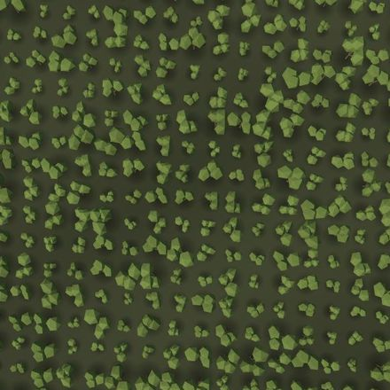 | 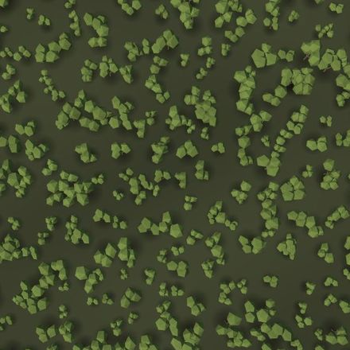 | 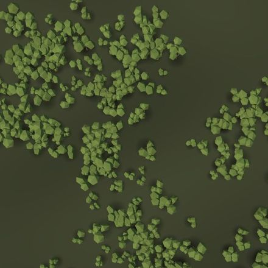 | 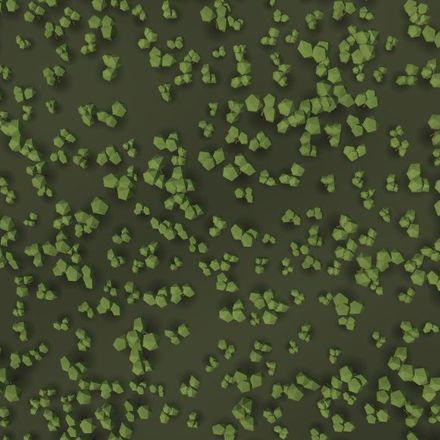 |
| R = 1.02 | R = 2.00 | R = 1.27 | R = 0.75 | R = 1.56 |

*The centre of the square from above: 400 saplings at 1.8× scale, scatter seed
4. Cluster: 14 groves of radius 10, no minimum spacing. Poisson: spacing 3.*

- **Uniform random** — every point independent. The clumps and holes are pure
  chance, which is what "random" actually looks like and why it rarely looks
  natural.
- **Grid** — `⌈√n⌉` columns, filled row by row; obviously planted.
- **Jittered grid** — one point per cell, anywhere in it at jitter 1.
- **Clustered** — a Thomas process: grove centres scattered first, each tree
  drawn from a Gaussian around one of them. Minimum spacing, if set, redraws a
  tree up to 30 times before giving it up.
- **Poisson disk** — dart throwing over a hash grid: throw uniformly, keep what
  lands at least the minimum spacing from everything kept. Bridson's algorithm
  fills the square faster, but it grows outward from one seed point, so
  stopping it at `count` leaves a disc in one corner; darts fill the whole
  square evenly at every count.

### One number to tell them apart

The readout carries the **Clark–Evans ratio** R: the mean distance from each
tree to its nearest neighbour, divided by `0.5 / √density`, what uniform random
placement at the same density gives. About 1 is random, below 1 clustered,
above 1 evenly spaced. Measured over ten seeds each, 400 trees on the 90-unit
square:

| Strategy | R, mean (range) | Closest pair |
| --- | --- | --- |
| Uniform random | 1.03 (0.99–1.08) | 0.17 |
| Grid | 2.00 (2.00–2.00) | 4.50 |
| Jittered grid | 1.29 (1.26–1.32) | 0.53 |
| Poisson disk, spacing 3 | 1.58 (1.56–1.60) | 3.00 |
| Clustered, no spacing | 0.70 (0.63–0.78) | — |
| Clustered, spacing 1.5 | 0.97 (0.92–1.04) | — |
| Clustered, spacing 3 | 1.32 (1.24–1.41), 144 trees would not fit | 3.00 |

The grid's 2.00 is exactly the square lattice's theoretical value, which is the
check on the measurement. Uniform reads a few percent over 1 because there is no
edge correction — trees near the border have fewer neighbours than they would
in an endless forest. That bias is the same for every strategy, so the
comparison stands.

**The clustered row was the surprise.** With the minimum spacing the first
version used, a forest that is visibly a set of groves measured *above* 1 —
"evenly spaced". That is not wrong, it is what the statistic measures: the
nearest neighbour only sees the smallest scale, and the spacing makes every
grove regular inside. Clumping lives at the scale of the groves, which R cannot
see. The figure above uses no spacing, and reads 0.75.

Per-tree variation draws from its own stream, so changing the scale variation
never moves a tree and changing the strategy never resizes one. Rotation
variation at 0 makes every tree face the same way, and the repetition is
immediately obvious.

## Levels of detail

Every tree type is built four times from the **same** skeleton and the same leaf
sites, so a tree changing level changes detail and never changes shape.

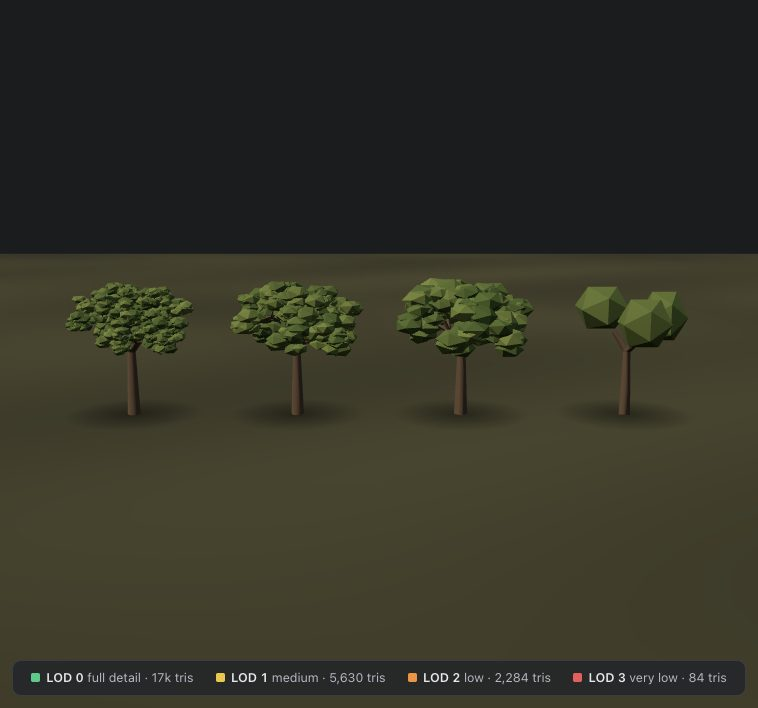

| Level | Sides | Branches kept | Steps merged under | Leaves |
| --- | --- | --- | --- | --- |
| LOD 0 — full | 7 | all | — | all |
| LOD 1 — medium | 5 | ≥ 12% of trunk radius | 12° | 40%, each ×1.6 |
| LOD 2 — low | 4 | ≥ 30% | 28° | 20%, each ×2.2 |
| LOD 3 — very low | 3 | ≥ 50% | 60° | three blobs fitted to the canopy |

Detail comes off three independent ways:

- **Thin branches** are dropped by **thickness**, not by generation number.
  Thickness is what decides whether a branch survives on screen at a distance.
  The first version cut every tree at "generation ≤ 1" for LOD 2, and the coral's
  tips — still 42% of its base thickness five forks up — were left floating in
  the air with nothing under them. Trunk and first generation are always kept.
- **Steps along a limb** are merged while they point within a tolerance of the
  run's overall direction — measured against the run, not the last step, so a
  long gentle curve cannot creep through one degree at a time. The oak's trunk
  is three `F` in a line and becomes one segment.
- **Leaves** are a fixed, nested subset — every leaf at LOD 2 is also at LOD 1 —
  each grown by `1/√keep` so the canopy covers about the same area of screen.
  Fewer leaves at the same size made a distant tree look bare, a far more
  visible error than lost facets.

**LOD 3 is a stand-in, not a reduced tree:** the trunk and main limbs as
three-sided sticks and the canopy as three blobs, fitted by k-means on the leaf
positions, each stretched to its cluster's spread. One ellipsoid round a whole
canopy turned a conifer into an egg; three keep a spire tall and an oak lumpy.
Tip-only leaves get a sparse subset rather than blobs, because fitting blobs to
a coral's polyps turned it into a field of mushrooms. A camera-facing billboard
would be cheaper still, but it needs every tree type rendered to a texture
first and pops visibly as the camera orbits — and at 84 triangles for the oak,
LOD 3 is already a rounding error.

The blobs were 80-triangle icosahedra at first. Three of them set a floor of
240, and a sapling's entire LOD 2 is 324, so the last level saved almost nothing
on the smallest trees; at 20 triangles each it is 84.

Measured, triangles per tree, wood and leaves:

| Preset | LOD 0 | LOD 1 | LOD 2 | LOD 3 |
| --- | --- | --- | --- | --- |
| Pine | 20,486 | 8,630 (42%) | 2,976 (15%) | 282 (1.4%) |
| Oak | 16,744 | 5,630 (34%) | 2,284 (14%) | 84 (0.5%) |
| Young | 2,014 | 880 (44%) | 324 (16%) | 84 (4.2%) |
| Coral | 13,392 | 4,600 (34%) | 2,592 (19%) | 408 (3.0%) |

### Choosing a level per tree

Distance from the camera to the centre of the tree's bounding sphere, against
three thresholds. **Auto LOD applies in the Forest view only.** A single tree
framed to fill the viewport is usually further away than the first threshold,
so under auto the Tree view opened at LOD 1; it holds the tree at the manual
level instead, which is also how each level is inspected up close.

**Hysteresis.** Without memory, a tree on a threshold flips level every time the
camera's damping moves it a millimetre either way — a flicker along the whole
ring on a slow orbit. So each threshold is a band: a tree only coarsens once it
is `h` past the threshold and only refines once it is `h` inside. Simulated
with a tree whose distance wanders randomly within ±1.5 units of a 26-unit
threshold for 600 frames:

| Band | Level switches |
| --- | --- |
| none | 44 |
| ±2% | 8 |
| ±5% | 4 |
| ±8% (default) | 0 |

±1.5 units is ±5.8% of 26, so the default band contains the wander entirely.
The band has to be wider than the camera's jitter, not merely nonzero.

**LOD rings** draw, on the ground, where the distance from the camera crosses
each threshold — at the horizontal radius `√(t² − Δy²)`, coloured for the level a
tree switches to. They follow the camera.

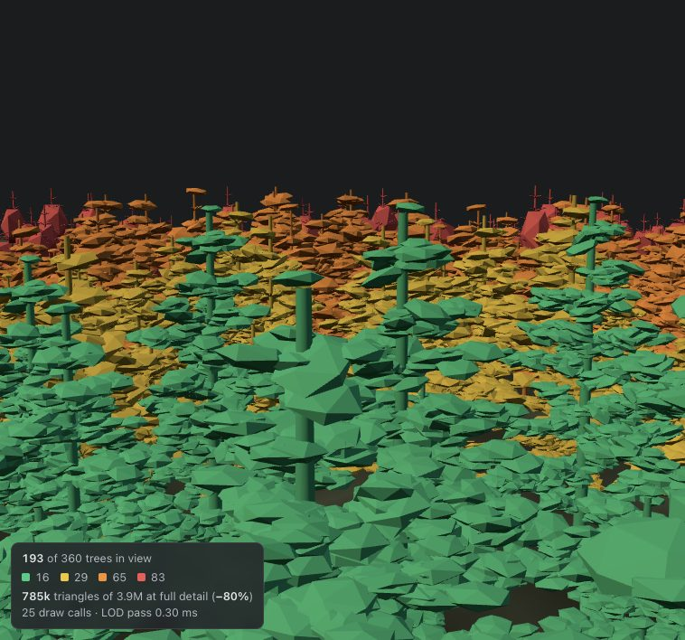

The pure distance metric is the one asked for and the one the rings can show.
A screen-size metric — bounding radius over distance — would let a large tree
keep its detail further out than a small one; with ±35% scale variation it would
also mean a tree inside a ring could legitimately be the wrong colour for it.

## Rendering and performance

**Instanced buckets.** One `InstancedMesh` per tree type, per LOD, per part —
wood and leaves. A forest of three tree types is 3 × 4 × 2 = 24 meshes however
many trees it holds, plus one for the contact shadows; the opening pine view is
25 draw calls for 360 trees. All of them share two materials (or eight debug
ones), so nothing is compiled per tree. A tree changing level is not a mesh
changing geometry: its precomputed matrix moves to another bucket's instance
buffer.

**Nothing happens per frame unless something moved.** The render loop idles as
in every other topic. When the camera moves, one pass frustum-tests every tree,
picks its level and copies sixteen floats per visible tree into a bucket — under
0.4 ms for every preset, 80 to 1,400 trees. Grammar, turtle, meshes and scatter each run
only when their own inputs change: a forest-count change re-scatters without
building a tree, and a threshold change touches no geometry at all.

**Culling is per tree.** Left to itself three.js culls an `InstancedMesh` as a
whole against its geometry's bounds — one tree at the origin — and the forest
vanishes when the origin leaves the frame. The meshes opt out and the forest
culls each tree itself, which also keeps off-screen trees out of the counts.

**Measured savings,** opening forest view of each preset:

| Preset | Trees in view | LOD 0 / 1 / 2 / 3 | Triangles drawn | At full detail | Saved |
| --- | --- | --- | --- | --- | --- |
| Pine | 193 of 360 | 16 / 29 / 65 / 83 | 785k | 3.9M | 80% |
| Oak | 42 of 80 | 5 / 8 / 16 / 13 | 166k | 701k | 76% |
| Young | 783 of 1,400 | 12 / 122 / 230 / 419 | 228k | 1.5M | 85% |
| Coral | 278 of 450 | 1 / 36 / 168 / 73 | 644k | 3.7M | 83% |

Triangle counts are hardware-independent. Frame time is not, and the only
renderer available for measuring here was SwiftShader, Chrome's software
rasteriser — a CPU, not a GPU. On it, orbiting the pine forest: **500 ms** per
frame with auto LOD (953k triangles) against **2,300 ms** with every tree held
at LOD 0 (4.3M), a 4.6× difference tracking the 4.5× in triangles. The
JavaScript side of each frame was 0.4 ms in both. A real GPU is far faster in
both cases, and the ratio there has not been measured.

**Build costs,** on the main thread: the turtle walks a preset's string in
0.2–2 ms, and the four LODs of one tree type mesh in 1–11 ms. An expansion
under the cap — `F = F[+F]F[-F]F` at 7 iterations, hitting the 40,000-segment
limit — meshes in 248 ms.

## Architecture

Each stage is its own module under `src/branching/`, and only the viewport
knows they connect:

| Module | Stage | Knows about |
| --- | --- | --- |
| `lsystem.ts` | Grammar | Strings only |
| `skeleton.ts` | Turtle → segments, leaf sites | three.js vectors |
| `treeGeometry.ts` | Segments → tube and leaf `BufferGeometry` | — |
| `lod.ts` | Four levels per tree, `chooseLod` with hysteresis | the two above |
| `distribution.ts` | Five point processes, Clark–Evans | nothing in the app |
| `ForestRenderer.ts` | Instanced buckets, culling, per-tree level, stats | `lod.ts` |
| `BranchingViewport.tsx` | Scene, camera, one effect per stage | all of the above |
| `presets.ts` | Settings shape, palettes, grammars, presets | types only |

`distribution.ts` and `lsystem.ts` have no rendering dependency at all, so the
Project can reuse them directly.

## Notes

**The first forest view held no LOD 0 trees.** The camera stood 14 units up,
and the bottom edge of a 40° view met the ground 22 units ahead — past the first
threshold, so the nearest tree on screen was already LOD 1. It now stands lower
and looks almost level, the presets' thresholds were raised, and the opening
view holds all four levels.

**The oak first read as a poplar.** `A = F[+FA][-FA]FA` keeps a leader through
every fork, and a leader makes a column. Dropping it for three-way forks with no
leader, `A = F[+A][-A][+A]`, gave the round crown.

**The coral first drowned in bulbs.** Leaves on "the last two generations" is
the right rule for a tree and the wrong one for a pure dichotomy, where the last
two generations are three-quarters of all segments. Leaf placement became a
setting, and the coral puts bulbs on tips only.

**Auto LOD is off in the Tree view, on purpose** — see
[Choosing a level per tree](#choosing-a-level-per-tree).

**What this does not do.** No shadow maps — the soft disc under each tree is a
contact shadow, because real shadows over a thousand instances would cost more
than the trees. No wind, no growth over time, no terrain. The branch tubes have
no caps and their joints are not welded; at the stylised scale it is not
visible, and it keeps every segment independent, which is what makes the turtle
progress a free draw-range change.

**Figures** are JPEG except the README's, which shows interface text. The
Topic 8 images are 1.1 MB together. `docs/images/` was already over 10 MB
before them.
