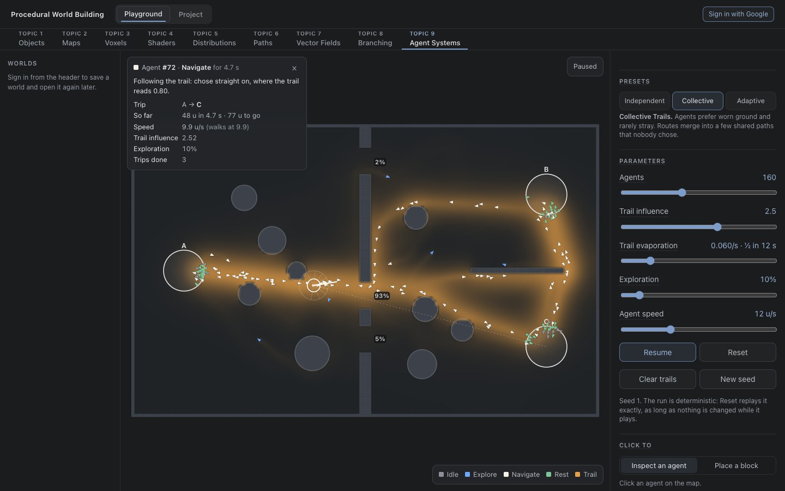
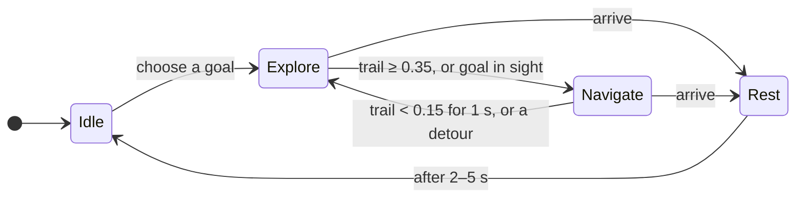
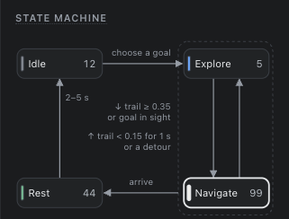

# Topic 9 — Agent Systems

Jessica Hsiao · Procedural World Building

An emergent-paths study. A hundred and sixty agents walk between three
destinations across a walled field. Each one runs the same four-state machine
and the same steering rule, and each knows only two things: which way its goal
is, and how worn the ground is a few steps ahead. Every step they take wears it
a little more. Nobody plans a route — and within a minute the colony is walking
a shared network of paths that is shorter than the routes any of them walks
alone.

[← back to the README](../../README.md) · [study notebook index](../README.md)



## Contents

- [What is on the page](#what-is-on-the-page)
- [The question](#the-question)
- [The world](#the-world) — designed, with the seed in the details
- [The state machine](#the-state-machine) — four states, and what moves an agent between them
- [Steering](#steering) — the active-walker rule
- [Stigmergy: the trail](#stigmergy-the-trail) — deposit, evaporation, diffusion
- [What emerges](#what-emerges) — the three presets, measured
- [Closing a gap](#closing-a-gap) — adaptation, measured
- [Inspecting an agent](#inspecting-an-agent)
- [Saving a world](#saving-a-world)
- [Cost](#cost)
- [Connection to Wildform](#connection-to-wildform)
- [Notes](#notes)

## What is on the page

| Control | What it does |
| --- | --- |
| **Presets** | Independent Exploration, Collective Trails, Rapid Adaptation — each sets trail influence, evaporation and exploration, nothing else |
| **Agents** | 10–400 agents. Raised mid-run, new agents appear at a destination; lowered, the newest leave |
| **Trail influence** | 0–4: how much a worn path pulls, against the compass's pull of 1 |
| **Trail evaporation** | 0.01–0.3 per second, shown with its half-life |
| **Exploration** | 0–100%: the temperature of each choice, and how often a trail-follower takes a detour |
| **Agent speed** | 4–30 world units per second (the world is 160 × 100) |
| **Pause / Reset / Clear trails / New seed** | Reset replays the run from the seed; Clear trails zeroes the field and leaves the agents walking |
| **Click to** | *Inspect an agent*, or *Place a block* — click empty ground to drop one, click a block to lift it |
| **Show** | The trail heatmap, and the selected agent's senses |

Under the controls: live **measurements**, the **state machine** with the
number of agents in each state, and a short **how it works**. On the map, each
gap in the wall is labelled with the share of recent crossings that went
through it.

At phone width the three columns stack — map, then controls, then the worlds
library — so the map keeps its own aspect rather than being squeezed to
nothing between two fixed panels.

## The question

*Can a group of autonomous agents collectively discover and reinforce useful
paths through an environment?*

"Useful" needs a number, so the page measures it: for every finished trip, the
distance actually walked against the shortest walkable route from where the
trip began. That shortest route is computed with Dijkstra's algorithm on the
walkable grid — for the measurement only. No agent can read it. An agent that
could would walk the best route and there would be nothing to watch.

## The world

[`environment.ts`](../../src/agents/environment.ts). A 160 × 100 grid of
one-unit cells:

- **Three destinations**: A on the west, B and C on the east.
- **A wall** down the middle with **three gaps**, one in each third of its
  height. The straight line from A to either B or C hits the wall, so walking
  by compass alone is never already the best route.
- **A short wall** between B and C, free-standing, with a passage at each end.
- **Rocks**, circles of radius 3–6, scattered either side.

The layout is designed and the seed fills in the details — where each gap sits
in its band, where the rocks fall. A fully random scatter could not promise
the things the experiment depends on: more than one route between every pair,
the straight line blocked, every destination reachable. Rocks are kept clear of
the gaps and destinations, and as a guarantee rather than an expectation,
the world is checked for connectivity after it is built; on all 40 seeds
tested, nothing had to be removed.

Rocks are circles on purpose. An agent sliding round a circle never meets a
concave corner to wedge in — and the one concave pocket the first layout had
was the worst bug in this topic (see [Notes](#notes)).

## The state machine

[`simulation.ts`](../../src/agents/simulation.ts). Every agent runs this one
machine:



| State | Behaviour |
| --- | --- |
| **Idle** | Standing at a destination. On entering, waits 0.4–1 s (0–3 s at the very start, so the first wave does not leave in step), then picks a destination uniformly among the other two |
| **Explore** | Searching. Walks by compass with the full exploration temperature; reads the trail but is not committed to it |
| **Navigate** | Has a lead — a trail strong enough to follow, or the goal in sight with nothing in the way. Chooses with half the temperature: a committed walker strays less |
| **Rest** | Arrived. Stands for 2–5 s, nudged only by the soft push from other agents |

The thresholds are a **hysteresis** band: 0.35 to enter Navigate, below 0.15
for a whole second to leave it, so an agent walking the faint edge of a trail
does not change state at every decision as the reading wavers about one
value.

States are behaviour, not labels. Explore and Navigate run the same scoring
with different temperatures, and Navigate is the only state that takes
detours. Every agent has the same machine; what differs is three personal
factors drawn from the seed — walking speed, trust in trails, curiosity —
each between 0.8 and 1.2 times the slider.

Two safety rules sit under the states rather than as states of their own,
because they interrupt any travelling behaviour:

- **Stuck**: an agent that has moved less than 2.5 units in 3 s backs out the
  way it came for 2 s, and from then on slides along walls the other way.
- **Boxed in**: if every heading ahead is struck out, turn round.

## Steering

Every 0.15 s a travelling agent looks along nine headings, fanned ±110° about
the way it faces, and scores each:

```
score = cos(heading − direction to goal)              the compass
      + influence · T / (T + 4)                        the trail, 5 units out
      + 0.3 · cos(heading − current heading)           momentum
      + 0.6 · side · sin(turn)                         only at a wall
```

A heading that runs into an obstacle within 3 units is struck out. The agent
then picks one **at random with probability ∝ exp(score / τ)** — a softmax —
where τ = 0.03 + 0.35 × exploration. Small τ is almost always the best-scoring
heading; large τ often takes one that scored a little worse, which is what
"trying a less-travelled route" is, mechanically. A navigating agent also
leaves its trail on purpose now and then — a detour of 1–2.5 s at a random
angle, ignoring trails — at a rate of 0.25 × exploration per second.

This is the **active-walker model** of trail formation (Helbing, Keltsch and
Molnár, *Modelling the evolution of human trail systems*, Nature 1997) — the
model that explains desire paths worn across a lawn — with the trail gradient
replaced by sampled headings so that walls can be struck out.

Three details carry most of the weight:

- **The compass is the only global knowledge.** An agent knows which way its
  goal is, as a person crossing a campus does, but not how to get there.
- **The trail term saturates.** With raw T, a busy path's pull would grow
  without limit and the first route to get busy would win from anywhere on the
  map. T / (T + 4) caps it at the influence slider.
- **Smoothness comes from the body, not the decision.** A decision can swing
  the desired heading by 45°; the body turns toward it at no more than 6 rad/s.
  That, and momentum in the score, is why agents curve rather than jitter.

**Walls**: when the heading straight at the goal is struck out, the agent
slides along the obstacle. The first time on a trip it chooses a side, and
keeps it for the rest of the trip — the Bug algorithm's rule — until the stuck
check flips it. Agents push each other apart softly within 1.6 units, so two
walkers meeting on a trail pass side by side.

## Stigmergy: the trail

[`trail.ts`](../../src/agents/trail.ts). One number per cell, written by every
agent and read by every agent — the only channel through which they affect
one another.

- **Deposit**: 1 unit of trail per unit walked, splatted bilinearly over four
  cells. Per unit *walked*, not per second, so speed changes how fast a route
  is worn but not how much trail a route gets.
- **Evaporation**: every cell × exp(−rate · dt). The slider shows the
  half-life: 12 s at 0.06/s, 5 s at 0.15/s.
- **Diffusion**: a small explicit blur, 0.6 cells² per second, so a path one
  agent wide is sensed from a cell or two away. Walls reflect — a blocked
  neighbour contributes the cell's own value — so trail neither soaks into a
  wall nor leaks out of the field. A test holds both: 300 steps of pure
  diffusion leave the total unchanged to 10⁻³ and every wall cell at zero.

The heatmap draws the field at its own resolution — one pixel per cell, 160 ×
100 — and lets the browser scale it up with smoothing, so it costs the same at
any canvas size. Its opacity is 1 − exp(−T / 6), capped at 80% so an agent on
the busiest path still reads against it.

**Trail concentration** is the share of all trail held by the busiest 5% of
walkable ground. An even spread scores 5%; all of it on a few narrow paths
approaches 100%. It does not depend on how much trail there is in total, which
evaporation and agent count both change.

## What emerges

Five seeds, 160 agents at 12 units/s, 180 simulated seconds from a fresh start
— headless, with the page's own code (`runFor` in `simulation.ts`):

| Preset | Influence | Evaporation | Exploration | Concentration | Walked vs shortest | Busiest gap | Trips |
| --- | --- | --- | --- | --- | --- | --- | --- |
| Independent | 0 | 0.06/s | 35% | 23–26% | **+33–38%** | 50–68% | 1,867–1,970 |
| Collective | 2.5 | 0.06/s | 10% | 33–40% | **+7.5–17%** | 72–100% | 2,113–2,208 |
| Rapid Adaptation | 2.5 | 0.15/s | 35% | 43–46% | +11–28% | 82–93% | 2,010–2,046 |


*Seed 1, 160 agents, 90 simulated seconds, captured from the page. The
page's own readouts at that moment — Independent: routes +27% over shortest,
28 / 42 / 30% through the gaps, concentration 24%. Collective: +15%, 0 / 98 /
2%, 41%. Rapid Adaptation: +15%, 5 / 85 / 10%, 43%. One run each, so the
numbers sit inside the five-seed ranges above rather than defining them.*

The answer to the question is yes, and the number is the walked-against-shortest
column. Walkers alone take routes a third longer than the best available; with
trails they take routes 8–17% longer, on every seed. Nobody in the Collective
colony knows the shortest route — they agree on one, and the one they agree on
is better than what each of them finds alone. It is also not the shortest: the
colony settles where the walkers' compromise between goal and trail puts it,
which is how desire paths across a real lawn look too.

The network has a recognisable shape: a single **trunk** from A through one
gap that **forks** toward B and C, and a **loop** between B and C round the
east end of the short wall. The fork is the active-walker model's signature —
two routes sharing ground for as long as they roughly agree on direction.

Two things about the table were not what was expected:

- **Rapid Adaptation scores higher concentration than Collective** (43–46%
  against 33–40%), though it explores more and its routes are longer. Fast
  evaporation leaves trail only where traffic is constant, so what remains is
  concentrated on the busiest paths; slower evaporation keeps the faint
  side-routes alive and spreads the total. Concentration measures how the trail
  is shared out, not how well the colony walks — the walked-versus-shortest
  column is the measure of that.
- **The baseline already prefers the middle gap.** With no trail influence,
  50–68% of crossings still go through it, because the compass leads most
  agents to the wall near it. The trail amplifies an asymmetry the geometry
  already has rather than creating one from nothing.

At 400 agents (seeds 1–5, Collective) the routes come out 7–11% longer than
shortest — a little better than at 160, because more walkers maintain a trail
more evenly.

## Closing a gap

The Collective colony is run for 150 s, the gap carrying most of its crossings
is closed with a block, and the next 60 s are watched. Five seeds:

| Preset | Agent-seconds within 12 units of the closed gap, next 60 s | Share through the new busiest gap afterwards |
| --- | --- | --- |
| Independent | 1,184–1,550 (mean 1,365) | 53–68% |
| Collective | 535–1,072 (mean 826) | 53–77% |
| Rapid Adaptation | 472–750 (mean 650) | 53–92% |

On every run, after closing, no crossing went through the closed gap.


*One Collective run, seed 1, captured from the page. Readouts — at 1:15,
before closing: routes +14% over shortest, 98% through the middle gap. At
2:00, 45 s after: +51%, 73 / 0 / 27%. At 2:45: +16%, 40 / 0 / 60%. Every one
of those trips started after the gap closed, and their shortest routes are
measured on the world with the block in it.*

The honest reading is that the difference is real but smaller than expected.
Every colony gets round the closure, because the compass and the wall-sliding
rule find another gap whatever the trail says. What evaporation changes is how
long the old trail keeps luring agents into the dead end: about 650
agent-seconds of crowding there with a 5 s half-life, 830 with 12 s, and 1,365
with no trails at all, where nothing ever tells the compass that the straight
way is shut. Higher exploration helps a new route form: Rapid Adaptation's
agreement on its new gap ran as high as 92%.

The cost of commitment shows in throughput. Trips finished in the 15 s after
closing, against the 15 s before (the same five seeds):

| Preset | Change in trips finished |
| --- | --- |
| Independent | −3% to −19% |
| Collective | **−12% to −31%** |
| Rapid Adaptation | −7% to −23% |

The colony that had agreed most firmly loses the most when its route is cut:
its agents are committed to a trail that now leads into a wall. That is the
trade the evaporation slider sets — a long memory makes better routes while the
world holds still and worse ones the moment it changes.

## Inspecting an agent

Click any agent. The overlay shows what the simulation itself holds — nothing
is computed for display:

- its **state** and how long it has been in it
- its **decision**, in words, from the record the steering rule writes when it
  chooses: *Following the trail: chose 22° left, where the trail reads 0.83*;
  *The way toward B is blocked — sliding along the obstacle*; *Detour:
  ignoring trails for 1.4 s more*
- its trip (origin → target), distance and time so far, and the shortest
  walkable distance still to go
- its speed now and its walking speed, its personal trail influence and
  exploration, and its trips completed.

With *Selected agent's senses* on, the map draws the nine headings it scored at
its last decision — each as bright as the probability it gave it, struck-out
headings in red — its 5-unit sensing radius, the heading it is turning
toward, a dashed line to its goal, and the last 30 s of its route.




## Saving a world

[`agentConfig.ts`](../../src/config/agentConfig.ts). Through the same
worlds library every topic uses — save, open, rename, delete, export JSON — as
the `agents` topic.

A world stores **the seed, the five parameters, the preset name, the blocks
placed by hand, and the two display toggles**. It does not store the agents
or the trail.

That is deliberate. The run is deterministic: one seeded random stream and a
fixed 1/30 s step, so the same seed and parameters replay the same colony from
the same start, step for step, at any frame rate (a test checks it). A loaded
world therefore starts again from its beginning and gets to the same place. What
cannot be rebuilt is a run that was steered while it played — a slider moved at
40 s, a block dropped at 90 s. Saving that would mean storing about 16,000 trail
values and a dozen fields per agent, and the world would be a recording
rather than an experiment.

Loading is defensive, as for every topic: numbers are clamped to their slider
ranges, an unknown preset becomes *custom*, at most 24 blocks are kept, each at
the standard radius, and a set of blocks that would cut a destination off is
dropped when the world is built.

Saving needs `agents` in the Firestore rules' list of topics, which this topic
adds to `firestore.rules`; the rules have to be deployed before a save from
the live site will be accepted.

## Cost

One simulation step — every agent's movement, any decisions due, separation,
and one evaporation-and-diffusion pass over the field — measured headless over
180 s:

| Agents | ms per step |
| --- | --- |
| 160 | 0.10–0.11 |
| 400 | 0.22–0.23 |

At 30 steps a second that is 3–7 ms of each second. The field pass is a fixed
16,000 cells; agent separation uses a spatial hash of 2 × 2-unit buckets, so it
is linear in the count. Concentration sorts the field and runs once per
simulated second, not per step. The loop goes idle when paused.

## Connection to Wildform

Wildform's inhabitants walk the living architecture the plants grow, and today
they find their way with A* over a walkable graph ([How Wildform
works](../project/how-it-works.md)). A* gives each inhabitant the best route and
the town no history. The rule here suggests the other half: inhabitants that
lay trail as they walk would wear their own paths across a bridge or a terrace,
and those paths would show how the architecture is actually used — which
platforms are crossings and which are dead ends, which a season of growth has
cut off. A trail field could even feed back into the growth model as one more
environmental field, so plants avoid well-worn routes or grow toward them.

This topic deliberately shares no code with the inhabitants: the Playground
takes one technique apart, and coupling it to Wildform's graph would make it a
study of that graph instead.

## Notes

**The spur that trapped the baseline.** The wall between B and C first ran in
from the east edge, and that made a dead-end pocket. A compass walker going
from B to C met it, slid east along it, and stopped in the corner with the
border. In the first measurement, that jam was the brightest trail on the map,
and the no-trail baseline scored *higher* concentration than the colony with
trails (45–49% against 27–28%) — a result that looked like a finding until
the picture was drawn. The wall is now free-standing with a passage at each
end.

**Wall-sliding needs memory.** Even without the pocket, some trips took 56–144
s where most took 10–15. The stuck check sent a wedged agent away, and the
compass walked it straight back into the same corner. A side chosen once per
trip, flipped when stuck, fixed it: across the five-seed runs, the longest of
the last 40 trips is now 22 s, and a test fails if any trip in 120 s passes 45.

**Dijkstra in Float32.** The measurement's distance field first stored
distances in a `Float32Array`. Some distances round *up* in Float32; the
stored value then never compares as settled against the exact one, the same
cells are pushed onto the heap again and again, and the heap ran out of memory.
It now searches in Float64 and stores the result in Float32. It also uses 16
neighbours (the 8 adjacent cells and 8 knight's moves) rather than 8: with 8, a
route at any angle but 0° or 45° is over-measured by up to 8%, which would
have read as agents beating the shortest path.

**Blocks snap to gaps.** Blocks were first placed exactly where clicked, with
radius 5, and a gap was labelled *closed* whenever a block was near it. A click
a unit or two off centre left a slit where the circle curved away from the
wall, and a click a few units off missed the gap entirely while the label still
said *closed*. Measured on 20 seeds, a radius-5 block 1 unit off centre
left the gap open on 13 and one 1.5 units off on all 20. A block dropped within
8 units of a gap now goes to the gap's centre, the radius is 6 (which holds to
1.5 units off centre) — at the gap's edge the circle still spans x 76–84,
past both faces of the 78–82 wall — and the label reads *closed* only for a
block that is actually there. A test closes a gap and checks that 60 s of
traffic never crosses it.

**A block that would strand everyone is refused.** Closing all three gaps
leaves A unreachable. That is a different experiment — the colony would only
circle — so placement checks connectivity first and refuses.

**Canvas 2D, not three.js.** Every earlier topic draws with WebGL, because it has
a surface to light or tens of thousands of particles. This one has a 160 × 100
field, a few hundred triangles and some lines, and has to answer "which agent is
under the pointer", which in 2D is a distance test in world units. Agents are
drawn as one path per state colour — four fills whatever the count.

**Colour by state, not by destination.** Three destination hues on top of four
state hues would leave nothing distinguishable. Blue for searching and
near-white for committed puts the trail-followers as the brightest things on
the trail; trail is amber, a hue no agent uses.

**The phone layout is this page's alone.** The shared Workspace is three
fixed columns, and on a 390 px screen it leaves every topic's canvas no width
at all — measured on Topics 7 and 9. Topic 9 stacks below 720 px with a rule
scoped by `:has()`, so no earlier topic changes. The same rule would serve the
others; that is a separate change.
